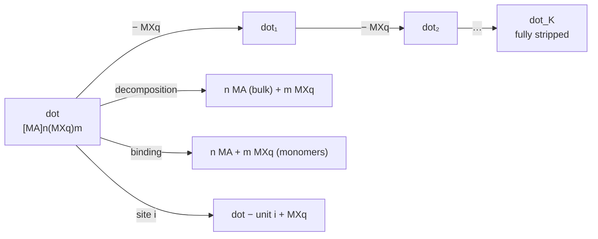

# Formulas of the qd-workflows pipeline

What each stage computes, as implemented (Orchestr.AI `qd`, qd-workflows). The pipeline diagram is
in [workflow.md](workflow.md); `qdw reaction` has its own page, [reactions.md](reactions.md).

A dot is a charge-balanced binary $[\mathrm{MA}]_n(\mathrm{MX}_q)_m$: $n$ MA units (core) and $m$
Z-type ligand units $\mathrm{MX}_q$. Energies $E$ are MACE-MH-1 energies at MACE-MH-1 minima;
$k_B T$ at 298.15 K is 25.69 meV.

## 1. Free energy of one species (after the Hessian)

Every molecule-like species (the dot and its stripped states, the MA and $\mathrm{MX}_q$ monomers) is
an ideal solute at the 1 M standard state, with rigid-rotor rotation and harmonic vibrations from the
MACE-MH-1 Hessian:

$$
G_i^\circ(T) = E_i + F_{\mathrm{vib},i}(T) + H_{\mathrm{trans}} + H_{\mathrm{rot}} - T\left(S_{\mathrm{trans}} + S_{\mathrm{rot}}\right)
$$

**Translation** at $c^\circ = 1$ M, i.e. at the pressure $p = c^\circ R T$ (ASE `IdealGasThermo`):

$$
H_{\mathrm{trans}} = \tfrac52 k_B T, \qquad
S_{\mathrm{trans}} = k_B\left[\ln\!\left(\left(\frac{2\pi m k_B T}{h^2}\right)^{3/2}\frac{k_B T}{p}\right) + \frac52\right]
$$

**Rotation** (rigid rotor, rotational symmetry number $\sigma$ from the point group):

$$
H_{\mathrm{rot}} = \tfrac32 k_B T, \qquad
S_{\mathrm{rot}} = k_B\left[\ln\!\left(\frac{\sqrt{\pi}}{\sigma}\sqrt{\frac{T^3}{\Theta_A\Theta_B\Theta_C}}\right) + \frac32\right], \qquad
\Theta_X = \frac{h^2}{8\pi^2 I_X k_B}
$$

(linear molecules: $H_{\mathrm{rot}} = k_BT$, $S_{\mathrm{rot}} = k_B[\ln(T/\sigma\Theta) + 1]$).

**Vibration**: harmonic $U$, quasi-RRHO entropy (Grimme), so that soft modes of large dots do not
inflate $S$. With $x_j = h\nu_j / k_B T$ (imaginary modes as $|\nu_j|$, modes below 10 cm⁻¹ raised to 10):

$$
F_{\mathrm{vib}} = U_{\mathrm{vib}} - T S_{\mathrm{vib}}, \qquad
U_{\mathrm{vib}} = \sum_j \left[\frac{h\nu_j}{2} + \frac{h\nu_j}{e^{x_j} - 1}\right]
$$

$$
S_{\mathrm{vib}} = \sum_j \Big[w_j\, S^{\mathrm{harm}}_j + (1 - w_j)\, S^{\mathrm{rot}}_j\Big], \qquad
w_j = \frac{1}{1 + (\nu_0/\nu_j)^4}, \quad \nu_0 = 100\ \mathrm{cm^{-1}}
$$

$$
S^{\mathrm{harm}}_j = k_B\left[\frac{x_j}{e^{x_j} - 1} - \ln\!\left(1 - e^{-x_j}\right)\right], \qquad
S^{\mathrm{rot}}_j = k_B\left[\frac12 + \ln\sqrt{\frac{8\pi^3 \mu'_j k_B T}{h^2}}\right]
$$

$$
\mu_j = \frac{h}{8\pi^2 \nu_j}, \qquad \mu'_j = \frac{\mu_j B_{\mathrm{av}}}{\mu_j + B_{\mathrm{av}}}, \qquad B_{\mathrm{av}} = 10^{-44}\ \mathrm{kg\,m^2}
$$

**Bulk MA** (the growth sink): cell-relaxed bulk from the record's CIF, phonons by finite displacements
in a supercell, per formula unit:

$$
G_{\mathrm{MA}}^{\mathrm{bulk}}(T) = E^{\mathrm{bulk}}_{\mathrm{MA}} + F^{\mathrm{phonon}}_{\mathrm{vib}}(T)
$$

## 2. Solvation (CP2K chain, `esp` step)

$$
\Delta G_{\mathrm{solv},i}(\varepsilon) = \left(1 - \frac{1}{\varepsilon}\right) E_{\infty,i} + (\alpha + \gamma)(\varepsilon)\, S_i
$$

$E_{\infty}$ is the conductor (COSMO) energy of the CP2K PBE electrostatic potential $\phi$ on the
electron-density isosurface $\rho_0 = e^{-7.6} = 5\times10^{-4}\ e/\mathrm{bohr^3}$, with surface elements
$a$ on the mesh vertices:

$$
\mathbf{A}\,\boldsymbol\sigma = -\boldsymbol\phi, \qquad
A_{ab} = \frac{1}{|\mathbf r_a - \mathbf r_b|}, \quad A_{aa} = 1.07\sqrt{\frac{4\pi}{a_a}}, \qquad
E_\infty = \tfrac12\,\boldsymbol\sigma\cdot\boldsymbol\phi
$$

$S$ is the area of the same isosurface; the cavity + dispersion term is the $\beta = 0$ fit of
Hille et al., J. Chem. Phys. 150, 041710 (2019), refitted over their 67 non-aqueous solvents:

$$
(\alpha + \gamma)(\varepsilon) = 2.16\,\ln\varepsilon - 14.79\ \ \mathrm{mN\,m^{-1}} \qquad (\varepsilon \ge 1.8)
$$

Below $\varepsilon = 1.8$ the term goes to zero with $(1 - 1/\varepsilon)$. $E_\infty$ and $S$ are computed for
the intact dot ($k = 0$), the fully stripped dot ($k = K$) and the monomers; the states in between are
linear in $k$:

$$
X_k = \left(1 - \frac{k}{K}\right) X_0 + \frac{k}{K}\, X_K, \qquad X \in \{E_\infty, S\}
$$

## 3. Chemical potentials

$$
G_i^{\mathrm{sol}}(T, \varepsilon) = G_i^\circ(T) + \Delta G_{\mathrm{solv},i}(\varepsilon), \qquad
\mu_i = G_i^{\mathrm{sol}} + k_B T \ln\frac{c_i}{c^\circ}
$$

The MA monomer can be shifted by $\Delta\mu_{\mathrm{prec}}$ (a stabilised molecular precursor):
$\mu_{\mathrm{MA}} = G^{\mathrm{sol}}_{\mathrm{MA}} + \Delta\mu_{\mathrm{prec}} + k_BT\ln c_{\mathrm{MA}}$. Bulk MA is a
solid: no solvation, no concentration term.

## 4. Reactions of the dot

**Decomposition** (stability against growth of the bulk; per MA unit):

$$
\Delta G_{\mathrm{dec}}(T) = \frac{G^{\mathrm{sol}}_{\mathrm{dot}} - n\,G^{\mathrm{bulk}}_{\mathrm{MA}} - m\,\mu_{\mathrm{MX}_q}}{n}
$$

**Binding** (cohesion against the monomers; per unit) and the dissolution temperature:

$$
\Delta G_{\mathrm{bind}}(T) = \frac{G^{\mathrm{sol}}_{\mathrm{dot}} - n\,\mu_{\mathrm{MA}} - m\,\mu_{\mathrm{MX}_q}}{n + m}, \qquad
\Delta G_{\mathrm{bind}}(T_{\mathrm{diss}}) = 0
$$

**Desorption ladder** ($\mathrm{dot}_{k-1} \to \mathrm{dot}_k + \mathrm{MX}_q$; dots up to 600 atoms).
The search removes one unit $u$ at a time from the relaxed structure $R_k$:

$$
\Delta E_k(u) = E[\mathrm{relax}(R_{k} - u)] + E(\mathrm{MX}_q) - E(R_k)
$$

keeping the 2 best structures per level (beam search). Along the best path, in vacuum and in solution:

$$
\Delta G_k^{\mathrm{gas}}(T) = E_k - E_{k-1} + \Delta F_{\mathrm{vib},k}(T) + G^\circ_{\mathrm{MX}_q}(T)
$$

$$
\Delta G_k(T, \varepsilon, c) = G^{\mathrm{sol}}_{k} - G^{\mathrm{sol}}_{k-1} + \mu_{\mathrm{MX}_q}
$$

**Mean number of removed units** at a ligand chemical potential: Boltzmann average over every relaxed
configuration $j$ the search evaluated ($k_j$ units removed, energy offset $\Delta E_j$ from the
ladder state, symmetry number $\sigma_j$):

$$
\langle k\rangle(T, \mu_{\mathrm{MX}_q}) = \frac{\sum_j k_j\, e^{-\mathcal G_j / k_BT}}{\sum_j e^{-\mathcal G_j / k_BT}}, \qquad
\mathcal G_j = G^{\mathrm{sol}}_{k_j} + \Delta E_j + k_BT\ln\frac{\sigma_j}{\sigma_{k_j}} + k_j\,\mu_{\mathrm{MX}_q}
$$

**Site-resolved binding** (one value per symmetry-distinct surface unit $u_i$), with the thermal part of
the first ladder step:

$$
\Delta G_{\mathrm{site},i} = G^{\mathrm{sol}}(\mathrm{dot} - u_i) - G^{\mathrm{sol}}(\mathrm{dot}) + \mu_{\mathrm{MX}_q}, \qquad
G(\mathrm{dot} - u_i) \simeq G(\mathrm{dot} - u_1) + E(\mathrm{dot} - u_i) - E(\mathrm{dot} - u_1)
$$

## 5. Coupled equilibria in solution

For a population of species $i$ (every $\mathrm{dot}_k$ of every dot family, $n_i$ MA and $m_i$
$\mathrm{MX}_q$ units each) in equilibrium with the free monomers:

$$
c_i = \exp\!\left(-\frac{\Delta G^\circ_i}{k_BT}\right) c_{\mathrm{MA}}^{\,n_i}\, c_{\mathrm{MX}}^{\,m_i}, \qquad
\Delta G^\circ_i = G^{\mathrm{sol}}_i - n_i\, G^{\mathrm{sol}}_{\mathrm{MA}} - m_i\, G^{\mathrm{sol}}_{\mathrm{MX}}
$$

with the mass balances for the totals $C_{\mathrm{MA}}$, $C_{\mathrm{MX}}$ put in:

$$
C_{\mathrm{MA}} = c_{\mathrm{MA}} + \sum_i n_i\, c_i, \qquad
C_{\mathrm{MX}} = c_{\mathrm{MX}} + \sum_i m_i\, c_i
$$

solved for $(\ln c_{\mathrm{MA}}, \ln c_{\mathrm{MX}})$ by nested bisection (both residuals are increasing
log-sum-exps). Optionally MA precipitates as bulk above its solubility:

$$
c_{\mathrm{MA}} \le c_{\mathrm{sat}} = \exp\!\left(-\frac{G^{\mathrm{sol}}_{\mathrm{MA}} - G^{\mathrm{bulk}}_{\mathrm{MA}}}{k_BT}\right), \qquad
\text{supersaturation} = c_{\mathrm{MA}} / c_{\mathrm{sat}}
$$

Outputs: the fraction of MA in each dot family, its mean $\langle k\rangle$, the free monomer fractions.

## 6. IR and Raman (CP2K chain, `field` step)

Thirteen single points in a uniform field $\mathbf E$ (amplitude $E = 0.002$ a.u.), restarted from the
geo_opt wavefunction. The forces respond as

$$
Z^*_{i,ab} = \frac{\partial F_{ib}}{\partial E_a} \approx \frac{F_{ib}(+E\hat a) - F_{ib}(-E\hat a)}{2E}, \qquad
\frac{\partial \alpha_{ac}}{\partial R_{ib}} = \frac{\partial^2 F_{ib}}{\partial E_a\,\partial E_c}
$$

$$
\frac{\partial^2 F}{\partial E_a \partial E_c} \approx \frac{F(E,E) + F(-E,-E) - F(E,0) - F(-E,0) - F(0,E) - F(0,-E) + 2F(0,0)}{2E^2}
$$

Projected on the MACE normal modes $L_k$ (mass-weighted, masses $m_i$):

$$
\frac{\partial \mu_a}{\partial Q_k} = \sum_{i,b} Z^*_{i,ab}\,\frac{L_{ib,k}}{\sqrt{m_i}}, \qquad
\frac{\partial \alpha_{ac}}{\partial Q_k} = \sum_{i,b} \frac{\partial \alpha_{ac}}{\partial R_{ib}}\,\frac{L_{ib,k}}{\sqrt{m_i}}
$$

$$
A_k = \frac{N_A \pi}{3c}\left|\frac{\partial \boldsymbol\mu}{\partial Q_k}\right|^2, \qquad
S_k = 45\,a'^2 + 7\,\gamma'^2, \qquad \rho_k = \frac{3\gamma'^2}{45 a'^2 + 4\gamma'^2}
$$

$$
a' = \tfrac13\,\mathrm{tr}\,\alpha', \qquad
\gamma'^2 = \tfrac12\left[(\alpha'_{xx} - \alpha'_{yy})^2 + (\alpha'_{yy} - \alpha'_{zz})^2 + (\alpha'_{zz} - \alpha'_{xx})^2
+ 6(\alpha'^2_{xy} + \alpha'^2_{yz} + \alpha'^2_{zx})\right]
$$

Peak positions are the harmonic MACE-MH-1 frequencies.

## 7. Electronic structure (CP2K chain → QDEX)

The geo_opt wavefunction (PBE, GAPW) gives the MO energies (`pdos`). The window from 5 eV below the
valence band edge to 5 eV above the conduction band edge goes to TREXIO. From it, QDEX computes:
- the quasiparticle gap (bulk-calibrated, scaled vertex);
- the excitons from a diagonal screened BSE (Resta screening), balanced to the window;
- spin–orbit coupling;
- fuzzy bands, PDOS and COOP.

Its formulas are in the QDEX documentation.
