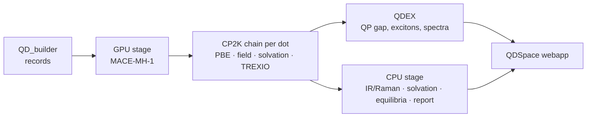

# qd-workflows

qd-workflows ties the quantum-dot packages together into one production pipeline for the
QDSpace library and webapp:

- **QD_builder** makes the structures (library records: `record.json` + `start.xyz`).
- **Orchestr.AI** (`run_type: PROPS`) computes the MACE-MH-1 properties: relaxation, Hessian,
  thermochemistry, desorption of Z-type ligands, ensembles, and assembles the report.
- **CP2K** (PBE, GAPW) gives the DFT layer: geometry, finite-field response (IR/Raman), solvation
  cubes, molecular orbitals.
- **QDEX** turns the DFT orbitals into quasiparticle gaps, excitons and spectra.

The packages keep their own repositories. This repository pins them (`components.yaml`),
describes each HPC cluster (`clusters/`), and holds the job templates and the glue code
(`src/qd_workflows`, command `qdw`).

## What is computed

| Quantity | How |
|---|---|
| Relaxed structure, core / surface / ligand roles | MACE-MH-1 |
| Frequencies, zero-point energy, free energies $G^\circ(T)$ | MACE-MH-1 Hessian, ideal solute at 1 M, quasi-RRHO |
| Stability: decomposition and binding free energies, dissolution temperature | MACE-MH-1 + bulk and monomer references |
| Desorption of Z-type ligands $\mathrm{MX}_q$: ladder $\Delta G_k$, $\langle k\rangle(T, \mu)$, site map | MACE-MH-1 beam search |
| Solvation $\Delta G_\mathrm{solv}(\varepsilon)$ | COSMO on the CP2K potential + cavity/dispersion term |
| Coupled equilibria of dot populations in solution | all of the above |
| IR and Raman intensities | CP2K finite-field Born charges and Raman tensors on the MACE modes |
| Band edges, QP gap, excitons, absorption, PDOS, COOP, fuzzy bands | CP2K → TREXIO → QDEX |
| Wigner and MD ensembles (fine-tuning sets) | MACE-MH-1 |

On demand, outside the batch: **`qdw reaction`**, the free energy of any reaction a user gives,
against temperature, dielectric constant and concentrations ([page](reactions.md)).

## Where to go next

- [Getting started](getting-started.md): environments, a cluster profile, the first run.
- [Pipeline overview](pipeline/overview.md): the three stages and what each step writes.
- [Theory](theory/thermochemistry.md): every formula, as implemented.
- [Command line](reference/cli.md): all `qdw` commands.
