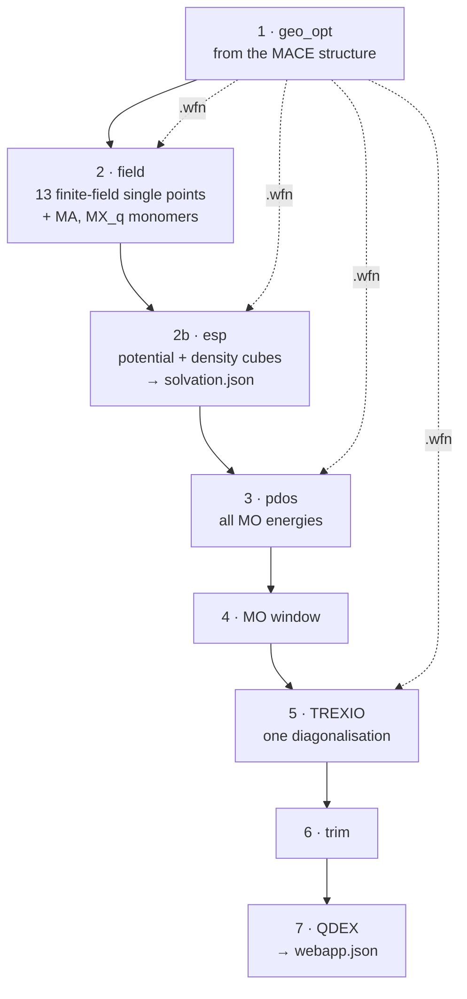

# 2 · CP2K chain

One Slurm job per dot (up to 2,000 atoms) runs the whole DFT track. It is written by
`qdw cp2k chain` (or by `qdw props chains` for a batch) as `<record>/cp2k/chain.sh`. Every step is
skipped when its output is already there, so a job stopped by the time limit continues where it
stopped when resubmitted.



## Common DFT settings

All steps share one setup (templates in `src/qd_workflows/templates/cp2k/`):

| Setting | Value |
|---|---|
| Functional | PBE |
| Method | GAPW (`FORCE_PAW T`, `GAPW_ACCURATE_XCINT T`, CP2K ≥ 2026.2) |
| Basis, pseudopotentials | DZVP-MOLOPT-GGA-GTH, GTH-GGA (`BASIS_MOLOPT_UZH`, `POTENTIAL_UZH`), per valence charge |
| Grid | `CUTOFF 400`, `REL_CUTOFF 60`, `NGRIDS 4` |
| Cell | non-periodic, the dot's extent + 12 Å (6 Å on each side); Poisson solver `MULTIPOLE` |
| SCF | OT, DIIS minimiser, `FULL_KINETIC` preconditioner, `EPS_SCF 1e-6`, `MAX_SCF 200`, no outer loop |

Every step after geo_opt restarts from the geo_opt wavefunction.

## 1 · geo_opt

Geometry optimisation from the MACE-relaxed structure (BFGS; L-BFGS above 1,000 atoms).
`IGNORE_CONVERGENCE_FAILURE` lets the first step use all 200 SCF cycles; later steps converge in
far fewer. A stopped run continues from the last frame of its trajectory.

## 2 · field (finite-field single points)

Thirteen single points in a uniform electric field (0.002 a.u. ≈ 0.1 V/Å), restarted from the
geo_opt wavefunction, written and read by Orchestr.AI `qd.field`:

| Run | Field |
|---|---|
| `f0` | none: reference forces, dipole, Hirshfeld charges |
| `fxp`, `fxm`, `fyp`, `fym`, `fzp`, `fzm` | $\pm E$ along one axis |
| `fxypp`, `fxymm`, `fxzpp`, `fxzmm`, `fyzpp`, `fyzmm` | $(+E,+E)$ and $(-E,-E)$ along two axes |

plus zero-field single points of the MA and MX$_q$ monomers. They give the Born charges, the Raman
tensors and the polarisability ([IR and Raman](../theory/spectra.md)). On Cd16 and Cd68: Born
charge sum rule to $10^{-4}\,e$, polarisability within 0.01 % of linear response.

The runs go side by side, as many as the job's memory holds (see [Memory](#memory)), the job's
ranks shared among them.

## 2b · esp (solvation cubes)

Hartree-potential and electron-density cubes (stride 2) of four structures, with the field
step's single-point settings:

| Run | Structure | Start |
|---|---|---|
| `dot_0` | the intact dot | restart from the geo_opt .wfn |
| `dot_K` | the fully stripped dot, last state of the desorption ladder (`props/detach_K.xyz`) | atomic guess, own cell |
| `MA`, `MX` | the monomers (`props/monomers.xyz`) | atomic guess, cell ≥ 15 Å |

`qdw cp2k esp collect` turns each pair of cubes into the COSMO conductor energy on the density
isosurface and the isosurface area, written to `cp2k/solvation.json`
([Solvation](../theory/solvation.md)). A failure of this step does not stop the chain.

## 3–6 · pdos, window, TREXIO, trim

- **pdos**: an OT single point that prints the energies and occupations of all MOs, with PDOS.
- **window** (`qdw cp2k window`): the MOs from 5 eV below the valence band edge to 5 eV above the
  conduction band edge; `added_mos` is the number of virtual MOs in the window.
- **TREXIO**: one diagonalisation cycle reading the geo_opt .wfn, `ADDED_MOS` = the window's
  virtual MOs, the orbitals written in TREXIO format (spherical AOs).
- **trim** (`qdw cp2k trim`): keeps only the window's MOs in the HDF5 file; QDEX reads any MO
  subset with its energies and occupations.

## 7 · QDEX

With the record's `record.json` present, QDEX runs on the trimmed orbitals on the first node's
cores, then `qdw qdex webapp` writes `qdex/webapp.json` ([QDEX](qdex.md)).

## Resources

Cores and memory grow with the square of the number of basis functions, scaled from the
profile's calibration run (`cp2k.calibration`: 24,000 basis functions, 240 cores, 340 GB for a
4.2 nm CdSe dot), at least `min_cores`, at least `mem_per_cpu` per core. The wall time of the
whole chain comes from the cost of a PBE geometry step on CdSe dots: 1.5 × the estimate, at least
one hour, at most the profile's cap.

### Memory

Each GAPW single point holds the cell's real-space grids, which outweigh the basis for small and
medium dots: Cd16Se13Cl6 in a 23.6 Å cube used 13.3 GB over 3 ranks, whatever the rank count. The
chain scales this with the cell volume,

$$
M_\mathrm{run} \approx 13.5\ \mathrm{GB}\times\frac{V_\mathrm{cell}}{(23.631\ \text{Å})^3},
$$

reads at run time the memory Slurm granted, and runs side by side at most
$\lfloor 0.8\, M_\mathrm{job} / M_\mathrm{run}\rfloor$ field single points (at most 13) and esp dots
(at most 2). Examples: 5 at a time in 96 GB, all 13 in 336 GB (NHR, 48 × 7 GB).

## Running a chain

```bash
qdw cp2k chain relaxed.xyz --project <id> --record record.json --out cp2k --cluster nhr
(cd cp2k && sbatch chain.sh)
```

Single steps can also be prepared alone:

```bash
qdw cp2k prepare relaxed.xyz --step geo_opt --project <id> --out run/geo_opt
qdw cp2k window run/pdos/*.pdos -o run/window.json
qdw cp2k prepare geo.xyz --step trexio --wfn ../geo_opt/<id>-RESTART.wfn --window run/window.json --out run/trexio
qdw cp2k trim run/trexio/orbitals.h5 run/orbitals.h5 --window run/window.json
```
