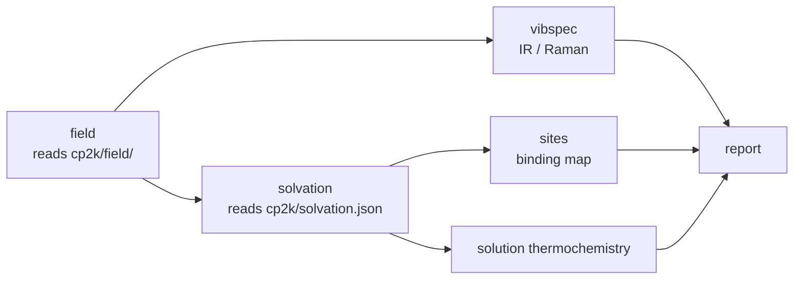

# 3 · CPU stage (assembly)

`job_cpu.sh` runs when every CP2K chain of the batch has ended. It reads the GPU steps from the
cache (`props.upstream: cached`: it never redoes a MACE step) and assembles what needs the DFT
results:

## field

Reads the chain's 13 finite-field runs and the monomer runs
(`<record>/cp2k/field/`): Born charges, Raman tensors, polarisability, dipole, Hirshfeld
charges. Tensors go to `props/field.npz`. The outputs of the runs enter the step's cache key, so
new DFT results invalidate it.

## vibspec

IR and Raman spectra: peak positions are the harmonic MACE-MH-1 frequencies; intensities are the
DFT Born charges and Raman tensors projected on the MACE normal modes
([IR and Raman](../theory/spectra.md)). Modes are symmetry-adapted within degenerate sets with
irreducible-representation labels and selection rules; each mode is characterised by its core /
surface / ligand and element shares and its overlap with a uniform breathing of the dot. The
bulk Γ-point optical frequency of the CIF is the reference.

## solvation

$\Delta G_\mathrm{solv}(\varepsilon)$ of every species on the ladder (the dot, its stripped states, the
MA and MX$_q$ monomers) from the chain's `solvation.json`: COSMO on the DFT potential plus the
cavity/dispersion term, the stripped states linear in $k$ between the intact and the fully
stripped dot ([Solvation](../theory/solvation.md)). The file's content enters the step's cache
key.

## sites

The binding-site map: one free energy per symmetry-distinct surface unit of the intact dot (the
first removal of the desorption search), each with its orbit of equivalent atoms, the dot's
faceted shape for the 2D map, and the solvated free energy evaluated live in the dashboard
([Reactions and equilibria](../theory/equilibria.md#site-resolved-binding)).

## report

`props/properties.json` (the step summaries) and the dashboards: structure and roles, vibrational
density of states, IR/Raman, stability against T, the desorption ladder and $\langle k\rangle$, the
site map, and the solution section (decomposition, binding, ladder and equilibria in solution with
sliders for $T$, $\varepsilon$, concentrations and precursor shift). Electronic properties are left
to the DFT/QDEX panels.
