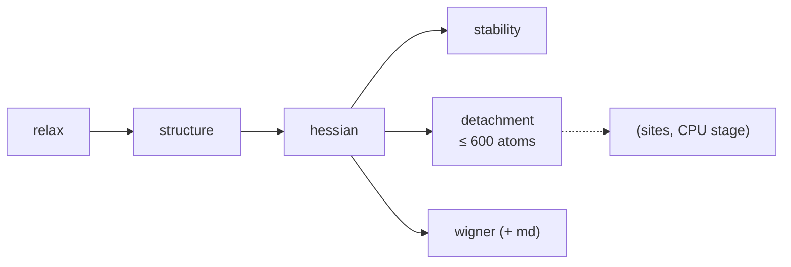

# 1 · GPU stage (MACE-MH-1)

`qdw props prepare` writes `config.yaml` and `job.sh` for Orchestr.AI `run_type: PROPS`; the job
runs these steps for every record on one GPU, each cached in `<record>/props/<step>.json`:

The model is MACE-MH-1 (head `omat_pbe`) in float64. When the run ends, the job submits one CP2K
chain per record (`qdw props chains --submit`) and then the CPU stage with a dependency on all
chains.

## relax

BFGS to $f_\mathrm{max} = 0.01$ eV/Å from the builder's start geometry (L-BFGS above 500 atoms,
where BFGS's $3N\times3N$ Hessian update on the CPU left the GPU idle); FIRE continues if BFGS
stalls. Output: `props/relaxed.xyz`, centred at the centre of mass.

## structure

Bonds are opposite-charge pairs closer than a tolerance times the bulk cation–anion bond of the
CIF (native pairs) or 1.25 × the covalent-radius sum (ligand pairs). Native atoms with their bulk
coordination are **core**, the others **surface**; ligands are classified by how many cations they
bind ($\mu_1$, $\mu_2$, $\mu_3$). The relaxed bond graph is compared with the start one, so ligand
detachment or migration during the relaxation is flagged.

## hessian

Analytic (autograd) MACE Hessian up to 2,000 atoms, central finite differences of the forces
otherwise (0.01 Å). It is mass-weighted, the three translations and three rotations are removed
exactly (diagonalisation in the complement of the Eckart vectors), leaving $3N - 6$ modes. From the
frequencies: zero-point energy, $U_\mathrm{vib}$, $S_\mathrm{vib}$, $C_v$, $F_\mathrm{vib}$ on the
temperature grid (50–800 K, every 25 K) with quasi-RRHO entropy, and the vibrational density of
states, total and projected on elements and on core / surface / ligand atoms.
Formulas: [Thermochemistry](../theory/thermochemistry.md).

## stability

The reference species, computed once per material and model head and shared between records
(`props.refs`):

- **bulk MA**: cell-relaxed from the record's CIF, phonons by finite displacements in a supercell;
- **MA monomer** (the diatomic) and **MX$_q$ monomer** (linear CdCl$_2$, trigonal InCl$_3$, …),
  ideal gases at 1 M.

From them the decomposition and binding free energies of the dot in vacuum and the dissolution
temperature ([Reactions and equilibria](../theory/equilibria.md)). Writes `props/monomers.xyz` for
the CP2K chain.

## detachment

Desorption of Z-type ligands $\mathrm{MX}_q$, one unit after another, for dots up to 600 atoms.
A unit is a surface cation with its own bonded X; a cation with fewer bonded X is completed by
the closest other X (flagged non-molecular). The default search moves symmetry-equivalent units
together (`detach_search: symmetric`); the alternative is a beam search (2 structures per level).
After every removal the units are redefined on the relaxed, reconstructed surface. Candidates are
relaxed in batches on the GPU (up to 4,000 atoms per MACE call), from a 0.02 Å random
perturbation so they leave flat valleys, and polished to 0.005 eV/Å before ranking.

Along the best path, Hessians of the products (up to 300 atoms) give the vibrational free-energy
change of each step. Output: the ladder $\Delta E_k$, $\Delta G_k(T)$, the files
`props/detach_<k>.xyz` (one per state), and every relaxed configuration the search evaluated, for
the Boltzmann average $\langle k\rangle(T, \mu)$.

## wigner (and md)

Structure ensembles for DFT labelling and fine-tuning:

- **wigner**: 100 structures per temperature (300, 400, 500, 600 K) from the quantum harmonic
  (Wigner) distribution of the MACE normal modes,
  $Q_j \sim \mathcal N\!\left(0, \frac{\hbar}{2\omega_j}\coth\frac{\hbar\omega_j}{2k_BT}\right)$; modes
  below 20 cm⁻¹ are left out and modes below 50 cm⁻¹ are sampled with the width of a 50 cm⁻¹
  mode (a straight-line displacement along a rotation-like mode stretches bonds).
- **md** (`--md`, a subset of the library): short Langevin MD (BAOAB, 2 fs, 5 ps) for six
  replicas at constant temperatures or ramps, one batched model call per step; frames every
  100 fs after 0.5 ps, each with its exact MACE energy and forces.

Every structure carries energy, forces and MACE descriptors; files go to `props/ensemble/`.

## Settings that matter

| Setting | Default | Effect |
|---|---|---|
| `fmax` | 0.01 eV/Å | relaxation convergence |
| `analytic_max_atoms` | 2000 | analytic Hessian up to here |
| `hessian_max_atoms` | 2000 | larger dots: no Hessian or anything built on it |
| `detach_max_atoms` | 600 | desorption search up to here |
| `detach_thermo_max_atoms` | 300 | Hessians of the desorption products up to here |
| `temperatures` | 50–800 K, step 25 | thermochemistry grid |
| `wigner_temperatures`, `wigner_samples` | 300–600 K, 100 | ensembles |
| `vibspec_source`, `solvation_charges` | `dft` | set by `qdw props prepare`: no xTB in the batch |
