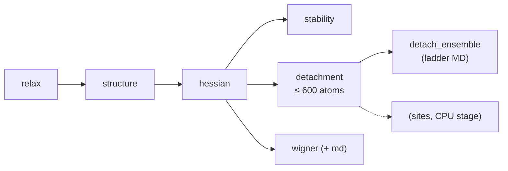

# 1 · GPU stage (MACE-MH-1)

`qdw props prepare` writes `config.yaml` and `job.sh` for Orchestr.AI `run_type: PROPS`; the job
runs these steps for every record on one GPU, each cached in `<record>/props/<step>.json`:

The model is MACE-MH-1 (head `omat_pbe`) in float64. When the run ends, the job submits one CP2K
chain per record (`qdw props chains --submit`) and then the CPU stage with a dependency on all
chains.

## relax

BFGS to $f_\mathrm{max} = 0.01$ eV/Å from the builder's start geometry (L-BFGS above 500 atoms,
where BFGS's $3N\times3N$ Hessian update on the CPU left the GPU idle); FIRE continues if BFGS
stalls. Output: `props/relaxed.xyz`, centred at the centre of mass.

## structure

Bonds are opposite-charge pairs closer than a tolerance times the bulk cation–anion bond of the
CIF (native pairs) or 1.25 × the covalent-radius sum (ligand pairs). Native atoms with their bulk
coordination are **core**, the others **surface**; ligands are classified by how many cations they
bind ($\mu_1$, $\mu_2$, $\mu_3$). The relaxed bond graph is compared with the start one, so ligand
detachment or migration during the relaxation is flagged.

## hessian

Central finite differences of the MACE forces (0.01 Å, $6N$ force evaluations), batched on the
GPU: the displaced copies reuse the reference structure's graph (same neighbour list, shifted
positions) and go through the model up to 4,000 atoms per call. This is 3–3.5× faster than the
autograd Hessian, which with cuEquivariance runs one row per backward pass (its kernels have no
`vmap` rule), and agrees with it to 0.03 cm⁻¹ or better (see [Validation](../reference/validation.md)).
The autograd Hessian is still available (`--hessian analytic`). The Hessian is mass-weighted, the three translations and three rotations are removed
exactly (diagonalisation in the complement of the Eckart vectors), leaving $3N - 6$ modes. From the
frequencies: zero-point energy, $U_\mathrm{vib}$, $S_\mathrm{vib}$, $C_v$, $F_\mathrm{vib}$ on the
temperature grid (50–800 K, every 25 K) with quasi-RRHO entropy, and the vibrational density of
states, total and projected on elements and on core / surface / ligand atoms.
Formulas: [Thermochemistry](../theory/thermochemistry.md).

## stability

The reference species, computed once per material and model head and shared between records
(`props.refs`):

- **bulk MA**: cell-relaxed from the record's CIF, phonons by finite displacements in a supercell;
- **MA monomer** (the diatomic) and **MX$_q$ monomer** (linear CdCl$_2$, trigonal InCl$_3$, …),
  ideal gases at 1 M.

From them the decomposition and binding free energies of the dot in vacuum and the dissolution
temperature ([Reactions and equilibria](../theory/equilibria.md)). Writes `props/monomers.xyz` for
the CP2K chain.

## detachment

Desorption of Z-type ligands $\mathrm{MX}_q$, one unit after another, for dots up to 600 atoms.
A unit is a surface cation with its own bonded X; a cation with fewer bonded X is completed by
the closest other X (flagged non-molecular). After every removal the units are redefined on the
relaxed, reconstructed surface. Candidates are relaxed in batches on the GPU (up to 4,000 atoms per
MACE call), from a 0.02 Å random perturbation so they leave flat valleys.

The default is a **greedy, quick** search, meant to describe the desorption energies
qualitatively at a bounded cost:

- one unit removed per step, the cheapest one (`detach_search: greedy`);
- after a removal only the units within 7 Å of it are re-relaxed, plus any unit within 0.3 eV of
  the best; the others keep their previous $\Delta E$;
- at most 12 removals (`detach_max_levels`);
- candidates relaxed to 0.05 eV/Å, no polishing (`detach_quick`);
- one Hessian per path, for the last state (dots up to 300 atoms); the vibrational free energy of
  the states in between is linear in $k$ from the intact dot.

On Cd68Se55Cl26 the first four removals equal those of the full beam search and the path drifts
higher by ~0.1 eV per unit after that; on Pb236S201Cl70 it equals the full greedy ladder. Cost on
an A100: 3.6 min (149 atoms), 8.5 min (507 atoms). The alternatives are `detach_search: beam`
(2 structures per level, every unit, polished to 0.005 eV/Å: accurate, ~7,000 relaxations at
300 atoms) and `symmetric` (symmetry-equivalent units together: cheap, but its paths were up to
2.2 eV higher on Cd68). A MACE-MH-1 force call costs ~80 ms whatever the size, so the number of
optimiser steps sets the cost. Output: the ladder $\Delta E_k$, $\Delta G_k(T)$, the files
`props/detach_<k>.xyz` (one per state), and every relaxed configuration the search evaluated, for
the Boltzmann average $\langle k\rangle(T, \mu)$.

## wigner (and md)

Structure ensembles for DFT labelling and fine-tuning:

- **wigner**: 100 structures per temperature (300, 400, 500, 600 K) from the quantum harmonic
  (Wigner) distribution of the MACE normal modes,
  $Q_j \sim \mathcal N\!\left(0, \frac{\hbar}{2\omega_j}\coth\frac{\hbar\omega_j}{2k_BT}\right)$; modes
  below 20 cm⁻¹ are left out and modes below 50 cm⁻¹ are sampled with the width of a 50 cm⁻¹
  mode (a straight-line displacement along a rotation-like mode stretches bonds).
- **md** (`--md`, a subset of the library): short canonical MD (velocity Verlet, 2 fs, 5 ps)
  with the CSVR thermostat of Bussi, Donadio and Parrinello (coupling time 100 fs; Langevin
  BAOAB with `md_thermostat: langevin`) for two replicas, 300 K and a 300 → 1000 K ramp, one
  batched model call per step; frames every 100 fs after 0.5 ps. CSVR rescales the velocities
  so that the kinetic energy $K$ follows its canonical distribution: over a time $\Delta t$, with
  $c = e^{-\Delta t/\tau}$, $N_f = 3N-3$ and $\bar K = N_f k_BT/2$,
  $K' = K + (1-c)\left[\frac{\bar K}{N_f}\left(R_1^2 + \textstyle\sum_{i=2}^{N_f} R_i^2\right) - K\right]
  + 2R_1\sqrt{\frac{c(1-c)\bar K K}{N_f}}$ ($R_i$ standard normal), applied for half a step
  before and after each Verlet step.

- **frames from the desorption search** (`detach_frames`, on by default): every candidate
  relaxation keeps snapshots at its start (the dot right after the unit is removed: large forces
  on the under-coordinated atoms) and at the first optimiser steps that release 25, 50 and 75 % of
  its energy drop (none for a drop below 0.05 eV). All frames of the relaxations on the best path
  are kept, plus a seeded random subset of at most 100 from the other candidates:
  `props/ensemble/detach_relax.extxyz`. The frames come from the batched L-BFGS at no extra
  model cost and are spooled to disk as the search runs, so a resumed search keeps them.
- **detach_ensemble**: short CSVR MD (1 ps, frames every 100 fs after 0.2 ps) at 300 and 600 K
  from the ladder states $k$ = 1, 4, 8, 12 (those the search reached, and always the last one),
  starting from Maxwell–Boltzmann velocities; all replicas share one batched model call per
  step: `props/ensemble/detach_md.extxyz`. The ladder minima themselves add little to a training
  set (their MACE forces are zero); the relaxation snapshots and the MD sample the newly exposed,
  reconstructing surfaces away from the minimum.

Every frame is written with its positions, the MACE-MH-1 energy (also per atom) and forces, and
velocities where it has them (extxyz: info `energy`, `energy_per_atom`, `label`; arrays `forces`,
`vel_A_fs`), so the files can be used for training as written and DFT labels can be added next to
them; MACE descriptors go to `embeddings.npz`. Files go to `props/ensemble/`.

## Settings that matter

| Setting | Default | Effect |
|---|---|---|
| `fmax` | 0.01 eV/Å | relaxation convergence |
| `hessian` | `fd` | `fd`, `analytic` (autograd) or `auto` (analytic up to `analytic_max_atoms`) |
| `hessian_max_atoms` | 2000 | larger dots: no Hessian or anything built on it |
| `detach_max_atoms` | 600 | desorption search up to here |
| `detach_thermo_max_atoms` | 300 | Hessians of the desorption products up to here |
| `temperatures` | 50–800 K, step 25 | thermochemistry grid |
| `wigner_temperatures`, `wigner_samples` | 300–600 K, 100 | ensembles |
| `vibspec_source`, `solvation_charges` | `dft` | set by `qdw props prepare`: no xTB in the batch |
