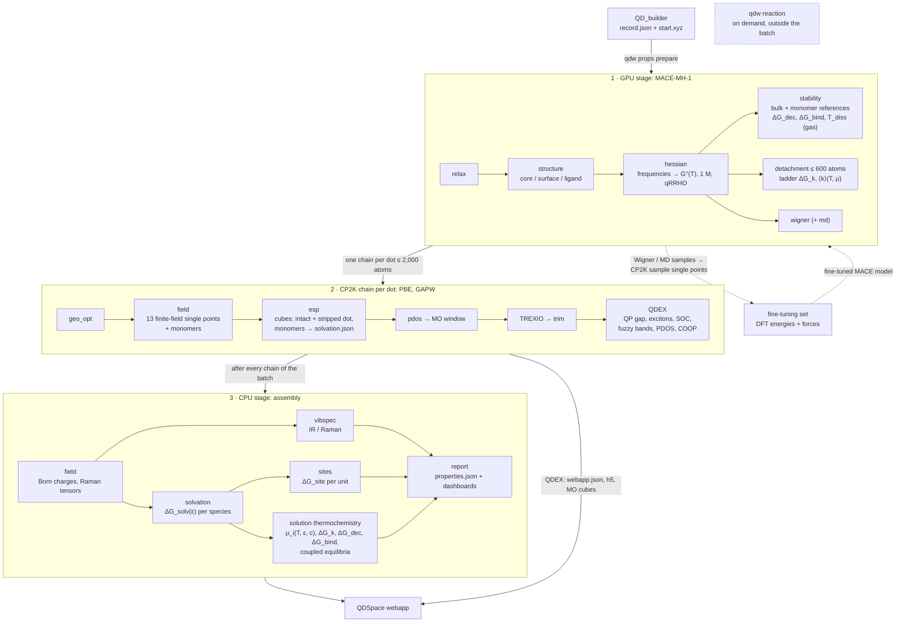
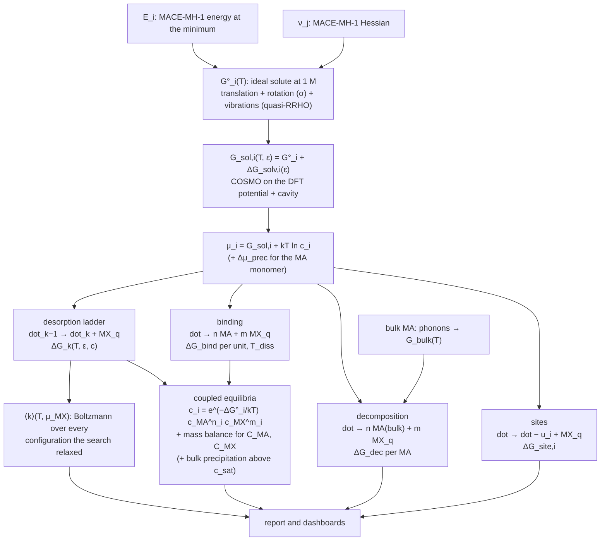

# Pipeline overview

One batch of library records goes through three Slurm stages. MACE-MH-1 runs on a GPU; each dot
gets one CP2K chain on CPU nodes; then a CPU job assembles the properties and the report. The GPU
job submits the chains and the CPU job itself, so a batch is one `sbatch`.

| Stage | Where | Steps | Page |
|---|---|---|---|
| 1 · GPU stage | one GPU (A100) | relax, structure, hessian, stability, detachment, wigner (md) | [GPU stage](gpu-stage.md) |
| 2 · CP2K chain | CPU nodes, one job per dot | geo_opt, field, esp, pdos, window, TREXIO, trim, QDEX | [CP2K chain](cp2k-chain.md) |
| 3 · CPU stage | one CPU node | field, vibspec, solvation, sites, report | [CPU stage](cpu-stage.md) |

## Thermochemistry and equilibria

What happens to the energies after the Hessian. Every box is a formula in the
[Theory](../theory/thermochemistry.md) pages; the dashboards evaluate the last rows live, with
sliders for $T$, $\varepsilon$, the concentrations and the precursor shift.

## What each engine provides

| Quantity | Source (dots ≤ 2,000 atoms) |
|---|---|
| Structure, frequencies, thermochemistry, desorption ladder, Wigner / MD ensembles | MACE-MH-1 |
| Electronic structure: levels, QP gap, excitons, absorption, PDOS, COOP | CP2K PBE → QDEX |
| IR / Raman intensities | DFT Born charges and Raman tensors (finite field) on the MACE modes |
| Solvation | COSMO on the DFT potential + cavity/dispersion |

No xTB: `qdw props prepare` sets `vibspec_source: dft` and `solvation_charges: dft`, so IR/Raman
and solvation come only from the DFT chain. (Orchestr.AI keeps its xTB steps for standalone runs.)

## Size routing

| Atoms | What runs |
|---|---|
| ≤ 600 | everything, including the desorption ladder and its thermochemistry |
| ≤ 2,000 | analytic Hessian, the CP2K chain and QDEX; no desorption ladder above 600 |
| > 2,000 | not in the batch: `qdw props prepare` leaves these records out (to be decided) |

## The fine-tuning loop

Dashed in the diagram. The Wigner and MD ensembles of the GPU stage are labelled with CP2K
single points (`qdw cp2k prepare --step sample`, energies and forces, `qdw cp2k label`), which
make a fine-tuning set for MACE; a fine-tuned model reruns the GPU stage. The pieces exist;
nothing runs the loop automatically yet.
