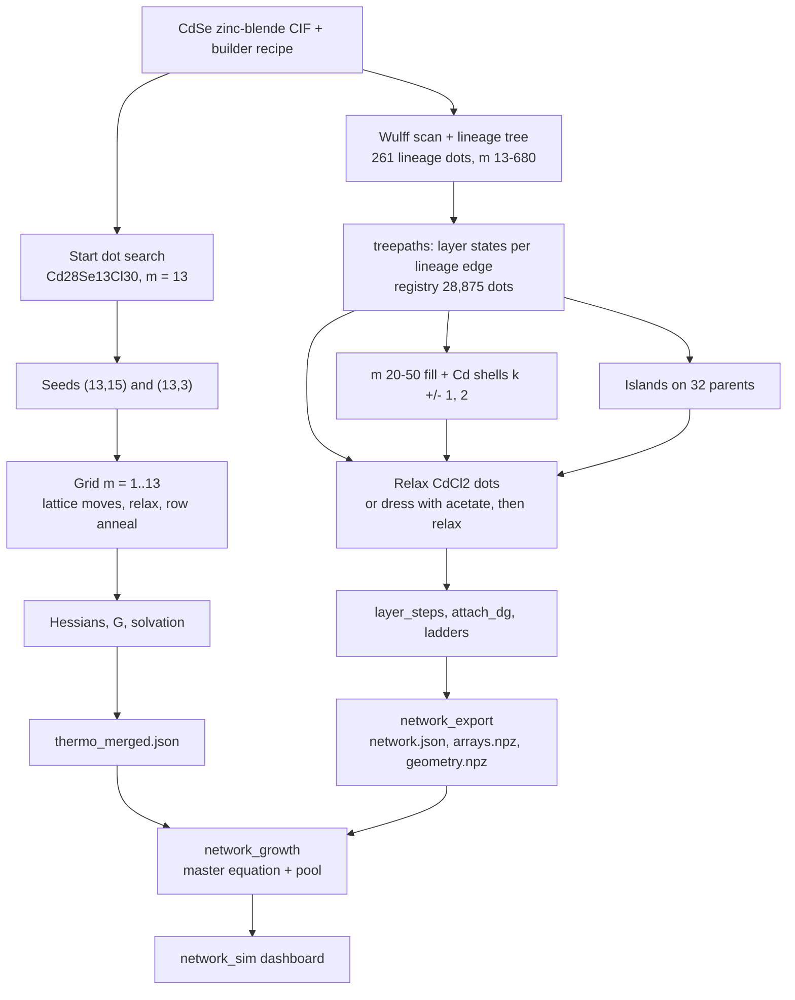

# CdSe nucleation and growth: how the maps were built

This page documents how the CdSe nucleation and growth model was built, end to end, for the CdCl2 and the acetate
cases. It is written as a protocol to repeat for another material (II-VI, III-V, IV-VI) and another ligand.

State on 2026-11-04. Every number below comes from a code file, a run log, a cluster folder or one of Ivan's decisions.
The [source index](#a-source-index) at the end lists where each piece lives. Where something could not be established
from the sources, the page says so.

!!! warning "Code that is not committed"
    Several stages ran from code that is not in any git branch:

    - the grid construction (`nucleation.py`, the seeded `lattice_grid.py`, `grid.py`): uncommitted in the
      `cdse-grid` worktree;
    - the carboxylate code (`ligands.py`, its `nucleation.py`): untracked, in the `cdse-carboxylate-plan` worktree
      (`docs/plans/cdse_carboxylate/pilot/code/`) and on LUMI `qdw/code`;
    - the layer-path scripts (`build2.py`, `treepaths.py`, `layer_steps.py`, `islands.py`, `stage*.py`, `ladders.py`,
      …). These lived only in a temporary session folder. They are now copied to
      `network_growth_data/pipeline_scripts_layer_path/` (72 files, with a `MANIFEST.txt`).

    Committing them is the first step of [generalising the protocol](#14-generalised-protocol-for-a-new-material-and-ligand).

---

## 1. The model in one picture

Two maps of relaxed structures, one master equation:

- **The nucleation grid**: every composition $[\mathrm{CdSe}]_m(\mathrm{CdX_2})_k$ with $m = 1 \ldots 13$, built by
  removing CdSe units from the smallest Wulff dot and annealed to find each node's isomers.
- **The layer-path network**: Wulff dots from QD_builder above $m = 13$, joined by the intermediates that add one
  facet layer at a time, plus island states on the facets.
- **The growth model**: populations on every grid node and network state, fed by a precursor that converts into a
  CdSe pool. The model is a master equation whose rates satisfy detailed balance with the computed free energies.



### 1.1 Notation

$$
[\mathrm{MA}]_m(\mathrm{MX}_q)_k,\qquad \mathrm{MA}=\mathrm{CdSe},\quad \mathrm{MX}_q=\mathrm{CdX_2}\ (q=2)
$$

- $m$ = number of Se (CdSe units); $k$ = number of CdX2 units = $N_\mathrm{Cd}-N_\mathrm{Se}$ = $N_X/q$.
- X is Cl or acetate (OAc). For carboxylates the lattice bookkeeping keeps a Cl placeholder for every X; the real
  structure carries the carboxylate.
- Charges Cd +2, Se −2, X −1. Every structure is charge neutral (Q = 0).
- Grand potential of a state $i$ at the pool's chemical potentials:

$$
\Omega_i=G_i(T,\varepsilon)-m_i\,\mu_\mathrm{MA}-k_i\,\mu_\mathrm{MX},\qquad \frac{c_i}{c^\circ}=e^{-\Omega_i/k_BT}\ \text{at equilibrium}
$$

---

## 2. Level of theory (shared by every stage)

### 2.1 Energies and relaxation

| item | CdCl2 grid and network | acetate grid and network |
|---|---|---|
| model | MACE-MH-1 (`macemh1model`), head `omat_pbe`, float64 | same |
| dispersion | none | D3(BJ), PBE parameters, torch-dftd 0.5.3, inside every evaluation (relax, MD, Hessian) |
| optimiser | batched L-BFGS | same |
| Hessian, grid | analytic MACE (autograd) | central finite differences, 0.01 Å, MACE + D3 |
| Hessian, network | finite differences (CdCl2 network) | finite differences where computed; learned F_vib on the LUMI P2 states |

- The relaxer string, identical in all production runs:
  `batched-lbfgs-0.02-plateau-0.15-20-1e-05-stall-3-1000-polish-0.005-0.3`.
  - Converge to FMAX = 0.02 eV/Å. A plateau is accepted below 0.15 eV/Å when ΔE < 1e-5 eV/atom over 20 steps, with 3
    stall windows. At most 1000 steps; max step 0.2 Å; L-BFGS memory 100; initial Hessian 70 eV/Ų.
  - Polish: every product within 0.3 eV of the best is re-relaxed to 0.005 eV/Å.
- **RelaxCache** (Orchestr.AI `steps/detachment.py`): results are keyed by the exact input geometry (sha256 of
  symbols + coordinates rounded to 1e-4 Å). The tag holds the model's absolute path, so a cache moved between clusters
  misses unless its keys are rewritten.
- Ivan's rules: MACE-MH-1 throughout; LBFGS only (FIRE gave minima 0.8–2.6 eV higher, FIRE2 diverged); no classical
  force fields, no metadynamics, no xTB. CP2K is used only for COSMO of free species.
- MACE + D3 energies on LUMI (OpenEquivariance) match NHR (cuEquivariance) to 1e-6 eV at the same geometry.
- Bulk zinc blende with D3: a = 6.1176 Å, E = −6.10058 eV per pair (MACE alone: 6.2019 Å, −5.49030 eV). The acetate
  simulator shifts g_bulk by −0.610 eV for this.

### 2.2 Vibrations

- **Imaginary modes**: counted when ν < −10 cm⁻¹. In the thermochemistry, imaginary ν is used as |ν|, and |ν| <
  10 cm⁻¹ is raised to 10 cm⁻¹. No state is re-optimised along its imaginary modes.
  - CdCl2 grid: 0 of 170 states affected. Acetate pool grid: 121 of 242 states have 1–3 such modes.
- **PHVA** (partial Hessian): only when the inner region is smaller than the structure. The inner region is the core
  Cd/Se, every carboxylate C with its two O, C_α and C_β and their H. **Acetate has no C_β, so its inner region is the
  whole structure, and the acetate grid and network used full Hessians.** PHVA applies to oleate and longer chains
  (the planned oleate grid, not built).
- **Learned F_vib** (Ivan's option A, 2026-11-01): every state is relaxed with MACE, so its energy is exact; only
  F_vib is learned, with a linear pair + embedding ridge model on the relaxed geometry (species Cd, Se, O, C, H).
  Translation, rotation, σ and the surface come from the geometry.
  - Acetate validation: trained on m ≤ 60, tested on m 61–223: growth-step MAE 0.062 eV, against 0.27 eV rms
    relaxation noise between two clusters' minima.
  - Refit on all 10,783 FD states; used for the 6,983 LUMI relax-only P2 states; one state out of domain (c021064).
  - Ivan: "Keep FD where it exists" (2026-11-03): FD F_vib wherever a Hessian exists, learned F_vib only where none.

### 2.3 Free energy of one state

Ideal gas at the 1 M standard state ($p=c^\circ RT$, $c^\circ$ = 1000 mol m⁻³), rigid rotor, Grimme quasi-RRHO
vibrations (Orchestr.AI `references.ideal_gas_g` and `steps/hessian.thermo`):

$$
G_i^\circ(T)=E_i+H_\mathrm{trans}+H_\mathrm{rot}-T\,(S_\mathrm{trans}+S_\mathrm{rot})+F_\mathrm{vib}(T),\qquad H_\mathrm{trans}=\tfrac52k_BT\ (\text{includes }pV)
$$

$$
S_\mathrm{trans}=k_B\left[\ln\!\left(\left(\frac{2\pi Mk_BT}{h^2}\right)^{3/2}\frac{k_BT}{p}\right)+\frac52\right],\qquad
S_\mathrm{rot}=k_B\left[\ln\!\left(\frac{\sqrt\pi}{\sigma}\sqrt{\frac{T^3}{\Theta_A\Theta_B\Theta_C}}\right)+\frac32\right]
$$

$$
F_\mathrm{vib}=\sum_j\left[\frac{h\nu_j}{2}+\frac{h\nu_j}{e^{x_j}-1}\right]-T\sum_j\Big[w_jS^\mathrm{harm}_j+(1-w_j)S^\mathrm{rot}_j\Big],\qquad
w_j=\frac{1}{1+(\nu_0/\nu_j)^4},\ \nu_0=100\ \mathrm{cm^{-1}},\ x_j=\frac{h\nu_j}{k_BT}
$$

- Free-rotor entropy with $\mu'_j=\mu_jB_\mathrm{av}/(\mu_j+B_\mathrm{av})$, $\mu_j=h/(8\pi^2\nu_j)$,
  $B_\mathrm{av}$ = 1e-44 kg m².
- **Symmetry number σ**: pymatgen `PointGroupAnalyzer(tolerance=0.1).get_rotational_symmetry_number()` on the relaxed
  geometry, 1 if it fails.
- **Temperatures**: 50 to 800 K in steps of 25 K (31 points); linear interpolation in between.
- **Grid node**: a Boltzmann sum over its states with Hessians, plus every other evaluated configuration of the node,
  each with the best state's thermal part:

$$
G(m,k;T)=-k_BT\ln\sum_{i\in(m,k)}e^{-G_i(T)/k_BT},\qquad G_i\approx E_i+\big[G_\mathrm{best}(T)-E_\mathrm{best}\big]\ \text{(no Hessian)}
$$

### 2.4 Solvation

Implicit solvent only, ε = 2.0 ("about octadecene"). Explicit solvent and ligand shells are not included; Ivan asked
that this stays noted as a future extension.

$$
\Delta G_\mathrm{solv}(\varepsilon)=\Big(1-\frac1\varepsilon\Big)E_\infty+(\alpha+\gamma)(\varepsilon)\,S,\qquad
(\alpha+\gamma)(\varepsilon)=2.16\ln\varepsilon-14.79\ \mathrm{mN\,m^{-1}}
$$

- The cavity term is the Hille et al. (2019) β = 0 fit, refitted on 67 non-aqueous solvents; it is evaluated at
  $\max(\varepsilon,1.8)$ in `grid_solvation` (`solvation.md` describes a scaling below 1.8 instead; this does not
  matter at ε = 2).
- **Clusters and dots: σ·S.** S is the solvent-exposed area of the union of vdW spheres × 1.4 (radii Cd 1.58, Se 1.90,
  Cl 1.75, O 1.52, C 1.70, H 1.20 Å), about 4 points per Ų, KD-tree neighbour search. The electrostatic term is per
  area, $E_\infty=e_\mathrm{el}S$ with $e_\mathrm{el}$ = −1.06 meV/Ų (the campaign dots' value, 196 CdSe variants,
  no size trend):

$$
\sigma(\varepsilon)=\Big(1-\frac1\varepsilon\Big)e_\mathrm{el}+(\alpha+\gamma)(\max(\varepsilon,1.8)),\qquad \sigma(2)=-1.36\ \mathrm{meV\,\AA^{-2}}
$$

- **Free species: CP2K COSMO** (PBE gas-phase single point, conductor E_inf and isosurface ρ₀ = 5e-4 e bohr⁻³). A
  free molecule's charge and surface are not a dot surface, so the per-area surrogate fitted on dots is replaced:

| species | E_inf (eV) | S (Ų) |
|---|---|---|
| CdSe monomer | −0.327178 | 117.799 |
| CdCl2 | −0.198261 | 135.843 |
| CdSe(CdCl2)₁ (this grid's own geometry) | −0.273933 | 208.805 |
| CdSe(CdCl2)₂ | −0.459247 | 287.439 |
| CdSe(CdCl2)₃ | −0.471024 | 358.550 |
| Cd(OAc)₂ | −0.229848 | 210.278 |
| Cd(oleate)₂ | −0.13244 | 647.55 |

- The acetate m = 1 complexes have no COSMO of their own; they take σ·S.
- CP2K runs: one whole node, all cores as MPI ranks, 1 thread; SCF in 100-cycle pieces restarted from the wavefunction
  (Ivan's rule).
- Ivan: "No xTB involved whatsoever" (2026-11-01).

---

## 3. Pool chemistry

### 3.1 Precursor conversion

The Se precursor P converts with the cadmium salt into the CdSe supply, 1:1, second order:

$$
Q=-\frac{dc_\mathrm{MX}}{dt}=k_\mathrm{conv}(T)\,c_\mathrm{MX}\,c_\mathrm P,\qquad
k_\mathrm{conv}(T)=k_\mathrm{conv}(500\,\mathrm K)\exp\!\left[-\frac{E_a}{k_B}\Big(\frac1T-\frac1{500\,\mathrm K}\Big)\right]
$$

With $a=c_\mathrm{MX,0}$, $b=c_\mathrm{P,0}$ the converted amount is closed form, and $\alpha=x/c_\mathrm{P,0}$ is the
fraction of precursor converted:

$$
x(t)=ab\,\frac{1-e^{-|a-b|k_\mathrm{conv}t}}{\max(a,b)-\min(a,b)\,e^{-|a-b|k_\mathrm{conv}t}}\ (a\ne b),\qquad
x(t)=\frac{a^2k_\mathrm{conv}t}{1+ak_\mathrm{conv}t}\ (a=b)
$$

- Defaults: T = 500 K, c_P0 = 0.025 M, c_MX0 = 0.03 M, k_conv(500 K) = 1 M⁻¹ s⁻¹, E_a = 0. k_conv is tuned, not
  computed (Ivan: "I should be able to set this as I wish").
- $x(t)$ is open loop: it does not see the MX that the dots take into their shells.

### 3.2 Complexes and chemical potentials

The CdSe in solution is spread over the packages CdSe(CdX2)ₙ, n = 0…3, which are the grid's own m = 1 row:

$$
x_n=\frac{e^{-(G_{1,n}-n\mu_\mathrm{MX})/k_BT}}{\sum_{n'}e^{-(G_{1,n'}-n'\mu_\mathrm{MX})/k_BT}},\qquad
\mu_\mathrm{MX}=G^\circ_\mathrm{MX}+\Delta G_\mathrm{solv,MX}+k_BT\ln\frac{\gamma_\mathrm{MX}c_\mathrm{MX,free}}{c^\circ}
$$

$$
\mu_\mathrm{MA}=k_BT\ln\frac{\gamma_\mathrm{MA}C_M}{c^\circ}-k_BT\ln\sum_n e^{-(G_{1,n}-n\mu_\mathrm{MX})/k_BT},\qquad
c_\mathrm{MX,free}+C_M\langle n\rangle=C_X
$$

- $C_M$ = all CdSe in solution, $C_X$ = all MX in solution; $c_\mathrm{MX,free}$ is found by bisection in ln c.
- Activity coefficients γ default to 1 (page range 0.3–3). A solubility cap $c_\mathrm{sat}$ exists in `pool()` but
  the network model does not pass it.
- Oleate enters only here and as steric coverage: Cd(oleate)2 solubility (assumed, tunable) and a maximum coverage of
  about 20–25 Ų per chain. Cd(OAc)2 is nearly insoluble.

---

## 4. Stage A: the nucleation grid (m ≤ 13)

Ivan's design (2026-10-23 to 10-25): start from the smallest Wulff dot that has discernible facets and detach CdSe
units backwards down to m = 1; lattice + relaxed descent, then annealed MD at each (m, k); no "corpus" structures;
generic so it applies to other systems.

### 4.1 The start dot and the two seeds

`python -m qd_workflows.nucleation start` (laptop, builder only) searches sizes 0.5–3.0 unit cells in steps of
0.125 and every centre (each species plus the CIF's empty interstitials). It keeps the smallest neutral dot whose
atom-fitted polyhedron exposes every facet family of the recipe, each with ≥ 1 site of area and ≥ 3 core atoms on one
plane, and with ≥ 20 core atoms. At the first size with candidates, the fewest anions wins.

- Recipe: QD_builder's II-VI default: {100} cation rich, {111} cation rich, {−1−1−1} anion rich, all γ = 1.0;
  passivation by Cl; `surf_tol` 2.0 Å; role-aware prepass; proper rotations only.
- Result: **Cd28Se13Cl30**, m = 13, at 1.125 unit cells, Se centred.

`nucleation seeds` builds two seeds from it:

| seed | formula | (m, k) | built by | laddered |
|---|---|---|---|---|
| `seed_full` | Cd28Se13Cl30 | (13, 15) | QD_builder `z_type_target` with an unreachable target, so every free host site takes a CdCl2 | down |
| `seed_x` | Cd16Se13Cl6 | (13, 3) | `seed_full` with every Z-type unit stripped (a cation bonded to exactly one anion, within 1.1 d_nn; 12 removed) | up |

**(13, 3) = Cd16Se13Cl6 is the first Wulff dot of the builder and the hand-over point to growth** (Ivan, 2026-10-29:
"You have to trust me. m = 13, k = 3 is the first wulff constructed from the builder").

### 4.2 Lattice moves and the k range

The k range of each row is not chosen; it follows from QD_builder's moves (`lattice_grid.py`):

- **+MX_q**: a Z-type unit on a free virtual cation site above an under-coordinated surface anion (builder
  `z_type_ligand_host_sites`), with its q X on free anion sites. Additions after which the remaining hosts could not
  all be filled are dropped (bipartite matching).
- **−MX_q**: a surface M with q of its X.
- **−MA**: a surface Se with a bonded surface Cd. Use the builder's surface shell (Ivan: "the 4 inner Cd are not
  surface").
- A removal is allowed only if no X is left without an M, no M without a bonded A, and the bond graph stays in one
  piece (no isolated CdCl2).

The search, row by row from m = 13 down:

1. Ladder each seed: +MX_q until no host site is left (sets $k_\mathrm{max}(m)$), −MX_q down to k = 0.
2. Descend: every kept state of every node (m, k) loses one MA, for every allowed pair; the whole row in one batch.
3. One batched neighbour pass: +MX_q from (m−1, k−1) and −MX_q from (m−1, k+1), from the best state only.
4. **Capacity**: each +MX_q and −MA step also keeps its product with the most free Z-type host sites, whatever its
   energy; then the row top is climbed from 3 nodes below it. Without this, rows m ≤ 9 stopped 1–3 CdCl2 short.
5. Every candidate is fully relaxed (no screening: a 20-step screen lost 0.21 eV per ladder step). Starts are the
   parent's relaxed coordinates, with added atoms on their lattice sites shifted by their host's displacement (lattice
   positions if a new atom lands within 1.4 Å of another).
6. Keep per node the states within 0.05 eV of the best, at most 3 (beam), plus the best of every protected path
   (seed ladders, anneal, capacity).

For carboxylates, every relaxation starts from the dot dressed by QD_builder's X-type exchange (donor O on the X
site, tail along the facet normal, seed 7, MMFF); +MX_q products are grown against the parent's relaxed shell; a
removal deletes whole molecules.

Resulting rows ($k_\mathrm{min}$ = 0 everywhere):

| m | 1 | 2 | 3 | 4 | 5 | 6 | 7 | 8 | 9 | 10 | 11 | 12 | 13 |
|---|---|---|---|---|---|---|---|---|---|---|---|---|---|
| CdCl2 $k_\mathrm{max}$ | 3 | 4 | 6 | 9 | 9 | 11 | 11 | 12 | 15 | 15 | 15 | 15 | 15 |
| acetate $k_\mathrm{max}$ | 3 | 3 | 6 | 10 | 11 | 12 | 12 | 14 | 15 | 15 | 15 | 15 | 15 |

### 4.3 Row anneal

After the top row and after every descended row (`row_anneal`):

- **Which nodes**: every node with m ≤ `anneal_all_m`; above it, the nodes within 0.15 eV of the row's lowest Ω at
  some T in 300–700 K and c in 1e-6–1 M (Ω without vibrations); always the seed nodes and $k_\mathrm{max}$.
- **Starts per node**: the best state, then the best of each other seed path, then other states, then the best again
  with new velocities.
- **MD**: velocity Verlet, CSVR thermostat (τ 100 fs), Maxwell velocities at $T_\mathrm{hot}$, linear ramp to 300 K.
  4 ps from 700 and 900 K; for m ≤ 6, 8 ps from 700, 900 and 1100 K. 2 fs (acetate with H mass 4 amu). A replica stops
  above 50 eV/Å or when an atom moves 10 Å.
- **Quench**: a frame every 0.5 ps after the first 0.5 ps (8 per 4-ps replica), each relaxed and polished if within
  0.3 eV; fragments (3.3 Å connectivity) dropped. A quench lower than the node's best by > 1 meV joins the node, so the
  next row descends from it.
- Ivan: the grid is annealed at 900 K on purpose to find other structures; above m = 13 there is no such search
  (2026-11-02).

| setting | CdCl2 `cdse_full2` | acetate (definitive pool) |
|---|---|---|
| anneal_all_m | 10 | 13 |
| anneal_starts | 2 | 3 |
| largest gain | 2.88 eV (m 6, k 11) | m = 13 row: 0.03–0.82 eV |

### 4.4 Hessians, merge, thermo

Every kept state of an annealed node gets a Hessian (§2.2). The merge adds solvation (§2.4) and writes
`thermo_merged.json` (states, frequencies, σ, S, references, COSMO block).

- CdCl2 `cdse_full2`: 155 lattice nodes, 136 with thermo, 170 states (15 nodes of rows 11–13 skipped: not annealed).
- Acetate `wd_full_acetate_pool`: 155 nodes, 242 states, none skipped.
- References: CdCl2 grid: the campaign library monomers CdCl2 and CdSe. Acetate grid: Cd(OAc)2 (lowest of 4
  conformers, rattled and re-relaxed, full Hessian) and the campaign CdSe monomer with D3 added at its geometry.

### 4.5 Grand potential, barrier and nucleation rate

$$
k^*(m)=\arg\min_k\Omega(m,k),\qquad P(k\mid m)=\frac{e^{-\Omega(m,k)/k_BT}}{\sum_{k'}e^{-\Omega(m,k')/k_BT}},\qquad
\Omega(m)=-k_BT\ln\sum_ke^{-\Omega(m,k)/k_BT}
$$

$$
\Delta\Omega^*=\max\Big(0,\max_{m\le13}\Omega(m)-\Omega(1)\Big),\qquad m^*=\arg\max_{m\le13}\Omega(m),\qquad \ln S=\frac{\mu_\mathrm{MA}-g_\mathrm{bulk}}{k_BT}
$$

$\Omega(1)=-k_BT\ln(C_M/c^\circ)$: the m = 1 row shares $\mu_\mathrm{MA}$ with the pool. The nucleation simulator
(`simulator.py`) evaluates these along the conversion, and a steady-state Becker–Döring flux through the grid:

$$
J=\left[\sum_{m=1}^{12}\frac{1}{f_m\,c_\mathrm{eq}(m)}\right]^{-1},\quad c_\mathrm{eq}(m)=c^\circ e^{-\Omega(m)/k_BT},\quad
f_m=4\pi(D_1+D_m)(r_1+r_m)N_AC_M
$$

The network growth model (§9) does not use $J$: it puts the grid's nodes in the master equation and forms nuclei
from the complexes.

### 4.6 The acetate grid: runs and pooling

All on LUMI, standard-g, one node (8 GCDs), `python -m qd_workflows.nucleation run $WD --model $M --refs $WD/refs`:

| run | job | node-h | what |
|---|---|---|---|
| `wd_full_acetate` | 23214948 | 14.28 | anneal_all_m 10, 2 starts; 31 nodes of rows 11–13 left without anneal |
| `wd_full_acetate_all` | 23250269 | 3.23 | `complete_grid.py`: anneal every remaining node; lowered 36 of 48 nodes by up to 0.58 eV |
| `wd_full_acetate_a13` | 23261779 | 23.18 | full rerun, anneal_all_m 13, 3 starts; per node ±0.7 eV against the completion, mean ~0 |
| `wd_full_acetate_pool` | 23271421 | 0.27 | `pool_grids.py`: each node keeps its lowest states over both runs, then Hessians and merge |

- Total 40.96 node-h ≈ 164 LUMI GPU-h. The pool takes 47 node minima from the completion and 102 from the rerun.
- **`wd_full_acetate_pool` is the definitive acetate grid.** Ivan, 2026-11-01: "Do not touch anymore the grid already
  built up to m = 13 because that was already very well done."
- Pooling two runs of the same workflow is not the "mixing" that is forbidden (§12).
- Oleate grids were planned (PHVA, 83–199 A100-h) but not built. Since 2026-11-01, carboxylate site energetics come
  from acetate only; oleate enters as solubility and steric coverage (§3.2).

### 4.7 The CdCl2 grid

`cdse_full2` on NHR gpu-a100, one A100 in 1-h self-restarting pieces: about 3.9 A100-h for the grid and anneals,
0.25 A100-h for thermo. Settings: seeded scheme, screen_steps 0, capacity, anneal_all_m 10, window 0.15 eV, 2 starts,
beam 3, m_min 1. The m = 1 complexes have their own COSMO from this grid's geometries (one Genoa node, CP2K 2026.2).

---

## 5. Stage B: QD_builder structures

Ivan's rule: **build with the builder, then relax; never graft onto relaxed dots** ("The best model is always the one
that is built with the builder and then relaxed", 2026-10-28). The builder's native Cl stays where the builder put it.

### 5.1 The Wulff scan and the lineage

- `QD_builder/runs/wulff_scan_cdse/scan.py`, run on LUMI (`job_scan5.sh`, 128 processes): ratios γ(111A)/γ(100) and
  γ(111B)/γ(100) over 24 values 0.5–3.0, optional {110}, plane distances 3–14 Å in 0.5 Å, centres Se, Cd and the two
  tetrahedral voids. 370,944 builds, 348,815 valid, 470 unique dots.
- The lineage (in `data.json`, not in git): 261 dots, m 13–680, 1,811 parent→child edges, generations 0–20. A parent
  is contained in a child on the Cd+Se lattice sites under a Td operation + translation (transitive reduction).
- Seeds of the lineage are dots with a zinc-blende core; node 0 = Cd16Se13Cl6 = (13, 3).
- Brothers = dots with the same Se framework that differ only in CdCl2.
- The script that wrote the `lineage` block of `data.json` was not found; `lineage_dots.py` is the closest.

### 5.2 One build

```
nc-builder CdSe_zb.cif recipe.yaml -o out.xyz --positive-q-mode add -r <min h> --write-all --verbose
```

- Recipe: the scan preset (charges, Cl passivation, `surf_tol` 2.0, role-aware prepass with min CN terrace/edge/vertex
  3/2/1, proper rotations only) plus one facet entry per plane: 14 planes ({100}×6, {111}A×4, {111}B×4), or 26 with
  {110}. Each plane's "gamma" is its distance in Å from a Se origin (`center_on_species: Se`); h = (lattice level −
  n·O)·Q/|n| + 0.3 Å, with Q = a/4 and a = 6.14054240 Å. A plane that cuts nothing goes to 60 Å.
- Stages: Wulff cut → prune CN 1 → facet detection → stepwise charge balance (prepass: surface anions with low CN
  swapped to Cl, surface cations with low CN removed; orphan-ligand prune; add or remove ligands until Q = 0; "add"
  mode for positive Q).
- The k of a plain build is $k_0=N_\mathrm{Cd}-N_\mathrm{Se}=N_\mathrm{Cl}/2$.

### 5.3 Site roles

The manifest `out.json` holds `site_roles`: every core atom is `facet:<f>`, `edge:<f>|<g>`, `vertex:…` or `interior`
from its distance (tolerance 1.0 Å) to the faces of the atom-fitted polyhedron; ligand atoms inherit their host's role.
Ivan's rule: use these roles on the as-built dot, carried by atom index; never write a new classifier.

Facet areas use planes through the outermost lattice sites (Se or swapped Cl on anion sites, Cd on cation sites;
adsorbed Cl excluded).

### 5.4 Cd shells: `post_treatment.z_type_target`

After charge balance the dot holds $k_X=N_\mathrm{Cd}-N_\mathrm{Se}$ units. A target $k>k_X$ adds Z-type CdCl2 on free
surface anions; $k<k_X$ displaces units (a core cation with its q ligands), refusing a displacement that orphans a
ligand or splits the dot. The sequence is deterministic: the build for k contains the one for k ± 1. Used in the
network only for the m 20–50 fill (k0 ± 1, ± 2).

### 5.5 Ligand exchange (dressing)

`qd_workflows.ligands.Dressing` calls QD_builder's `run_ligand_exchange_posttreatment` with one pass
`{replace: Cl, charge: −1, smiles: CC(=O)O, ratio: 1.0, distribution: uniform}`, seed 7, MMFF. Every Cl is replaced,
bridging and Z-type included (Z-type CdCl2 becomes Cd(OAc)2). The donor O sits on the old Cl site within 1e-3 Å; atom
order is fixed. A `DressError` is raised if any placeholder is left. On 10 test dots: no Cl left, Q = 0, ≤ 2.1 s each.

---

## 6. Stage C: the layer-path network (registry)

### 6.1 Why a network, not a continuous size law

The first growth model was a continuous size law: per facet, diffusion in series with an effective surface rate,

$$
\frac{dm}{dt}=N_A\sum_fA_f(m)\frac{c^*_{M}-C_\mathrm{eq}\,e^{\Delta\mu_f/k_BT}}{\delta_f/D+1/k^{(f)}_\mathrm{eff}},\qquad
k^{(f)}_\mathrm{eff}=\frac{k_\mathrm{dir}+k_\mathrm{disp}K_{X,\mathrm{edge}}c_X}{1+K_{X,\mathrm{eff}}c_X}
$$

with Δμ per builder role, K_X from site states and k_dir/k_disp from NEBs with the bare CdSe monomer (branch
`feat/growth-unified`, facet-area variant). It stalled numerically after the first dots and depended on placeholder
parameters. On 2026-10-31 Ivan chose a new model built only from relaxed structures: "a completely new growth model
without relying on what the previous data gave. Only on the new map data." Every size between the seed and the
largest dot is then a set of relaxed states, joined by the steps that add one layer on one facet.

### 6.2 Prototype

Seed Cd16Se13Cl6 → Cd38Se28Cl20 by 7 single-plane layer moves: 2⁷ = 128 layer states, 28 symmetry-distinct, each built
with QD_builder and relaxed (Ivan: "Add the full CdSe layer on one direction, charge balance via let qd builder doing
it. Relax. Then add the other layer"; 2026-10-30).

### 6.3 From lineage edges to registry dots

1. **Size each lineage edge** (`size_edges.py`): embed the parent's lattice sites in the child (Td op + translation);
   layers per plane $L=(d_\mathrm{child}-d_\mathrm{parent})/\mathrm{spacing}$, spacing in n·r units of a/4: {100} 2,
   {111} 4, {110} 2. Number of layer states $\prod(L+1)$.
2. **Enumerate layer states** (`treepaths.py data.json net_dir MMAX SMAX`): for every edge with child m ≤ MMAX and ≤
   SMAX states, every level vector of the moved planes is a lattice cut. Its class key is the set of lattice sites,
   canonical under the 24 Td ops + translation. Edges between classes differ by +1 layer in one plane. If the path end
   does not reproduce the child with 14 planes, retry with 26 (with {110}).
3. **Build** each new class with QD_builder (§5.2). Its dot key (every atom, including off-lattice Z-type Cl, on an a/16
   grid, canonical) gets a registry id if new. Two classes can give the same dot after the prepass.
4. Write `net/registry.json` (`classes`, `class_dot`, `dots` {id, formula, se, dir}, `lineage`) and one edge file per
   lineage edge (`net/edges/{p}_{c}.json`).

Of 594 edge files, 393 were built (345 with 14 planes, 48 with 26); 201 failed (123 too many states, 43 a child plane
inside the parent, 35 no embedding). They hold 44,091 classes and 149,074 dot-level edges.

### 6.4 Waves and the fill

| wave | MMAX, SMAX | registry ids | dots | m (min/median/max) | CdCl2 relaxed | acetate relaxed |
|---|---|---|---|---|---|---|
| (earlier) | – | in 0–5,982 | 373 | – | yes | yes |
| wave 1 | 100, 20,000 | 0–5,982 | 5,610 | 7/49/104 | all | all |
| wave 2 | 140, 10,000 | 5,983–10,230 | 4,248 | 23/94/188 | all | all |
| wave 3 | 200, 5,000 | 10,231–14,806 | 4,575 | 8/134/223 | all | all |
| wave 4 | 300, 5,000 | 14,807–26,117 | 11,311 | 79/211/405 | 1,231, never collected | none |
| m 20–50 fill | – | 26,118–28,874 | 2,757 | 14/34/63 | all | 2,726 |

- Wave 4 was cancelled on 2026-10-31 (all 112 LUMI jobs); Ivan: "don't do too large dots for now. We have lots of data".
- **Registry total: 28,875 dots, all built.** CdCl2 results: 17,564 states (m 7–223); acetate: 17,533.
- Staging (`stage.py`): every registry dot without results goes to `WAVE/batchJ/dNNNNN.xyz`, balanced by Σ atoms^1.5.

**The m 20–50 fill** (`fill2050/`, Ivan: "plan the builder structures and shells for that window, with the count and
GPU cost, before launching"):

1. `enumerate.py`: parents = network states at m 14–55 within 0.4 eV of each m's lowest Ω (C_M 7.6e-4 and 3e-3 M,
   500 K, ε 2), at most 6 per m → 121 parents; every one of the 14 planes moved ±1 spacing → 808 classes not in the
   registry.
2. `links.py`: 145 candidates link ≥ 2 low-lying parents, 121 link parents of different m.
3. `build_all.py`: 548 new layer dots, plus Cd shells k0 ± 1, ± 2 via `z_type_target` → 2,993 new dots (162 s on 4
   processes); keep m ≥ 14 → 2,757 (500 layer, 2,257 shell).
4. `register.py`: registry ids 26,118–28,874 and one edge file `fill2050.json` (2,955 edges).

### 6.5 Layer steps

`layer_steps.py net_dir results_by_key.json g_cache.json out.json` walks every dot-level edge and describes it.

| field | meaning |
|---|---|
| `a`, `b` | registry ids, b the larger (more Se, or equal Se and more Cd) |
| `dSe`, `dCd`, `dCl` | b − a in atom counts |
| `framework` | a's Cd+Se sites embed in b's |
| `pure` | a's full lattice sites embed in b's: the step only adds |
| `nD`, `nD_A`, `nD_C` | new lattice sites: total, anion, Cd |
| `dir` | the facet family of the step, from the **new Cd**: the normal (of 26) with all new Cd beyond a's outermost Cd layer and the smallest span; `None` = no new Cd; `mixed` = new Cd on several sides |
| `normal`, `span` | that normal; depth of the new Cd in layers |
| `sheet` | number of new Cd in the lowest new sheet |
| `perimeter` | sheet Cd with fewer in-plane Cd neighbours than a full sheet (6 on {111}, 4 on {100}, 2 on {110}) |
| `n_sheets` | distinct new-Cd heights |
| `same_slab_next` | chains a→b→c whose new Cd lie in one slab: rungs of the same island |
| `m_a`, `dG` | Se of a; G_b − G_a at T (`attach_dg.py`) |

Families: {111}A normals have sign product < 0, {111}B > 0 (the builder labels (1,1,1) as 111B).

Counts on the 152,029 steps (149,074 lineage + 2,955 fill): 88,340 pure; by `dir`: {111}B 36,877, {100} 32,341,
{111}A 8,962, {110} 4,331, mixed 3,766, none 2,063. **The acetate network reuses the CdCl2 steps file and only
re-attaches ΔG**: the lattice geometry does not depend on the ligand.

### 6.6 Islands and ladder rungs

A layer on a facet need not appear at once: an island grows on the facet until the layer is complete.

- **Rungs already in the registry** (`ladders.py`): one-sheet pure steps from the same parent along the same family
  with different `sheet` sizes; the lowest-ΔG step per (parent, family, size) is kept; ladders = (parent, family) with
  ≥ 3 sizes.
- **Builder islands** (`islands.py net_dir parents.json outdir`): on 32 (parent, family) pairs (12 {111}B, 12 {100},
  8 {111}A; parent m 9–150; all ladder parents; the rule that chose these 32 was not found):
  1. take the parent's recipe and move its facet plane n0 out one spacing;
  2. add vicinal planes that cut the new layer back to an island bounded by steps ({100}: 4 {210} planes; {111}: 3
     {211} planes), never inside the parent;
  3. enumerate all vicinal levels, dedupe by lattice class, keep at most 2 states per new-Cd count s, for s ≤ 14 or
     the full layer; build each with QD_builder.
- `states_index.json`: 1,090 rows (111B 526, 100 333, 111A 231), with parent, family, n0, s_sites, vicinal, levels,
  full_layer_Cd, tag, formula, Q, key, in_registry (107), dup_of (435), status, pure, name.
  - 643 unique island states ({111}B 321, {111}A 230, {100} 92).
  - 450 were staged for CdCl2 (todo, pure, 1–10 new Cd), named i0000–i0449 by atom count ({111}A 208, {111}B 157,
    {100} 85), and relaxed on LUMI.
  - Acetate: 679 island inputs in P1/P2; 448 named island states used by the export; 110 unique islands have no
    acetate input ({111}B 99, {100} 7, {111}A 4).
- The island builds are kept in `network_growth_data/island_builds_cdcl2/`.

### 6.7 CdCl2 relaxations

`relax_states.py` on LUMI small-g (1 GCD, 5–6 h per batch): RelaxCache relax, polish, FD frequencies; MACE-MH-1
omat_pbe float64, **no D3, no anneal**. `collect.py` merges the batches into `results_by_key.json` (dot key → state).
G per dot (`g_cache.json`, key `T|dotkey|E`) = `grid_thermo._gas` at T + σ(ε)·S, from the growth template (500 K, ε 2).

---

## 7. Stage D: the acetate network

Ivan (2026-11-01): "you dont have to re-run the builder, but postprocess simply the structures of the CdCl2 and apply
the postprocess of the builder to add acetate."

- **Inputs**: the CdCl2 **builder** `out.xyz` of every dot (checked by md5), named by registry `dir` or island `tag`.
- **Pipeline** (`p1.py relax GRID_WD MODEL LIST OUT`): dress (§5.5) → relax → polish → full FD Hessian (inner region =
  whole acetate dot) → G on the grid's temperatures. `P1_NO_HESSIAN=1` stops after the polish.
- **No anneal above m = 13**; at most one short MD per dot with one seed (Ivan: "I would just use a very short MD to
  accommodate better the acetates on the surface not to reconstruct the full structure"). P0 showed no MD variant beats
  relax only (−0.08/+0.09 eV mean, ±0.6 eV scatter), so P1 and P2 were relax only.

| phase | m | where | inputs | result | cost |
|---|---|---|---|---|---|
| P0 | pilot, m ≤ 13 + tests | LUMI small-g | 41 + 34 | pipeline works 71–1,544 atoms; m ≤ 13 network dots +1.24 eV above the grid's lowest | – |
| P1 | 14–60 + islands | NHR gpu-a100, 4 batches per node (LUMI was reserved) | 8,199 | 8,169 states, 30 dressing failures (all k+1/k+2 shells), FD Hessians | 45.5 node-h |
| P2 NHR | 61–223 + islands, b000–b063 and b287–b319 | NHR gpu-a100 + test queue | 3,027 | 3,026 states, FD Hessians | ~32k core-h |
| P2 LUMI | b064–b286 | LUMI standard-g, 8 GCDs per node | 6,983 | relax only, learned F_vib | 48.3 node-h = 193 GPU-h |

- Dot selection: **all** CdCl2-relaxed registry dots in the m range (7,849 at m 14–60, 9,681 at m 61–223). The
  island-input selection script was not found.
- Cost model from P0: Hessian 2.28 ms·N², relax + polish 0.30 s/atom, MD 0.19 s/atom/ps. One A100 ≈ 3.9 MI250X GCDs.
- Relaxation noise: the same start relaxed on NHR and on LUMI lands in different minima, 0.27 eV rms.
- Combined: 34 + 7,819 + 9,680 = **17,533 acetate dots** (31 dressing failures left out).

---

## 8. Stage E: export

On NHR cpu-clx, one node, 96 cores (`job_net_p2.sh`, 1 h with the G cache, 7 min without):

```
python ac_build.py net states_index.json thermo_acetate_pool.json cdse_zb_acetate.yaml TREE 96 \
    p0_out_A_states.json P1/b*/states.json P2/b???/states.json P2/b???q?/states.json   # FVIB_PRED=predictions.json
cp layer_steps_cdcl2_fill.json TREE/layer_steps.json
python attach_dg.py net TREE/results_by_key.json TREE/g_cache.json TREE/layer_steps.json
python ladders.py TREE/layer_steps.json TREE/ladders.json
python -m qd_workflows.network_export --registry net/registry.json --results TREE/results_by_key.json \
    --g-cache TREE/g_cache.json --steps TREE/layer_steps.json --ladders TREE/ladders.json \
    --islands states_index.json --island-states TREE/island_states.json \
    --thermo thermo_acetate_pool.json --params cdse_zb_acetate.yaml --out OUT --nproc 96
```

`network_export`:

- **Steps** between relaxed dots, deduplicated, oriented so (m, k) grows: `layer` (Δm > 0 along a facet family and not
  the continuation of a started sheet), `attach` (other Δm > 0), `shell` (Δm = 0, Δk ≠ 0), `iso` (same composition).
  Extra shell links join, per Se framework, the lowest isomer of each k to the next k.
- **Kept**: the connected component of the seed (registry lineage 0 = dot 12 = Cd16Se13Cl6).
- **Islands**: island rows with status todo/relaxed, pure, 1–10 new Cd, parent in the component, plus the ladder rungs
  of those (parent, family) pairs.
- **G**: `ideal_gas_g` with σ = 1 on the temperatures + vdW surface; without frequencies, translation + rotation + pV +
  the learned F_vib (flag `fvib: model` or `model_ood`). σ is recovered from the cached G and added as $k_BT\ln\sigma$.
- **Files**: `network.json` (states {id, formula, m, k, fw, n_imag, fvib}, steps {a, b, dm, dk, kind, facet, sheet},
  islands, temperatures, seed, elements Cd Se Cl C O H), `arrays.npz` (G_gas, S, σ), `geometry.npz`.

| export | states | steps | island rows |
|---|---|---|---|
| CdCl2 tree + fill | 15,160, m 7–223 | 78,838 | 578 |
| acetate P1 | 7,491, m 7–60 | 34,731 | 179 |
| acetate P1 + P2 | 15,131, m 7–223 | 78,870 (layer 26,432, attach 37,835, shell 10,518, iso 4,085) | 576 |

Acetate P1 + P2: 5,595 of 15,707 structures with learned F_vib; σ = 1 for 15,126, 2 for 4, 3 for 1. Laptop copy:
`network_growth_data/cdse_acetate_p2`.

---

## 9. Stage F: the network growth model

Code: `network_growth.py` on `claude/fervent-greider-938b1f` (the one growth branch, Ivan 2026-11-03). Theory page:
[Network growth model](../theory/network-growth.md).

### 9.1 States and equations

- States: the grid's nodes with m ≥ 2 (m = 1 is the pool), then the network's relaxed states. A network state with
  m ≤ 13 whose (m, k) the grid has **is** that grid node, so the seed (13, 3) is the grid node (13, 3). "Dots" are the
  states with m ≥ 13.
- Master equation with the nucleus sources $s_i$, and the pool closing the mass balance:

$$
\frac{dN_i}{dt}=\sum_j\left(k_{j\to i}N_j-k_{i\to j}N_i\right)+s_i,\qquad
C_M=x(t)-\sum_im_iN_i,\qquad C_X=c_\mathrm{MX,0}-x(t)-\sum_ik_iN_i
$$

- Step types: **layer**, **attach**, **shell** (free MX arrives or leaves), **iso**, **grid** ((m, k) → (m+1, k+n) by
  a complex n, (m, k) → (m, k+1) by MX) and **nucleus** sources.

### 9.2 Rates: one top per step

$$
\Omega^\ddagger_{ab}=\max\left(\Omega_b,\ \Omega_a+w_s+B_{ab}\right),\qquad w_s=-k_BT\ln\frac{c_s}{c^\circ}
$$

$$
k_{a\to b}=\nu_{ab}\,e^{-(\Omega^\ddagger_{ab}-\Omega_a)/k_BT},\qquad k_{b\to a}=\nu_{ab}\,e^{-(\Omega^\ddagger_{ab}-\Omega_b)/k_BT}
$$

- The ratio is $e^{-(\Omega_b-\Omega_a)/k_BT}$ whatever the top, so at a fixed pool $N_i=c^\circ e^{-\Omega_i/k_BT}$:
  detailed balance by construction (residual 1e-13).
- $c_s$: the CdSe carrier uses the **total** $C_M$ (Ivan's rule: all packages react like bare CdSe, on the total
  supply); free MX uses $c_\mathrm{MX,free}$; a complex n uses $C_Mx_n$; isomerisations $w = 0$.
- Prefactor: collision in series with Stokes–Einstein diffusion, times one kinetic scale $s_\nu$:

$$
\nu_{ab}=s_\nu\left[\frac{1}{k_\mathrm{coll}}+\frac{1}{k_D}\right]^{-1},\quad
k_\mathrm{coll}=n_\mathrm{sites}\,a_\mathrm{site}\,N_A\sqrt{\frac{k_BT}{2\pi M_s}},\quad
k_D=4\pi(D_a+D_s)(R_a+R_s)N_A,\quad D=\frac{k_BT}{6\pi\eta R}
$$

  - $n_\mathrm{sites}$ = the new sheet's size for a layer step, the parent's surface $S_a/a_\mathrm{site}$ otherwise;
    radii $R=\sqrt{S/4\pi}$ from the vdW surfaces and the solvation block; isomerisations use $k_BT/h$.
  - The carrier mass uses X from the seed's structure (Cl, or acetate 59.04).
- Nothing from the continuous size law is used: no NEB rates, k_f, β, γ, coverage isotherms or Δμ per role.

### 9.3 Island barriers

For each (parent, facet) curve of relaxed islands and rungs, shell free at each added CdSe:

$$
\Omega^*_{p,f}(\Delta m)=\min_{\text{islands with }\Delta m}\left[G_\mathrm{isl}-G_p-\Delta m\,\mu_\mathrm{MA}-\Delta k\,\mu_\mathrm{MX}\right]
$$

$B$ is the highest $\Omega^*$ before the curve first drops below the parent (or the highest point if it never does),
recomputed at every pool. A layer step uses its parent's own curve; else the median curve of its facet and parent-size
bin (m < 30, 30–60, 60–100, 100–150, ≥ 150); else of its facet; else of all curves ({110} has none). A median predicts
one parent's barrier to about 0.8–1.1 eV (leave-one-out). The page can switch barriers off (attachment-limited growth).

### 9.4 Nuclei

For every pair $n_1\le n_2$ of pool complexes with $(2,n_1+n_2)$ a grid node $j$:

$$
s_f=\sigma\,\nu_\mathrm{src}\,c_{n_1}e^{-(\Omega^\ddagger-\Omega_1)/k_BT},\quad s_r=\sigma\,\nu_\mathrm{src}\,e^{-(\Omega^\ddagger-\Omega_j)/k_BT},\quad
\Omega^\ddagger=\max(\Omega_1+w_2,\Omega_j),\quad \sigma=\tfrac12\text{ if }n_1=n_2
$$

6 sources on the acetate grid, 8 on CdCl2. One master equation runs from the pool through the grid into the network.

### 9.5 Integrator

- Backward Euler: $(I-\Delta t\,M(u))N^{n+1}=N^n+\Delta t\,s(u)$, with the pool $u=(\ln C_M,\ln C_X)$ by Newton
  (tolerance 1e-8, step ≤ 0.2 in ln C, backtracking) and a Jacobian through the same LU.
- **Pool residual from the step fluxes**: held(t + Δt) = held(t) + Δt Σ (Δm, Δk) J, not (m, k)·N; the isomerisations'
  ~1e13 s⁻¹ terms otherwise left round-off above the tolerance.
- Sparse LU: MUMPS (METIS, analysis once per run, min(4, cores) threads), SuperLU as fallback; GMRES dropped. The
  acetate network to 20 s: 407 s before, 46–69 s after.
- Step control: Δt shrinks when ln C, ln(number of dots) or ⟨m⟩ moves too much; **⟨m⟩ moves at most 1 CdSe per step
  once the dots hold 1e-12 of the CdSe** (the nucleation-burst fix); extra outputs where the run moves fast.
- **Stops**, each with the outputs so far and a reason: the page's Stop; `max_wall_s` (1800 s); 400 step attempts
  without reaching the next output; pool not converging; **network edge** (`frontier_stop` 0.5: once the dots hold 1 %
  of the CdSe, more than half of them on states without a growth step). Ivan: "if it gets stuck, to stop. You cannot
  wait forever."

| default | value | default | value |
|---|---|---|---|
| T | 500 K | s_ν | 1 |
| ε | 2 | η | 0.5 mPa s |
| c_P0 | 0.025 M | a_site | 15 Ų |
| c_MX0 | 0.03 M | islands | on |
| k_conv(500 K) | 1 M⁻¹ s⁻¹ | t_end | 600 s |
| E_a | 0 eV | frontier_stop | 0.5 |

Run outputs: t, α, c_MA, c_X_left, c_MX_free, μ's, n_dots, n_clusters, ⟨m⟩, σ_m, nucleation flux, frontier share,
layer and CdSe flux per facet, attach flux, barrier table, populations, run statistics and the stop reason.

---

## 10. The dashboard

`python -m qd_workflows.network_sim --network DIR --thermo thermo_merged.json --params TEMPLATE --port 8777` (branch
`claude/fervent-greider-938b1f`; Ivan: this is the page to use).

| card | shows |
|---|---|
| Conditions | T, ε, c_P0, c_MX0, k_conv, E_a, time, s_ν, η, site area, wall limit, network-edge stop; island barriers on/off; Run/Stop; the time at which to look at Ω |
| 1 · Nucleation | the grid's ΔΩ(m) up to 13 with ln S, ΔΩ*, m*, k*; P(m, k) map; barrier and pool along t; ΔΩ(m, t); the profile from the pool through the grid to the dots with the run's −kT ln N(m) |
| 2 · Growth | time bar with play; α, CdSe in solution, dots, mean diameter, ⟨m⟩ ± σ, share on the network's edge; pool, nucleation, diameter and size-distribution charts |
| 3 · Facets | CdSe added per facet family; island-barrier table per family and size bin |
| 4 · Map | one cell per (m, k), coloured by Ω; populations as circles; the steps with the most net flux |
| 5 · Structure | the 8 most populated states at the bar's time; space-filling view (Cd orange, Se blue, ligands pale); .xyz downloads |
| 6 · Growth movie | the dots over time, a growth path (widest integrated net transfer from the nuclei) or a dissolution path; .webm and .xyz export |

Diameter $d=(6mV/\pi)^{1/3}$ with V = 59.667 ų per CdSe.

---

## 11. Results so far

### 11.1 CdCl2 (architecture test)

On the CdCl2 network nothing grows past the seed in the default case: dots stay at m = 13 (about 1e-5 M), the pool at
about 1e-4 M; 600 s in 109 s on 4 threads. **This is a valid result**: CdCl2 tests the architecture only, and Ivan
asked four times never to push it to grow (§12).

### 11.2 Acetate default case (P1 + P2 network, 2026-11-04, NHR job 9644764)

| t (s) | α | C_M (M) | dots (M) | ⟨m⟩ ± σ |
|---|---|---|---|---|
| 13 | 0.29 | 7.2e-3 | 3e-13 | 14 |
| 16 | 0.34 | 6.7e-3 | 1.1e-5 | 149 ± 36 |
| 50 | 0.63 | 3.0e-3 | 8.3e-5 | 150 ± 35 |
| 124 | 0.84 | 5.5e-4 | 1.3e-4 | 150 ± 35 |
| 200 | 0.91 | 1e-12 | 1.5e-4 | 152 ± 34 |
| 300 | 0.95 | 2e-11 | 1.5e-4 | 159 ± 28 |
| 356 | 0.97 | 1.6e-8 | 1.8e-4 | 136 ± 59 |

- The pool builds to about 7 mM, then a burst at 13–16 s takes the new dots straight to m ≈ 150, where the network
  thins (850–950 states per 20 m up to m 180, then 133, 14 and 1).
- The dots do not grow further; the pool goes into new dots until it is used up at about 200 s. About 18 % of the dots
  sit on states with no growth step.
- 200–300 s: ripening ({100} layers grow, {111}B gives material back). Near 356 s the converting precursor starts a
  second burst of small dots and the solver stalls (Δt 2e-8 s). The run is fast up to the pool's end (78 s in under
  4 min).

### 11.3 Comparison with experiments

| study | system | nucleation | conversion |
|---|---|---|---|
| Prins, Hens et al., Nano Lett. 2021 (in situ SAXS, SI) | Cd stearate + TOP-Se, 245/230 °C | number of nanocrystals constant after 0.31 min; 12.5 % of the reaction (15–20 % in the main text) | 98 % of the yield in 2.5 min |
| Abécassis et al., Nano Lett. 2015 (in situ SAXS, heat-up) | Cd carboxylate + Se, 240 °C | burst of 30 s | limited by Se activation |
| Owen, Chan, Liu, Alivisatos, JACS 2010 | Cd phosphonate + phosphine selenides | number set by the conversion rate | 3–36 µM/s initial rate |
| Hamachi, Owen et al., Chem. Sci. 2019 | Cd oleate + seleno/thioureas, 240 °C | number set by the conversion rate | 1.3e-5 to 0.2 s⁻¹ |

The model's conversion is within the measured range (half converted at about 30 s, a few times slower than the TOP-Se
recipe). Its nucleation starts late (13 s, while the pool builds), lasts about half the reaction instead of 12–20 %,
and its dots do not grow after they form, where experiments show a fixed number of dots that keep growing. The
network thinning at m ≈ 150–180 is likely part of that.

---

## 12. Decisions and their reasons

| topic | rule | reason / Ivan's words | date |
|---|---|---|---|
| grid | Detach CdSe backwards from the smallest Wulff dot; lattice + relaxed descent, then annealed MD; no corpus structures | generic, applies to other systems | 10-23/24 |
| grid | k range from the builder's moves and the Se deficit, never a fixed k_max | "You do not have to reimplement anything … already available in the QD_builder" | 10-23 |
| grid | One workflow, no mixing with older grids | "once we go to a new system, we cannot run all stuff we have done so far. It should be consistent" | 10-25 |
| grid | Acetate: anneal every node up to m 13, then pool the two runs' lowest states; never touch the grid again | anneal noise ±0.3–0.7 eV per node | 10-28/30, 11-01 |
| grid → growth | Hand-over at m = 13; its k comes from μ | (13, 3) is the builder's first Wulff dot | 10-29, 11-02 |
| builder | Build with the builder, then relax; never graft onto relaxed dots; native Cl untouched | "The best model is always the one that is built with the builder and then relaxed" | 10-25/28 |
| builder | Site roles from the builder's manifest, carried by atom; one site per distinct environment | "why every time you have to reinvent a new way to classify" | 10-29 |
| builder | Facet areas through the outermost lattice sites | area is geometric | 10-30 |
| network | Grow by full layers per direction, charge-balanced by the builder | – | 10-30 |
| network | The growth model uses only the network map, not NEB/γ/size-law parameters | "a completely new growth model … Only on the new map data" | 10-31 |
| network | Islands built by the builder (plane out one layer, vicinal planes cut back) | 2D nucleation on facets | 10-31 |
| network | No anneal for m > 13; at most one short MD | "already a crystal"; "otherwise it becomes a mess" | 11-01/02 |
| network | Acetate = CdCl2 builder dots dressed by the builder's X-type exchange | no need to rerun the builder | 11-01 |
| network | Acetate only from 2026-11-04 | – | 11-04 |
| theory | MACE-MH-1 omat_pbe; D3 for carboxylates; LBFGS; no FF, metadynamics or xTB | – | 10-25/27, 11-01 |
| thermo | Free energies with Hessians; σ·S for dots, COSMO for free species | vary T and concentrations | 10-23/25 |
| thermo | Learned F_vib for relax-only states; keep FD where it exists; no extra FD checks | step error 0.06 eV ≪ 0.27 eV relaxation noise; "Waste of computer time" | 11-01/03/04 |
| kinetics | Packages react like bare CdSe on the total C_M | "to keep it clean we study the reactivity with only cdse" | 10-30 |
| kinetics | Computed values only, never the webapp placeholders | "Lets not mix stuff" | 10-29 |
| model | Qualitative and tunable (activities, concentrations, k_conv) to experiments | "what we do is qualitative and could be fine tuned later" | 10-25 |
| model | CdCl2 is an architecture test only; never push it to grow | "If you force it to grow you are probably breaking some physics" | 10-29 … 11-02 |
| model | Runs must stop cleanly; speed-ups must not change the physics | "You cannot wait forever" | 10-30, 11-03 |
| compute | NHR account bep00157, pack 4 GPU tasks per A100 node; prefer LUMI; nothing heavy on the laptop; no calculation without a usable output | budget | 10-13 … 10-29 |

Superseded along the way: the continuous size law with Δμ per builder role (plain Cd-weighted mean), K_X from site
states and NEB k_dir/k_disp (10-29/30), and the facet-area law (10-30), all on `feat/growth-unified`.

---

## 13. Current state and gaps (2026-11-04)

- **Grids**: CdCl2 `cdse_full2`; acetate `wd_full_acetate_pool` (definitive).
- **Networks**: CdCl2 tree + fill (15,160 states); acetate P1 + P2 (15,131 states, m 7–223).
- **On hold (Ivan, 2026-11-04)**: the acetate fill, A = wave 4 up to m 239 + 31 fill dots + islands (~470 LUMI
  GPU-h), B = m 240–405 (~145 GPU-h). The FD Hessian check C was dropped. Plan page:
  [Acetate Network Fill Plan](https://claude.ai/artifact/VXmjtdWMhq9NT8NgeeiqXw).
- **Gaps in the map**: wave 4 (11,311 dots, m 79–405) built but not relaxed for acetate; no islands on parents above
  m 150; the registry stops at m 405.
- **Model gaps**: the stall at the second burst (t ≈ 356 s); conversion that ignores the MX taken by the dots; layer
  steps that also change k carry only CdSe in their rate; the acetate complexes have no COSMO (CdSe monomer radius).
- **Hand-over**: the network's relaxed (13, 3) is 0.32 eV above the grid's annealed node, and network dots with m ≤ 13
  are 1.24 eV above the grid on average; the model replaces them by the grid nodes. Whether to seed the network from
  the grid's (13, 3) geometry was never decided.
- **Not found in the sources**: the script that wrote the lineage; the rule that chose the 32 island parents; the
  script that cut the P1/P2 lists and chose their islands.
- **MACE distillation**: a plan to make large-m relaxations cheaper is being discussed in its own session.

---

## 14. Generalised protocol for a new material and ligand

Each stage lists its inputs, outputs, code, where to run it and the checks before moving on.

**0. Decide the chemistry.** Cation M, anion A, the X-type ligand and its Z-type salt MX_q; the precursor P; solvent
ε; the CIF; the builder recipe (facet families, passivation, prepass). Use the simplest ligand for site energetics
(acetate for carboxylates); a long chain enters only as solubility and steric coverage.

**1. Start dot and seeds** (`nucleation start`, `nucleation seeds`; laptop, builder only).
Out: the smallest neutral dot exposing every facet family; seed_full and seed_x (X-type only). Check: the X-type seed
is the builder's first Wulff dot (CdSe: (13, 3)).

**2. References** (`ligands refs` for carboxylates; campaign monomers otherwise; one GPU).
Out: the MA and MX_q monomers with Hessians. Check: lowest conformer, imaginary modes.

**3. Grid** (`nucleation run WD --model M --refs WD/refs`; one LUMI node or one A100 in 1-h pieces).
Settings to start from: seeded scheme, screen_steps 0, capacity, anneal_all_m = top, 3 starts, 4 ps from 700/900 K
(8 ps and 1100 K for m ≤ 6), beam 3, δ 0.05 eV, polish 0.005 eV/Å within 0.3 eV. Out: `grid.json`, Hessians,
`thermo_merged.json`. Checks: every row reaches k = 0 and its $k_\mathrm{max}$; no skipped node; imaginary modes per
state < 3; row-anneal gains settle. Cost: CdSe/CdCl2 ~4 A100-h; CdSe/acetate ~41 LUMI node-h with D3.

**4. COSMO of free species** (CP2K, one whole CPU node, all cores as MPI ranks, 100-cycle SCF restarts).
Out: E_inf, S for the monomers and the m = 1 complexes, from this grid's own geometries.

**5. Simulator check** (`simulator`, `grid_thermo`): ΔΩ(m), ΔΩ*, m*, ln S along the conversion at the target
conditions. Check: a barrier exists at realistic supersaturation.

**6. Wulff scan and lineage** (QD_builder `scan.py` on a CPU cluster; lineage script). Out: unique dots, the lineage tree
from the first Wulff dot. Check: the first lineage node is the grid's hand-over dot.

**7. Layer states and registry** (`size_edges.py`, `treepaths.py data.json net MMAX SMAX` in waves of growing MMAX).
Out: `registry.json`, edge files, builds. Checks: failed edges per reason; the seed in the registry.

**8. Fill and shells** where the low-Ω band is sparse (`enumerate.py`, `links.py`, `build_all.py`, `register.py`):
one-layer neighbours of low-lying parents, Cd shells k0 ± 1, ± 2 by `z_type_target`. Plan the count and cost first.

**9. Islands** (`islands.py` on ladder parents; `stage_islands.py`). Cover every facet family and parent sizes up to
the largest m the growth will reach (CdSe stopped at m 150, which left the m 150–240 range without islands).

**10. Relax** (`relax_states.py`, or `p1.py` for a dressed ligand; GPU batches, 8 per LUMI node or 4 per A100 node).
No anneal above the grid. FD Hessians on a training set spanning the m range (CdSe: m ≤ 60 plus part of the large
sizes), learned F_vib for the rest. Checks: dressing failures, convergence, the F_vib model's domain flags.

**11. Steps, ΔG, ladders, export** (`layer_steps.py`, or reuse the steps of another ligand on the same registry;
`attach_dg.py`; `ladders.py`; `network_export`; one CPU node). Checks: state count of the seed's component, σ values,
G-cache consistency (< 2 meV), island curves per family.

**12. Growth** (`network_growth run --network OUT --thermo thermo_merged.json --params TEMPLATE`, or the page).
Checks: detailed-balance residual (`network_growth check`); stop reason; the share of dots on the network's edge; the
nucleation time, burst length and conversion against experiments for that system. Tune k_conv, activities and s_ν to
experiments; do not rerun atomistic stages for exactness.

**13. Extend the map where the run stops** (the edge share > 0.5 or the dots piling where states thin out), then
re-export and rerun.

Before step 1 for a new system: commit the grid, ligand and layer-path code listed at the top of this page as one
module, so every stage runs from one tagged version.

---

## A. Source index

| what | where |
|---|---|
| grid construction code (CdCl2) | worktree `cdse-grid`: `src/qd_workflows/nucleation.py` (untracked), `lattice_grid.py`, `grid.py`, `templates/nucleation/cdse_zb.yaml` (modified) |
| carboxylate grid code | worktree `cdse-carboxylate-plan-501d58`: `docs/plans/cdse_carboxylate/pilot/code/qd_workflows/` (`ligands.py`, `nucleation.py`), `pool_grids.py`, `complete_grid.py`, `plan.html` |
| thermo, solvation, pool | `src/qd_workflows/grid_thermo.py`, `grid_solvation.py`, `reaction/solvation.py`; docs `theory/thermochemistry.md`, `theory/solvation.md` |
| CdCl2 grid run | `cdse-grid/cd16_lattice_grid/nucleation_builder_main/full_run2/` (`thermo_merged.json`, `grid/grid.json`, `complexes/`) |
| acetate grid run | LUMI `/scratch/project_465003437/qdw/wd_full_acetate_pool/`; local `thermo_acetate_pool.json` in `network_growth_data/cdse_acetate_p2/` |
| QD_builder | `~/Documents/University/escience/QD_builder` (HEAD 6561a07), `runs/wulff_scan_cdse/` (scan, `data.json`) |
| layer-path scripts | `network_growth_data/pipeline_scripts_layer_path/` (`overlay/`, `tree/`, `fill2050/`; copied from a temporary session folder) |
| registry, builds | growth-models session folder `overlay/net/` (registry 711 MB, 40,048 build folders); NHR `$WORK/qdw_tests/acetate_net_export/net/registry.json`; LUMI `layer_path_tree/` (waves, `isl/`) |
| island builds | `network_growth_data/island_builds_cdcl2/` (`states_index.json`, `islands.json`, `builds/`) |
| acetate network runs | NHR `$WORK/qdw_tests/acetate_net_p{0,1,2}_nhr/`, LUMI `qdw/acetate_net_p2/` |
| export | NHR `$WORK/qdw_tests/acetate_net_export/` (`ac_build.py`, `attach_dg.py`, `ladders.py`, `job_net_p2.sh`, `network_p2/`); `src/qd_workflows/network_export.py` |
| learned F_vib | branch `claude/ml-dot-energy-2af8ae` (fvib_model); NHR `$WORK/qdw_tests/acetate_fvib/` |
| growth model and page | branch `claude/fervent-greider-938b1f`: `network_growth.py`, `network_sim.py`, `templates/network/index.html`, `templates/growth/cdse_zb*.yaml` |
| older size law | branch `feat/growth-unified`: `growth.py`, `facet_kinetics.py`, `builder_geometry.py`, `sitekin/` |
| exported networks | `network_growth_data/cdse_cdcl2_tree_fill/`, `cdse_acetate_tree/`, `cdse_acetate_p2/` |
| plans | [Acetate Layer-Path Network](https://claude.ai/artifact/6VCgDSB4A5az6HN1YuqBkc), [Acetate Network Fill Plan](https://claude.ai/artifact/VXmjtdWMhq9NT8NgeeiqXw), [qdw Nucleation Recipe](https://claude.ai/artifact/6AjayTE3CL3mzJHvbdFu1a) |
