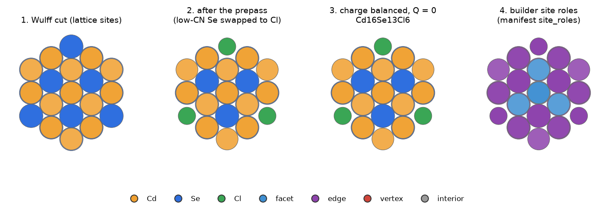
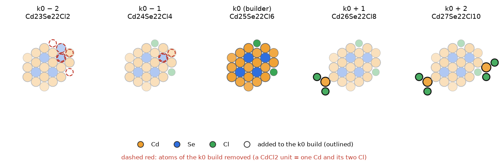
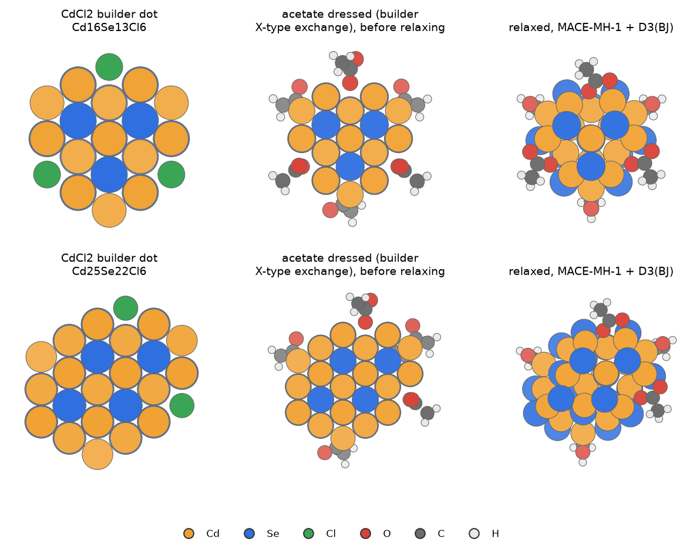

# Stage B: QD_builder structures

Ivan's rule: **build with the builder, then relax; never graft onto relaxed dots** ("The best model is always the one
that is built with the builder and then relaxed", 2026-10-28). Every structure of the network, including the
intermediates, islands, Cd shells and acetate dots, starts as a QD_builder output. The builder's native Cl stays where
the builder put it.

The builder used is `~/Documents/University/escience/QD_builder` (HEAD 6561a07), through the `qd_builder` conda
environment.

## 1. One build, step by step

```
nc-builder CdSe_zb.cif recipe.yaml -o out.xyz --positive-q-mode add -r <min h> --write-all --verbose
```

**The recipe.** The scan preset plus one facet entry per plane:

- preset: charges Cd +2, Se −2, Cl −1; Cl passivation; `surf_tol` 2.0 Å; role-aware prepass with minimum
  coordination 3/2/1 on terrace/edge/vertex; proper rotations only;
- **14 planes** ({100}×6, {111}A×4, {111}B×4), or 26 planes when {110} is needed;
- each plane's "gamma" is its distance in Å from a Se origin (`construction_origin: center_on_species: Se`):
  $h=(\text{lattice level}-n\cdot O)\,Q/|n|+0.3$ Å, with $Q=a/4$ and $a$ = 6.14054240 Å;
- a plane that cuts nothing is pushed to 60 Å.

Because every plane sits on a lattice level, a dot is fully described by its set of plane levels. Two dots of the same
family differ only in which planes moved out by one layer. **This is what makes the intermediates and islands of the
next pages possible.**

**The builder stages:**

1. **Wulff cut**: keep the lattice sites (Cd and Se) inside all planes (`out_cut.xyz`); prune atoms with one neighbour.
2. **Facet detection** on the cut.
3. **Prepass** (role aware): surface Se with too low coordination are swapped to Cl (they become X-type ligands);
   surface Cd with too low coordination are removed (`out_02_after_prepass.xyz`).
4. **Charge balance**, step by step: prune orphan ligands, then add or remove Cl until Q = 0 (`--positive-q-mode add`:
   more anions on a positive dot). Result `out.xyz`, plus the manifest `out.json`.

The k of a plain build is $k_0=N_\mathrm{Cd}-N_\mathrm{Se}=N_\mathrm{Cl}/2$.



[Rotate these structures in the 3D viewer](viewer.html#builder_stages) · files: `structures/builder_stages/`

*The seed Cd16Se13Cl6 through the builder stages, seen along a 3-fold axis. Panel 4 colours each atom by its builder
site role: facet, edge, vertex or interior.*

## 2. Site roles

The manifest's `site_roles` gives every core atom a role, `facet:<f>`, `edge:<f>|<g>`, `vertex:…` or `interior`. The
role comes from the atom's distance (tolerance 1.0 Å) to the faces of the atom-fitted polyhedron; ligand atoms inherit
the role of their host. Ivan's rule: use these roles on the as-built dot, carried by atom index, and never write a new
classifier. Facet areas use planes through the outermost lattice sites: Se, or swapped Cl, on anion sites and Cd on
cation sites, with adsorbed Cl excluded.

## 3. Cd shells: `post_treatment.z_type_target`

After the charge balance the dot holds $k_X=N_\mathrm{Cd}-N_\mathrm{Se}$ CdCl2 units.

- A target $k>k_X$ adds Z-type CdCl2 units (a Cd with 2 Cl) on free surface Se.
- A target $k<k_X$ displaces units (a surface Cd with its 2 Cl). A displacement that would orphan a ligand or split
  the dot is refused.
- The sequence is deterministic: the build for k contains the one for k ± 1.

The network uses shells only in the m 20–50 fill, at $k_0\pm1$ and $k_0\pm2$
([network](network.md) §5).



[Rotate these structures in the 3D viewer](viewer.html#cd_shells) · files: `structures/cd_shells/`

*A fill dot (registry 33, Cd25Se22Cl6) and its four shell variants, superposed on the k0 build. Outlined: CdCl2 units
added on free Se sites. Dashed red: units displaced.*

## 4. Ligand exchange: dressing with acetate

`qd_workflows.ligands.Dressing` calls QD_builder's `run_ligand_exchange_posttreatment` with one pass:
`{replace: Cl, charge: −1, smiles: CC(=O)O, ratio: 1.0, distribution: uniform}`, seed 7, MMFF.

- Every Cl is replaced, bridging and Z-type included, so a Z-type CdCl2 becomes Cd(OAc)2.
- The donor O sits on the old Cl site to within 1e-3 Å, and the atom order is fixed: each Cl becomes one molecule
  block.
- A `DressError` stops the dot if any Cl is left. P1 had 30 such failures, all in `_k+1`/`_k+2` shells; P2 had 1.
- Tested on 10 dots: no Cl left, Q = 0, at most 2.1 s each.

The acetate network does not rerun the builder. Ivan (2026-11-01): "you dont have to re-run the builder, but
postprocess simply the structures of the CdCl2 and apply the postprocess of the builder to add acetate."



[Rotate these structures in the 3D viewer](viewer.html#acetate_dressing) · files: `structures/acetate_dressing/`

*Two CdCl2 builder dots, the same dots dressed with acetate by the builder's X-type exchange, and after relaxation
with MACE-MH-1 + D3(BJ) (superposed on the dressed start). The acetates start monodentate on the old Cl sites and
settle on the surface during the relaxation.*

## 5. The Wulff scan and the lineage

The network's skeleton comes from a scan of Wulff dots:

- `QD_builder/runs/wulff_scan_cdse/scan.py` ran on LUMI (`job_scan5.sh`, 128 processes).
- It varied the ratios γ(111A)/γ(100) and γ(111B)/γ(100) over 24 values from 0.5 to 3.0, optionally added {110},
  set plane distances from 3 to 14 Å in 0.5 Å steps, and used four centres: Se, Cd and the two tetrahedral voids.
- 370,944 builds gave 348,815 valid dots, of which 470 are unique.
- **The lineage** (`data.json`, not in git) links the dots:
  - a parent is contained in a child on the Cd + Se lattice sites, under a Td operation plus a translation;
  - only direct edges are kept (transitive reduction);
  - 261 dots, m 13–680, 1,811 parent → child edges, generations 0–20.
- The lineage's seeds are dots with a zinc-blende core. Node 0 is Cd16Se13Cl6 = (13, 3), the grid's hand-over dot.
- Brothers are dots with the same Se framework that differ only in CdCl2.

The script that wrote the lineage block was not found; `lineage_dots.py` in the same folder is the closest.
