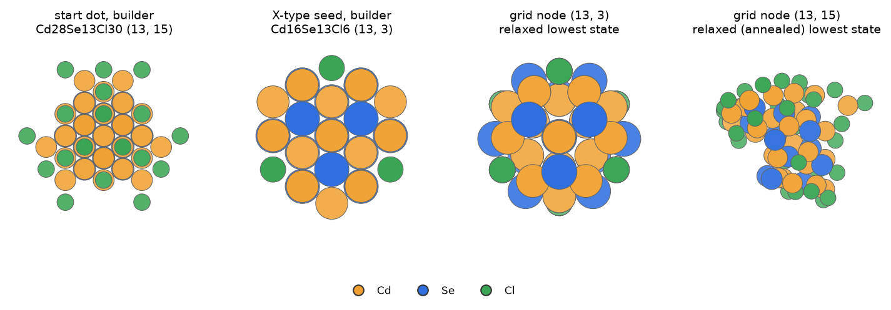
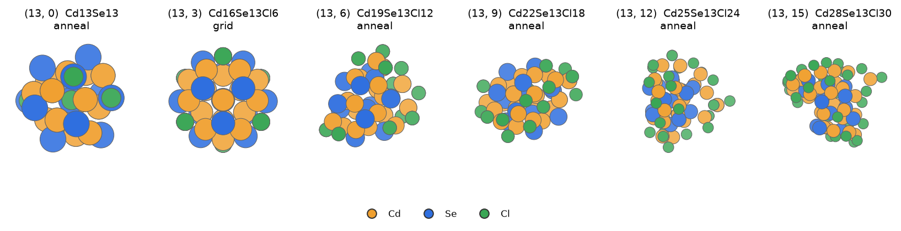
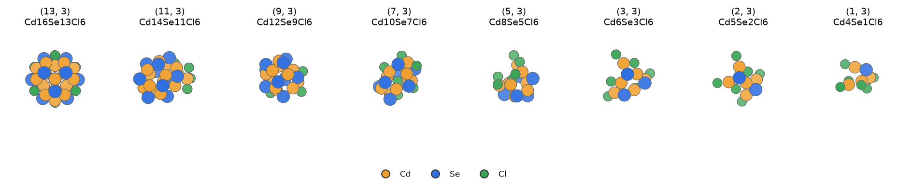

# Stage A: the nucleation grid (m ≤ 13)

Ivan's design (2026-10-23 to 10-25): start from the smallest Wulff dot that has discernible facets and detach CdSe
units backwards, down to m = 1. Use lattice moves with relaxed descent, then annealed MD at each (m, k). No "corpus"
structures. Keep it generic, so it applies to other systems.

## 1. The start dot and the two seeds

`python -m qd_workflows.nucleation start` (laptop, builder only) searches sizes 0.5–3.0 unit cells in steps of 0.125,
over every possible centre (each species and the CIF's empty interstitials). It keeps the smallest neutral dot whose
atom-fitted polyhedron:

- exposes every facet family of the recipe;
- has, on each family, at least 1 site of area and at least 3 core atoms on one plane;
- has at least 20 core atoms.

At the first size that has candidates, the one with the fewest anions wins. The recipe is QD_builder's II-VI default:
{100} cation rich, {111} cation rich and {−1−1−1} anion rich, all with γ = 1.0; Cl passivation; `surf_tol` 2.0 Å;
role-aware prepass; proper rotations only. Result: **Cd28Se13Cl30**, m = 13, at 1.125 unit cells, Se centred.

`nucleation seeds` then builds two seeds:

| seed | formula | (m, k) | how | used to ladder |
|---|---|---|---|---|
| `seed_full` | Cd28Se13Cl30 | (13, 15) | QD_builder `z_type_target` with a target no dot can reach: every free host site takes a CdCl2 | down in k |
| `seed_x` | Cd16Se13Cl6 | (13, 3) | `seed_full` with every Z-type unit stripped (a cation bonded to exactly one anion within 1.1 d_nn; 12 removed) | up in k |

**(13, 3) = Cd16Se13Cl6 is the first Wulff dot of the builder and the hand-over to growth** (Ivan, 2026-10-29: "You
have to trust me. m = 13, k = 3 is the first wulff constructed from the builder").

[Rotate these structures in the 3D viewer](viewer.html#grid_seeds) · files: `structures/grid_seeds/`

*The builder's start dot (13, 15) and X-type seed (13, 3), and the lowest relaxed state of the same two grid nodes
(CdCl2 grid `cdse_full2`). Cd orange, Se blue, Cl green.*

## 2. The lattice moves set the k range of each row

The k range is not chosen; it follows from QD_builder's own moves (`lattice_grid.py`):

| move | what is added or removed | rule |
|---|---|---|
| **+MX_q** | one Z-type unit: a Cd on a free virtual cation site above an under-coordinated surface Se (builder `z_type_ligand_host_sites`), with its 2 X on free anion sites | dropped if the remaining host sites could not all be filled afterwards (bipartite matching) |
| **−MX_q** | a surface Cd with 2 of its X | no X left without a Cd |
| **−MA** | a surface Se together with a bonded surface Cd (the builder's surface shell) | no Cd left without a Se; the bond graph stays in one piece (no isolated CdCl2) |

The search, row by row from m = 13 down:

1. **Ladder** each seed: +MX_q until no host site is left (this sets $k_\mathrm{max}(m)$), −MX_q down to k = 0.
2. **Descend**: every kept state of every node (m, k) loses one MA, for every allowed (Se, Cd) pair, the whole row in
   one batch. This gives the nodes (m − 1, k).
3. **Neighbour pass**: +MX_q from (m − 1, k − 1) and −MX_q from (m − 1, k + 1), from the best state only.
4. **Capacity**: each +MX_q and −MA step also keeps the product with the most free Z-type host sites, whatever its
   energy, and the row top is climbed again from 3 nodes below it. Without this, rows m ≤ 9 stopped 1–3 CdCl2 short.
5. **Relax** every candidate fully. A short screen was tried and dropped, because 20 steps lost 0.21 eV per ladder
   step. Each candidate starts from its parent's relaxed coordinates; added atoms go on their lattice sites, shifted by
   their host's displacement, or on the plain lattice if they land within 1.4 Å of another atom.
6. **Keep** per node the states within 0.05 eV of the best, at most 3 (beam), plus the best of every protected path
   (seed ladders, anneal, capacity).

For carboxylates every relaxation starts from the structure dressed by QD_builder's X-type exchange (donor O on the X
site, tail along the facet normal, seed 7, MMFF). +MX_q products are grown against the parent's relaxed shell, and a
removal deletes whole molecules.

| m | 1 | 2 | 3 | 4 | 5 | 6 | 7 | 8 | 9 | 10 | 11 | 12 | 13 |
|---|---|---|---|---|---|---|---|---|---|---|---|---|---|
| CdCl2 $k_\mathrm{max}$ | 3 | 4 | 6 | 9 | 9 | 11 | 11 | 12 | 15 | 15 | 15 | 15 | 15 |
| acetate $k_\mathrm{max}$ | 3 | 3 | 6 | 10 | 11 | 12 | 12 | 14 | 15 | 15 | 15 | 15 | 15 |

$k_\mathrm{min}$ = 0 in every row.

[Rotate these structures in the 3D viewer](viewer.html#grid_row13) · files: `structures/grid_row13/`

*The m = 13 row of the CdCl2 grid: the lowest relaxed state of each node with k = 0 … 15. "grid" marks a state from
the lattice search; "anneal" marks one that the row anneal (§3) found lower.*

[Rotate these structures in the 3D viewer](viewer.html#grid_descent) · files: `structures/grid_descent/`

*Removing CdSe units: the lowest state of the node nearest to k = 3 in rows m = 13 … 1 (same scale).*

## 3. The row anneal

After the top row and after every descended row, `row_anneal` looks for lower isomers.

- **Which nodes**:
  - every node with m ≤ `anneal_all_m`;
  - above that, the nodes within 0.15 eV of their row's lowest Ω for some T in 300–700 K and c in 1e-6–1 M (Ω here
    without vibrations);
  - always the seed nodes and $k_\mathrm{max}$.
- **Starts per node**: the best state, then the best of each other seed path, then other states, then the best again
  with new velocities.
- **MD**:
  - velocity Verlet with a CSVR thermostat (τ = 100 fs), Maxwell velocities at $T_\mathrm{hot}$, then a linear ramp
    down to 300 K;
  - 4 ps from 700 and 900 K; for m ≤ 6, 8 ps from 700, 900 and 1100 K;
  - time step 2 fs (acetate with H mass 4 amu);
  - a replica stops if a force exceeds 50 eV/Å or an atom moves 10 Å.
- **Quench**: a frame every 0.5 ps after the first 0.5 ps (8 frames per 4-ps replica). Each frame is relaxed, and
  polished if it lands within 0.3 eV of the best. Fragments are dropped (3.3 Å connectivity). A quench lower than the
  node's best by more than 1 meV joins the node, so the next row descends from it.

Ivan: the grid is annealed at 900 K on purpose, to find other structures; above m = 13 there is no such search,
because the dots are already crystals (2026-11-02).

| setting | CdCl2 `cdse_full2` | acetate (definitive pool) |
|---|---|---|
| anneal_all_m | 10 | 13 |
| anneal_starts | 2 | 3 |
| largest gain | 2.88 eV (m 6, k 11) | m = 13 row: 0.03–0.82 eV |

## 4. Hessians and thermo

Every kept state of an annealed node gets a Hessian ([theory](theory.md) §2). The merge adds solvation and writes
`thermo_merged.json`: states, frequencies, σ, S, references and the COSMO block.

- CdCl2 `cdse_full2`: 155 lattice nodes; thermo for 136 nodes and 170 states. 15 nodes of rows 11–13 were skipped
  because they were not annealed.
- Acetate `wd_full_acetate_pool`: 155 nodes, 242 states, none skipped.
- References:
  - CdCl2 grid: the campaign library monomers CdCl2 and CdSe.
  - Acetate grid: Cd(OAc)2 (the lowest of 4 conformers, rattled and re-relaxed, full Hessian), and the campaign CdSe
    monomer with D3 added at its geometry.

## 5. Nucleation: barrier, critical size, rate

With the pool's $\mu_\mathrm{MA}$, $\mu_\mathrm{MX}$ ([theory](theory.md) §6), each node gets
$\Omega(m,k)=G(m,k)-m\mu_\mathrm{MA}-k\mu_\mathrm{MX}$, and:

$$
k^*(m)=\arg\min_k\Omega(m,k),\qquad P(k\mid m)=\frac{e^{-\Omega(m,k)/k_BT}}{\sum_{k'}e^{-\Omega(m,k')/k_BT}},\qquad
\Omega(m)=-k_BT\ln\sum_ke^{-\Omega(m,k)/k_BT}
$$

$$
\Delta\Omega^*=\max\Big(0,\ \max_{m\le13}\Omega(m)-\Omega(1)\Big),\qquad m^*=\arg\max_{m\le13}\Omega(m)
$$

- $k^*(m)$ is the most stable shell at each size; $P(k\mid m)$ is the distribution of shells.
- $\Omega(1)=-k_BT\ln(C_M/c^\circ)$, because the m = 1 row is the pool itself.
- $\Delta\Omega^*$ is the nucleation barrier, and $m^*$ the critical size.

The nucleation simulator (`simulator.py`) follows these along the conversion and gives a steady-state Becker–Döring
flux through the grid:

$$
J=\left[\sum_{m=1}^{12}\frac{1}{f_m\,c_\mathrm{eq}(m)}\right]^{-1},\qquad c_\mathrm{eq}(m)=c^\circ e^{-\Omega(m)/k_BT},\qquad
f_m=4\pi(D_1+D_m)(r_1+r_m)N_AC_M
$$

The growth model does not use $J$. It puts the grid's nodes into the master equation, where nuclei form from two pool
packages and climb the grid by the same rules as every other step ([master equation](master-equation.md) §5).

## 6. The acetate grid: runs and pooling

All four runs were on LUMI standard-g, one node (8 GCDs), using
`python -m qd_workflows.nucleation run $WD --model $M --refs $WD/refs`:

| run | job | node-h | what |
|---|---|---|---|
| `wd_full_acetate` | 23214948 | 14.28 | anneal_all_m 10, 2 starts; 31 nodes of rows 11–13 left without anneal |
| `wd_full_acetate_all` | 23250269 | 3.23 | `complete_grid.py`: anneal every remaining node; lowered 36 of 48 nodes by up to 0.58 eV |
| `wd_full_acetate_a13` | 23261779 | 23.18 | full rerun with anneal_all_m 13 and 3 starts; per node ±0.7 eV against the completion, mean about 0 |
| `wd_full_acetate_pool` | 23271421 | 0.27 | `pool_grids.py`: each node keeps its lowest states over both runs, then Hessians and merge |

- Total 40.96 node-h ≈ 164 LUMI GPU-h. The pool takes 47 node minima from the completion and 102 from the rerun.
- **`wd_full_acetate_pool` is the definitive acetate grid.** Ivan, 2026-11-01: "Do not touch anymore the grid already
  built up to m = 13 because that was already very well done."
- Oleate grids were planned, with partial Hessians at an estimated 83–199 A100-h, but were not built. Since
  2026-11-01, carboxylate site energetics come from acetate only.

The CdCl2 grid `cdse_full2` ran on NHR gpu-a100, one A100 in 1-h self-restarting pieces: about 3.9 A100-h for the
grid and anneals, 0.25 A100-h for thermo. Its m = 1 complexes have their own COSMO, computed on this grid's
geometries.
