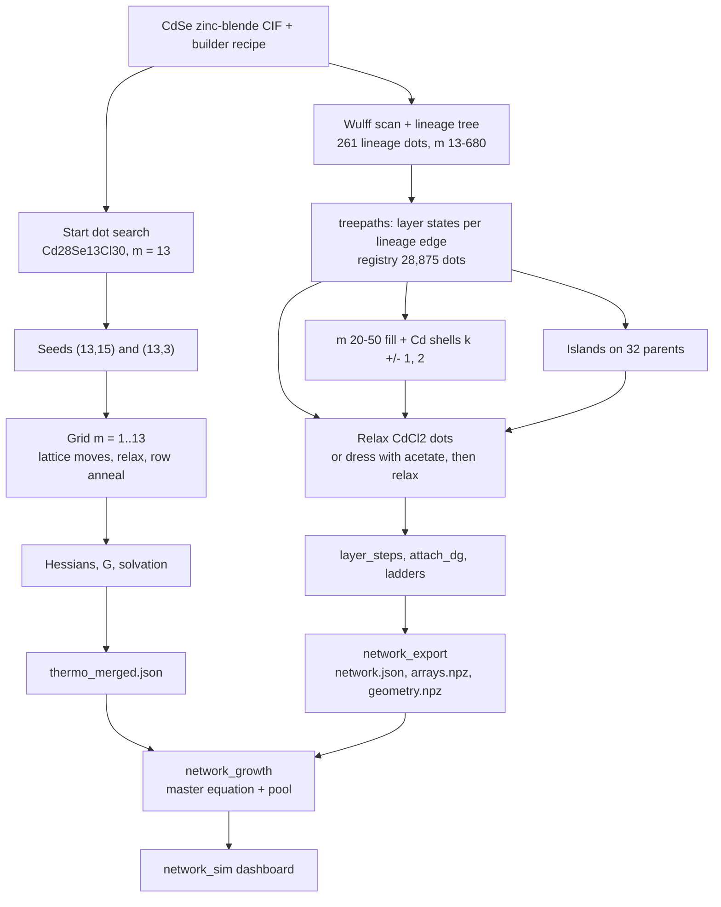

# CdSe nucleation and growth: overview

This section documents, end to end, how the CdSe nucleation and growth model was built for two ligands, CdCl2 and
acetate. It is written so that the same protocol can be repeated for another material (II-VI, III-V, IV-VI) and
another ligand. State on 2026-11-04.

The model has three parts:

1. **The nucleation grid.** Every composition $[\mathrm{CdSe}]_m(\mathrm{CdX_2})_k$ with $m = 1 \ldots 13$. It is
   built by removing CdSe units from the smallest Wulff dot, and annealed to find each composition's isomers.
2. **The layer-path network.** Wulff dots from QD_builder above $m = 13$, joined by the intermediates that add one
   facet layer at a time, plus island states that grow a layer on a facet one Cd at a time.
3. **The growth model.** Populations on every grid node and network state, fed by a precursor that converts into a
   CdSe pool. It is a master equation whose rates obey detailed balance with the computed free energies.

Every structure is built with QD_builder, then relaxed with MACE-MH-1. Every state gets a free energy in solution, and
at a given pool composition every state gets a grand potential $\Omega$. The set of all $\Omega$ is the **map**. The
growth model moves populations on that map, downhill and uphill.

## The structures in 3D

Every structure in the figures of this section can be opened and rotated:

- **[3D viewer](viewer.html)**: space-filling spheres (Cd orange, Se blue, ligands), preset views down each facet
  normal and from the side, the atoms a step adds in full colour over a faded reference, removed atoms in red, and the
  reference side by side.
- **Files**: `docs/protocols/cdse/structures/<set>/*.xyz`, one folder per figure, with a `README.md`. Each folder has a
  VMD script `<set>.tcl` that loads the whole set as VDW spheres with the same colours, outlines the added atoms and
  sets the camera along the facet of interest. In VMD (VMD 2 runs natively on Apple Silicon), open
  Extensions → Tk Console and run `cd <folder>` then `source <set>.tcl`; show one structure at a time with the D
  column of the molecule list. Any .xyz also opens in VESTA, Avogadro or OVITO.

## The pages

| page | what it covers |
|---|---|
| [Theory: free energies and the pool](theory.md) | level of theory, every term of a state's free energy, solvation, precursor conversion, the pool's chemical potentials, the grand potential |
| [Stage A: the nucleation grid](grid.md) | start dot, seeds, the lattice moves that set each row, the row anneal, Hessians, barrier and critical size, the acetate grid |
| [Stage B: QD_builder structures](builder.md) | one build step by step, site roles, Cd shells, the acetate exchange |
| [Stage C: the layer-path network](network.md) | lineage, parent and child, how every intermediate is generated, the registry, waves and fill, layer steps |
| [Stage C': islands](islands.md) | island states on {111}B, {111}A and {100}, ladder rungs, the island barrier |
| [Stages D–E: acetate network and export](acetate-export.md) | dressing, P0/P1/P2, learned F_vib, the exported files |
| [Stage F: the master equation](master-equation.md) | every term of the growth model, what each represents, how the map is read for growth and dissolution |
| [The dashboard](dashboard.md) | the network page and what each card shows |
| [Results and experiments](results.md) | the acetate and CdCl2 runs, phase by phase, against the literature |
| [Decisions](decisions.md) | Ivan's rules, with their reasons |
| [Generalised protocol and gaps](protocol.md) | step by step for a new material and ligand; current gaps |
| [Sources](sources.md) | where every piece of code, data and run lives |

## Notation

$$
[\mathrm{MA}]_m(\mathrm{MX}_q)_k,\qquad \mathrm{MA}=\mathrm{CdSe},\quad \mathrm{MX}_q=\mathrm{CdX_2}\ (q=2)
$$

- $m$ = number of Se (CdSe units); $k$ = number of CdX2 units $=N_\mathrm{Cd}-N_\mathrm{Se}=N_X/q$.
- X is Cl or acetate (OAc). For carboxylates the lattice bookkeeping keeps a Cl placeholder for every X.
- Charges Cd +2, Se −2, X −1; every structure is neutral (Q = 0).
- A **state** is one relaxed structure. A **node** or **composition** is an $(m, k)$ pair, which can hold several
  states (isomers).
- **Dots** are states with $m \ge 13$; **clusters** are states with $m < 13$.

!!! warning "Code that is not committed"
    Several stages ran from code that is not in any git branch:

    - the grid construction (`nucleation.py`, the seeded `lattice_grid.py`, `grid.py`): uncommitted in the
      `cdse-grid` worktree;
    - the carboxylate code (`ligands.py` and its `nucleation.py`): untracked, in the `cdse-carboxylate-plan` worktree
      and on LUMI `qdw/code`;
    - the layer-path scripts (`build2.py`, `treepaths.py`, `layer_steps.py`, `islands.py`, `stage*.py`, `ladders.py`,
      …) ran from session folders; they are now the module `qd_workflows.layer_path`
      (`python -m qd_workflows.layer_path <command>`), with the same keys and builder recipes.

    The figures of this section were made with the scripts in `docs/protocols/cdse/figure_scripts/`.
