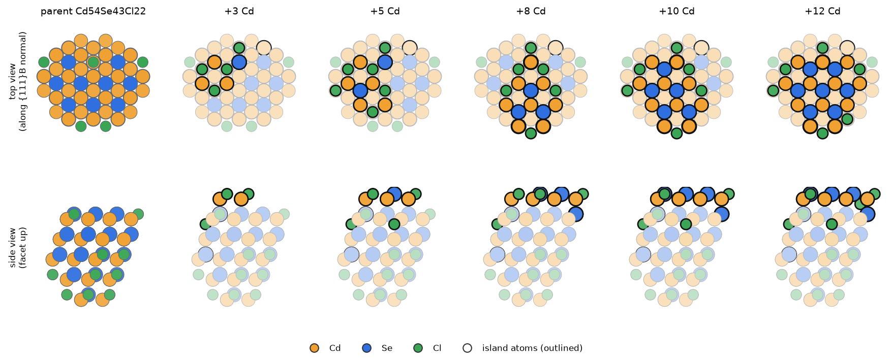
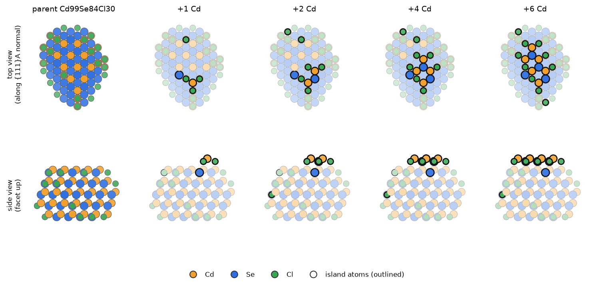
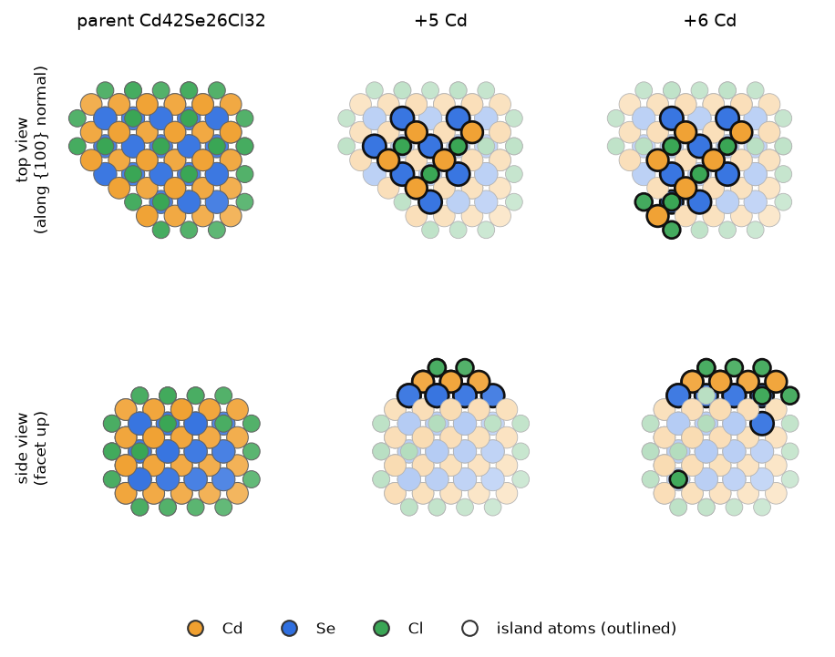

# Stage C′: islands and ladder rungs

A layer step in the registry adds a whole facet layer at once. On a real facet a new layer starts as a small island,
a few Cd and Se, and grows until the layer is complete. If the first atoms of an island are uphill, the layer has a
**2D nucleation barrier**, even when the full layer is downhill. Island states measure that barrier.

## 1. Builder islands

`python -m qd_workflows.layer_path islands net_dir parents.json outdir --cif CdSe_zb.cif` builds islands on chosen (parent, facet)
pairs:

1. Start from the parent's own recipe (its plane levels) and move one facet plane $n_0$ out by one spacing. On its own
   this would add the full layer.
2. Add **vicinal planes** that cut the new layer back to an island bounded by steps:
   - {100}: 4 planes of the {210} family, $v=2n_0\pm e_j$;
   - {111}: 3 planes of the {211} family, $v=n_0+n_{0,i}e_i$.

   A vicinal plane is never placed inside the parent's own cut.
3. Enumerate every combination of vicinal levels, then dedupe by lattice class.
4. Keep at most 2 states per number of new Cd sites s, for s ≤ 14 and for the full layer.
5. Build each with QD_builder (prepass and charge balance as usual).

The 32 (parent, facet) pairs are 12 {111}B, 12 {100} and 8 {111}A, on parents with m 9–150. All are parents of
ladders (§3). The rule that chose these 32 was not found.

[Rotate these structures in the 3D viewer](viewer.html#islands_111B) · files: `structures/islands_111B/`

*Islands on a {111}B facet of the dot Cd54Se43Cl22 (registry 1817, m = 43), from 3 to 12 new Cd (the full layer has
14). Top row: looking down the facet normal. Bottom row: from the side, facet up. The outlined atoms are the island;
the parent is faded. Each island arrives with its Se and Cl, so it is a charge-balanced piece of the next layer.*

[Rotate these structures in the 3D viewer](viewer.html#islands_111A) · files: `structures/islands_111A/`

*Islands on {111}A of Cd99Se84Cl30 (registry 6281, m = 84), from 1 to 6 new Cd (full layer 6). On {111}A the first Cd
atoms go in with Cl, and one Se of the old surface is swapped (Δ Se = −1 for 1–3 Cd).*

[Rotate these structures in the 3D viewer](viewer.html#islands_100) · files: `structures/islands_100/`

*Islands on {100} of Cd42Se26Cl32 (registry 3592): 5 and 6 new Cd on one {100} facet (full layer 9).*

## 2. The island index

`states_index.json` (written by `layer_path islands` and `layer_path stage-islands`) has one row per built island:

| field | meaning |
|---|---|
| `parent`, `family`, `n0` | registry id of the parent, facet family, the normal moved out |
| `s_sites` | new Cd lattice sites in the island cut, before the builder's prepass |
| `vicinal`, `levels` | the vicinal normals and their levels |
| `full_layer_Cd` | new Cd of the complete next layer |
| `tag` | `p<parent>_<family>_<n0 signs>_s<s>_<levels>`, also the build folder |
| `formula`, `Q`, `key` | the built dot; Q ≠ 0 rows are dropped |
| `dSe`, `dCd`, `dCl`, `pure` | the island against its parent; `pure` = the parent's lattice embeds in the island |
| `in_registry`, `dup_of` | the island is already a registry dot, or the same dot as another island |
| `status`, `name` | CdCl2 staging (todo, relaxed, dup, parent, missing); `i####` for the 450 staged ones |

Counts:

- 1,090 rows: {111}B 526, {100} 333, {111}A 231.
- 643 unique island states: {111}B 321, {111}A 230, {100} 92.
- **CdCl2**: 450 islands (status todo, pure, 1–10 new Cd), named i0000–i0449 by atom count ({111}A 208, {111}B 157,
  {100} 85), relaxed on LUMI.
- **Acetate**: 679 island inputs in P1 and P2; 448 named island states used by the export. 110 unique islands have no
  acetate input ({111}B 99, {100} 7, {111}A 4).
- **No islands exist on parents above m = 150.**

The builds are kept in `network_growth_data/island_builds_cdcl2/`.

## 3. Ladder rungs already in the registry

The registry steps contain partial layers too. A **ladder** is a set of one-sheet pure steps from the same parent, along
the same facet, with different sheet sizes (`layer_path ladders`):

- per (parent, facet, sheet size), keep the step with the lowest ΔG;
- a ladder is a (parent, facet) pair with at least 3 sizes;
- counts: CdCl2 2,891 ladders ({111}B 1,398, {100} 1,414, {111}A 74, {110} 5); acetate P1 1,032.

`layer_path ladders` also prints a per-facet regression $\Delta G\approx g_m\Delta m+g_k\Delta k+\epsilon\,P$ (P = perimeter
Cd) as a diagnostic. The growth model does not use it.

## 4. From islands to the barrier of a layer step

In the growth model ([master equation](master-equation.md) §4) the islands and rungs of a (parent, facet) pair form
one curve. Each point is the island's grand potential relative to its parent, taking the best shell at each added
CdSe:

$$
\Omega^*_{p,f}(\Delta m)=\min_{\text{islands with }\Delta m}\left[G_\mathrm{isl}-G_p-\Delta m\,\mu_\mathrm{MA}-\Delta k\,\mu_\mathrm{MX}\right]
$$

The **barrier** $B$ is the highest point of the curve before it first drops below the parent (or the highest point
if it never does). A layer step of that parent on that facet must climb $B$ on top of its own free energy.

- Layer steps of other parents use the median curve of their facet and parent-size bin.
- {110} has no islands, so it uses the median over all curves.
- The export carries 30 such curves (576 island rows) for the acetate network.
- A median predicts one parent's barrier to about 0.8–1.1 eV (leave-one-out).

The same curves at the three reference pools, outside the growth model, come from `layer_path island-barriers`
(islands and rungs per added Cd, against the classical fit of `layer_path ladder-fit`) and `layer_path island-cdse`
(per added CdSe with the shell equilibrated, as above).
