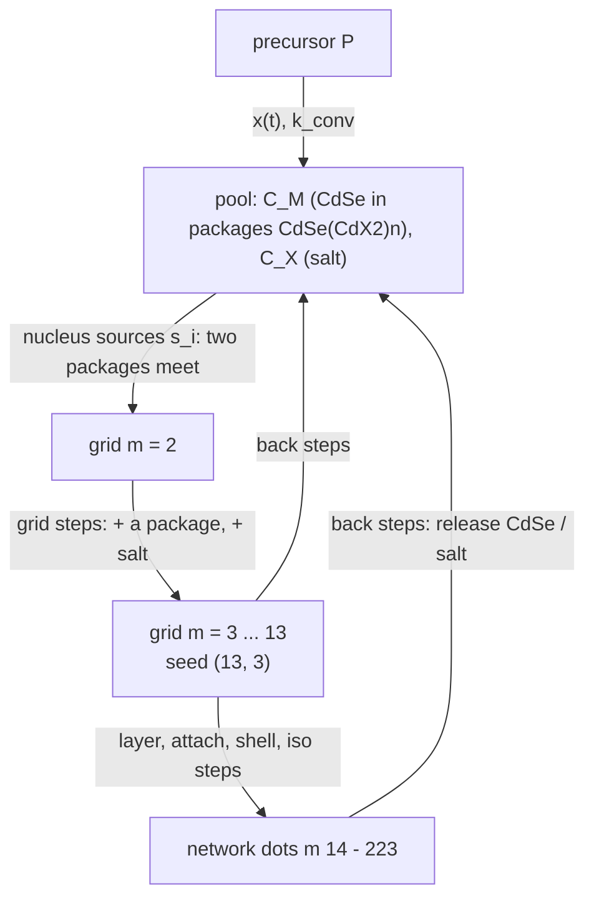
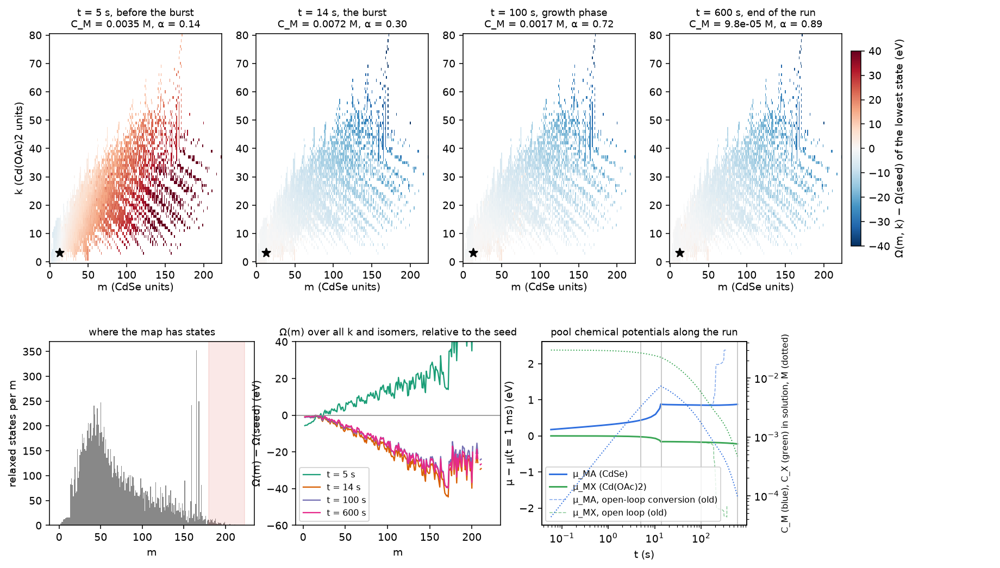
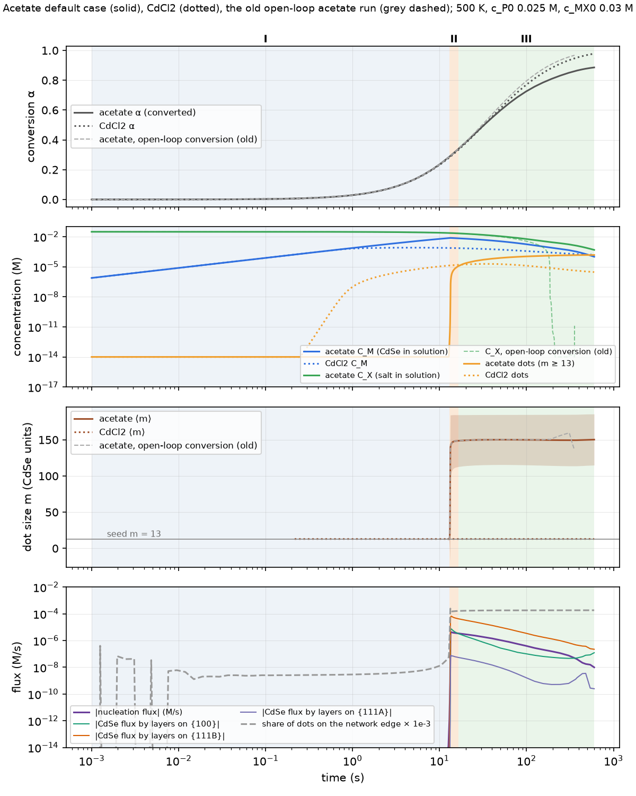

# Stage F: the master equation

Code: `network_growth.py` on branch `claude/fervent-greider-938b1f`, the single growth branch (Ivan, 2026-11-03). The
short theory page is [Network growth model](../../theory/network-growth.md). This page goes term by term.

## 1. What is solved

The model follows, in time, how many of each structure exist in solution:

- $N_i(t)$ (mol/L): the population of every state $i$, meaning every grid node with $m\ge2$ and every relaxed network
  state;
- $C_M(t)$, $C_X(t)$: the CdSe and the salt in solution (the pool, [theory](theory.md) §6);
- $x(t)$: the CdSe made so far by the precursor ([theory](theory.md) §5), converting on the salt left in solution.

**The states.** The grid's nodes with m ≥ 2 come first (m = 1 is the pool itself), then the network's relaxed states.
A network state with m ≤ 13 whose (m, k) is a grid node **is** that grid node: it takes the node's Boltzmann-summed
G, and its steps are re-pointed. So the network's seed is the grid node (13, 3), and one equation runs from the pool
through the grid into the dots. Dots are the states with m ≥ 13.

## 2. The equation, term by term

$$
\underbrace{\frac{dN_i}{dt}}_{\text{change of state }i}=\sum_{j}\underbrace{k_{j\to i}N_j}_{\text{arrivals from }j}-\sum_j\underbrace{k_{i\to j}N_i}_{\text{departures to }j}+\underbrace{s_i}_{\text{new nuclei}}
$$

| term | represents | computed from |
|---|---|---|
| $k_{j\to i}N_j$ | states $j$ that become $i$ per second: a CdSe, salt unit or island atom arrives (j smaller) or leaves (j larger), or an isomerisation | the rate of the step $j\to i$ (§3) and the current population of $j$ |
| $k_{i\to j}N_i$ | states $i$ that become something else | the same, for every step touching $i$ |
| $s_i$ | nuclei formed from two pool packages (only m = 2 nodes) | §5 |

Every step $a\to b$ has a forward and a backward rate, and its **net flux** is

$$
J_{ab}=k_{a\to b}N_a-k_{b\to a}N_b\qquad(\text{M/s}).
$$

A positive $J_{ab}$ means states grow from a to b; a negative one means b shrinks back to a. Growth and dissolution are
the same steps with the sign of $J$ reversed.

### 2.1 The step kinds

| kind | what happens | Δm, Δk | arriving species $s$ and its concentration $c_s$ | sites $n_\mathrm{sites}$ |
|---|---|---|---|---|
| **layer** | a facet layer (or the first sheet of one) is added on one facet family | Δm > 0 | one CdSe from the pool: $c_s=C_M$ | the new sheet's Cd count |
| **attach** | any other CdSe-adding step between relaxed states | Δm > 0 | one CdSe: $c_s=C_M$ | the parent's surface $S_a/a_\mathrm{site}$ |
| **shell** | a salt unit binds to or leaves the surface | Δm = 0, Δk ≠ 0 | free salt: $c_s=c_\mathrm{MX,free}$ | $S_a/a_\mathrm{site}$ |
| **iso** | the state rearranges into another isomer | 0, 0 | none ($w_s=0$) | – |
| **grid** | in the grid: + a package CdSe(CdX2)ₙ, or + salt | (+1, +n), (0, +1) | the package n: $c_s=C_Mx_n$; or free salt | $S_a/a_\mathrm{site}$ |
| **nucleus** | two packages form an m = 2 cluster | – | §5 | 1 |

All packages react through the same step, with the total $C_M$ as the CdSe concentration (Ivan's rule: the reactivity
is that of bare CdSe, the packages enter only through $\mu_\mathrm{MA}$). A layer or attach step that also changes k
counts the salt in Ω and in the pool balance, not in $w_s$ or ν.

## 3. The rate of one step

### 3.1 One top per step

$$
\Omega^\ddagger_{ab}=\max\left(\Omega_b,\ \Omega_a+w_s+B_{ab}\right),\qquad w_s=-k_BT\ln\frac{c_s}{c^\circ}
$$

$$
k_{a\to b}=\nu_{ab}\,e^{-(\Omega^\ddagger_{ab}-\Omega_a)/k_BT},\qquad k_{b\to a}=\nu_{ab}\,e^{-(\Omega^\ddagger_{ab}-\Omega_b)/k_BT}
$$

| symbol | represents |
|---|---|
| $\Omega_a$, $\Omega_b$ | grand potentials of the two states at the current pool ([theory](theory.md) §7) |
| $w_s$ | the free-energy cost of taking one arriving unit out of solution at concentration $c_s$: the entropy of finding it. Dilute solution means a large $w_s$ |
| $\Omega_a+w_s$ | the "encounter" state: a, with the unit already picked out of solution |
| $B_{ab}$ | the island barrier of a layer step (§4); 0 for every other step |
| $\nu_{ab}$ | the attempt rate at $c^\circ$ = 1 M (§3.3) |

### 3.2 What the formula does

**Downhill step** ($\Omega_b\le\Omega_a+w_s+B$):

$$
k_{a\to b}=\nu_{ab}\,\frac{c_s}{c^\circ}\,e^{-B_{ab}/k_BT},\qquad
k_{b\to a}=\nu_{ab}\,e^{-(\Omega_a+w_s+B_{ab}-\Omega_b)/k_BT}
$$

Growth is limited by how often the unit arrives (first order in $c_s$) and by the island barrier. Release is slower by
how far downhill the step is.

**Uphill step** ($\Omega_b>\Omega_a+w_s+B$):

$$
k_{a\to b}=\nu_{ab}\,e^{-(\Omega_b-\Omega_a)/k_BT},\qquad k_{b\to a}=\nu_{ab}
$$

The reverse, release, runs at the attempt rate, and the forward is slowed by the free energy of the step.

**Either way**, the ratio $k_{a\to b}/k_{b\to a}=e^{-(\Omega_b-\Omega_a)/k_BT}$ does not depend on the top. At a fixed
pool, the populations therefore relax to $N_i=c^\circ e^{-\Omega_i/k_BT}$, which is **detailed balance**. The code
checks it (`network_growth check`, residual 1e-13). The island barrier $B$ slows a step in both directions but never
changes where it ends.

### 3.3 The attempt rate ν

$$
\nu_{ab}=s_\nu\left[\frac{1}{k_\mathrm{coll}}+\frac{1}{k_D}\right]^{-1},\qquad
k_\mathrm{coll}=n_\mathrm{sites}\,a_\mathrm{site}\,N_A\sqrt{\frac{k_BT}{2\pi M_s}},\qquad
k_D=4\pi(D_a+D_s)(R_a+R_s)N_A
$$

$$
D=\frac{k_BT}{6\pi\eta R},\qquad R=\sqrt{S/4\pi}
$$

| term | represents | computed from |
|---|---|---|
| $k_\mathrm{coll}$ | how often units hit the reactive area if transport were free: the kinetic-theory flux through $n_\mathrm{sites}$ sites of area $a_\mathrm{site}$ | $a_\mathrm{site}$ = 15 Ų; $M_s$ = mass of the arriving unit (CdSe package, or Cd + 2X with X = Cl or acetate 59.04 from the seed structure) |
| $k_D$ | the Smoluchowski diffusion limit: how often they reach the dot at all | Stokes–Einstein $D$ at viscosity η = 0.5 mPa s (octadecene near 500 K); radii from the vdW surfaces of the state and of the unit (COSMO surface for free species) |
| series sum | the slower of the two controls, as $\delta/D+1/k_\mathrm{eff}$ did in the old size law | – |
| $s_\nu$ | one kinetic scale on all prefactors, for tuning to experiment (default 1) | set by hand |
| isomerisation | $\nu=k_BT/h$ ≈ 1e13 s⁻¹ at 500 K | – |

No NEB rate, k_f, β, γ or coverage isotherm enters: everything comes from the relaxed map.

## 4. The island barrier

For each (parent p, facet f) pair with islands and ladder rungs ([islands](islands.md)):

$$
\Omega^*_{p,f}(\Delta m)=\min_{\text{islands with }\Delta m}\left[G_\mathrm{isl}-G_p-\Delta m\,\mu_\mathrm{MA}-\Delta k\,\mu_\mathrm{MX}\right]
$$

This is the island's grand potential relative to its parent, taking the best shell at each added CdSe. $B_{p,f}$ is the
highest point of this curve before it first drops below the parent (or its highest point if it never does), and never
below 0.

Which curve a layer step uses:

1. its parent's own curve;
2. otherwise, the median curve of its facet and parent-size bin (m < 30, 30–60, 60–100, 100–150, ≥ 150);
3. otherwise, the median curve of its facet;
4. otherwise, the median of all curves ({110} has none).

$B$ is recomputed at every pool, because it depends on $\mu_\mathrm{MA}$ and $\mu_\mathrm{MX}$: at high supersaturation
the curve tilts down and the barrier shrinks. The dashboard can switch barriers off ("attachment-limited growth").

## 5. Nuclei

There is no separate nucleation rate. For every pair of packages $n_1\le n_2$ whose sum is a grid node
$j=(2,n_1+n_2)$:

$$
\Omega^\ddagger=\max(\Omega_{1,n_1}+w_{n_2},\ \Omega_j),\qquad
s_f=\sigma\,\nu_\mathrm{src}\,c_{n_1}e^{-(\Omega^\ddagger-\Omega_{1,n_1})/k_BT},\qquad
s_r=\sigma\,\nu_\mathrm{src}\,e^{-(\Omega^\ddagger-\Omega_j)/k_BT}
$$

- The source into $j$ is $s_f-s_rN_j$: pairs form, and m = 2 clusters fall apart again.
- $c_n=C_Mx_n$, and $\sigma=\tfrac12$ for identical partners.
- $\nu_\mathrm{src}$ is the collision–diffusion rate with one site.
- Acetate has 6 such sources and CdCl2 has 8.

From m = 2 the clusters climb the grid by grid steps, and the barrier $\Delta\Omega^*$ of [the grid](grid.md) §5
emerges by itself.

## 6. The pool: closing the mass balance

Every CdSe and salt unit is either in solution or in a state:

$$
C_M=x(t)-\sum_im_iN_i,\qquad C_X=c_\mathrm{MX,0}-x(t)-\sum_ik_iN_i
$$

| term | represents |
|---|---|
| $x(t)$ | CdSe made by the precursor so far, $dx/dt=k_\mathrm{conv}(c_\mathrm{P,0}-x)\,C_X$; it also removes one salt per CdSe |
| $\sum_im_iN_i$ | CdSe held in clusters and dots |
| $\sum_ik_iN_i$ | salt held in their shells |

$C_M$ and $C_X$ fix $\mu_\mathrm{MA}$, $\mu_\mathrm{MX}$ and the package shares $x_n$ ([theory](theory.md) §6). These in
turn fix every Ω and every rate, so the pool couples all states.

$x$ is solved inside each implicit step with the populations, the held salt taken at the step's end (closed form while
nothing holds salt). In the code the held amounts are carried forward with the step fluxes, held(t + Δt) = held(t) + Δt Σ (Δm, Δk) J, not
recomputed as Σ m N. The isomerisations' ~1e13 s⁻¹ terms otherwise left round-off above the tolerance.

## 7. Solving it

- **Backward Euler**: $(I-\Delta t\,M(u))N^{n+1}=N^n+\Delta t\,s(u)$ for the populations, with the pool
  $u=(\ln C_M,\ln C_X)$ solved by Newton (tolerance 1e-8, steps ≤ 0.2 in ln C, backtracking). The Jacobian goes
  through the same LU.
- **Sparse LU**: MUMPS (METIS ordering, analysis once per run, min(4, cores) threads), with SuperLU as fallback.
  The acetate network to 20 s took 407 s before and 46–69 s after.
- **Time step**: Δt shrinks when ln C, ln(number of dots) or ⟨m⟩ moves too much. ⟨m⟩ moves at most 1 CdSe per step
  once the dots hold 1e-12 of the CdSe (this resolves the nucleation burst). Extra outputs are written where the run
  moves fast.
- **Stops**, each with the outputs so far and a reason:
  - the page's Stop;
  - `max_wall_s` (1800 s);
  - 400 step attempts without reaching the next output;
  - the pool not converging;
  - the **network edge**: once the dots hold 1 % of the CdSe, more than half of them (`frontier_stop` 0.5) sit on
    states without a growth step.

| default | value | default | value |
|---|---|---|---|
| T | 500 K | $s_\nu$ | 1 |
| ε | 2 | η | 0.5 mPa s |
| $c_\mathrm{P,0}$ | 0.025 M | $a_\mathrm{site}$ | 15 Ų |
| $c_\mathrm{MX,0}$ | 0.03 M | islands | on |
| $k_\mathrm{conv}$(500 K) | 1 M⁻¹ s⁻¹ | $t_\mathrm{end}$ | 600 s |
| $E_a$ | 0 eV | frontier_stop | 0.5 |

## 8. Reading the map: growth and dissolution

### 8.1 Net flux in terms of the map

Write each population relative to its equilibrium value at the current pool,
$\phi_i=N_i/\big(c^\circ e^{-\Omega_i/k_BT}\big)$. With detailed balance, the net flux of a step becomes

$$
J_{ab}=k_{a\to b}\,c^\circ e^{-\Omega_a/k_BT}\,\big(\phi_a-\phi_b\big).
$$

**Material flows from the state that is over-populated, relative to the map, to the one that is under-populated.** The
map (all Ω at the current pool) says where equilibrium is. The populations say how far from it the system is. The
prefactor $k_{a\to b}e^{-\Omega_a/k_BT}$ is large only on low-Ω paths, so the flux goes through the valleys of the map.

- **Growth** is a step with $J_{ab}>0$ towards larger m: the small state holds more than its share ($\phi_a>\phi_b$).
- **Dissolution** is the same step with $J_{ab}<0$: the large state holds more than its share and returns material to
  smaller states and to the pool.

Both happen at once in a run, on different parts of the map.

### 8.2 The map at four moments of the acetate run

*Top: Ω of the lowest state of each composition (m, k), relative to the seed (13, 3), at the pool of the acetate
default run at 5, 14, 100 and 600 s. Blue lies downhill of the seed, red uphill. Bottom: the number of relaxed states
per m (where the map exists); Ω(m) summed over k and isomers; the pool's chemical potentials along the run (solid; the
old open-loop run dashed) and the CdSe and salt left in solution (dotted).*

*The same run against time (solid), with CdCl2 (dotted) and the old open-loop acetate run (grey dashed). Phases: I pool
builds, II burst, III nucleation-limited growth to the end of the run.*

**I. Before the burst (0–13 s).**

- The precursor fills the pool: $C_M$ rises to 7 mM and $\mu_\mathrm{MA}$ rises with it.
- The map is red beyond the seed: every state larger than the clusters is uphill, and Ω(m) climbs with m.
- Clusters up to m = 13 are fast and follow the pool ($\phi\approx1$); the dots' $\phi\approx0$.
- The flux to large m has to pass the highest point of Ω(m) on the way, the nucleation barrier, so it is tiny.

**II. The burst (13–16 s).**

- As $\mu_\mathrm{MA}$ rises, the $-m\mu_\mathrm{MA}$ term tilts the whole map: Ω(m) turns downhill from the seed onward
  and the barrier disappears.
- The seed is now over-populated ($\phi_\mathrm{seed}\gg\phi_\mathrm{dots}$), and every layer path carries flux towards
  large m.
- New nuclei do not stop at intermediate sizes. They slide down to where Ω(m) is lowest, about m ≈ 170, which is
  where the relaxed states thin out (bottom-left panel).
- Within 3 s the dots reach ⟨m⟩ ≈ 150 ± 35.

**III. Nucleation-limited growth (16–600 s).**

- The map stays tilted towards large m (the 100 s and 600 s maps are almost the same), so every dot sits near the
  bottom of the landscape, at the map's edge.
- About 18 % of the dots are on states with no growth step out. The edge share stays below 0.5, so the frontier stop
  does not fire.
- The pool falls as new nuclei form and slide to the edge, so the number of dots rises from 1e-5 to 1.5e-4 M while
  ⟨m⟩ stays at 150 ± 35. At 600 s, α = 0.89, $C_M$ = 1e-4 M and $C_X$ = 5e-4 M.
- **Growth of existing dots is limited by the map running out of states, not by kinetics.**
- The chemical potentials barely move after the burst: $\mu_\mathrm{MA}$ stays within −5.90 … −5.93 eV, because the
  dots, not the pool, set it.

**The old open-loop run.** Before the conversion was made salt-limited (commit 5af3e3f), $x(t)$ kept making CdSe after
the dots' shells had taken the salt. At about 200 s the salt in solution fell to 1e-16 M, $\mu_\mathrm{MX}$ dropped by
about 2 eV and $\mu_\mathrm{MA}$ rose by about 1 eV. That produced a second burst of small dots at about 356 s and a
solver stall (dashed lines in the figures). This was an artefact of the conversion, not a prediction.

### 8.3 Following material on the dashboard

The dashboard ([dashboard](dashboard.md)) shows this directly:

- **Map card**: the colour is Ω(m, k) at the pool of the chosen time; circles are the populations; lines are the steps
  with the most net flux. Blue regions ahead of the populations show where the dots will go; populated red regions
  show what will dissolve.
- **Growth path** (growth movie): from the nuclei to a chosen state, the chain of steps whose smallest integrated net
  transfer is largest (a widest-path search over $\int J\,dt$). It shows the route the material actually took.
- **Dissolution path**: from a dot that loses more CdSe to smaller states than it gains, the chain of steps with net
  flux towards smaller states, back to the pool when a nucleus flux reaches it.
- **Profile card**: Ω(m) from the pool (m = 1) through the grid to the dots, together with the run's $-k_BT\ln N(m)$.
  Where the two curves coincide the sizes are in equilibrium with the pool ($\phi=1$). Where the population curve lies
  above, the sizes are under-populated and will fill; where it lies below, they are over-populated and will shrink.

## 9. Outputs of a run

| output | meaning |
|---|---|
| `t`, `alpha` | output times; conversion |
| `c_MA`, `c_X_left`, `c_MX_free`, `mu_MA`, `mu_MX` | the pool |
| `n_dots`, `n_clusters` | total dots (m ≥ 13) and clusters (m < 13), M |
| `m_mean`, `m_std` | mean and spread of the dot size |
| `nucleation` | net flux from m < 13 to m ≥ 13 (M/s) |
| `frontier` | share of dots on states without a growth step |
| `layer_flux[f]`, `cdse_flux[f]` | layer-step flux and CdSe added per facet family |
| `attach_flux` | CdSe added by attach steps |
| `barriers` | the island-barrier table in use |
| `N` | all populations per output (kept by the page, not written by the CLI) |
| `stopped` | the reason a run ended early |
