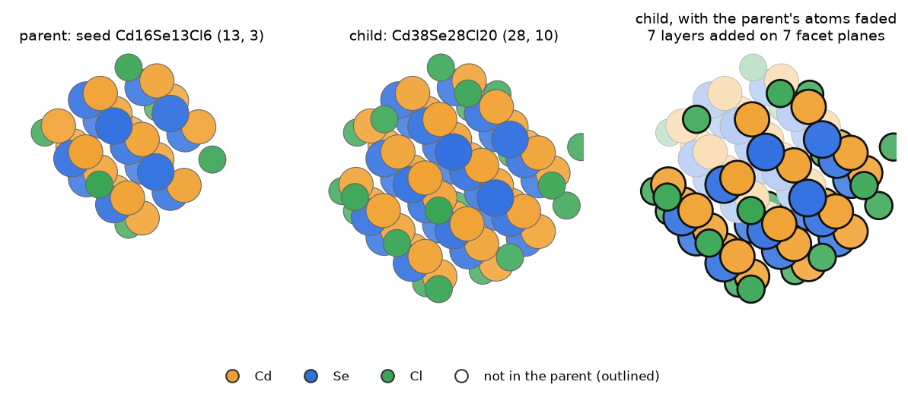
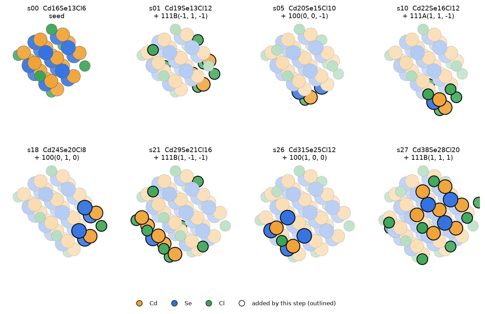

# Stage C: the layer-path network (m > 13)

## 1. Why a network

The first growth model was a continuous size law: per facet, diffusion in series with an effective surface rate.

$$
\frac{dm}{dt}=N_A\sum_fA_f(m)\frac{c^*_{M}-C_\mathrm{eq}\,e^{\Delta\mu_f/k_BT}}{\delta_f/D+1/k^{(f)}_\mathrm{eff}},\qquad
k^{(f)}_\mathrm{eff}=\frac{k_\mathrm{dir}+k_\mathrm{disp}K_{X,\mathrm{edge}}c_X}{1+K_{X,\mathrm{eff}}c_X}
$$

Its inputs were:

- Δμ per builder role;
- binding constants K_X from separately computed site states;
- k_dir and k_disp from NEBs with the bare CdSe monomer.

This model, on branch `feat/growth-unified`, needed parameters that were never computed, and it stalled numerically
after the first dots. On 2026-10-31 Ivan chose a new model built only from relaxed structures: "a completely new
growth model without relying on what the previous data gave. Only on the new map data."

In the network every size between the seed and the largest dot is a set of relaxed states. The steps between them add
one layer on one facet, one island atom, or one shell unit. Growth then means walking this map ([master
equation](master-equation.md)).

## 2. Parent and child: one lineage edge

Two Wulff dots of the lineage are a parent and a child when the parent's lattice sites fit inside the child's. Going
from parent to child moves some facet planes out by one or more layers.

The first case built (2026-10-30) is the seed Cd16Se13Cl6 = (13, 3) → Cd38Se28Cl20 = (28, 10). It takes **7
single-plane moves**:

| family | planes moved out by one layer |
|---|---|
| {100} | (1 0 0), (0 1 0), (0 0 −1) |
| {111}A | (1 1 −1) |
| {111}B | (1 1 1), (1 −1 −1), (−1 1 −1) |

[Rotate these structures in the 3D viewer](viewer.html#layer_states) · files: `structures/layer_states/`

*The lineage edge seed → Cd38Se28Cl20. Right: the child with the atoms it shares with its parent faded; the outlined
atoms are the seven layers added.*

## 3. How the intermediates are generated

Each of the 7 planes can be at its parent level or one layer out, so the edge has $2^7=128$ **layer states**. Each is a
lattice cut defined by its plane levels:

1. **Enumerate** every level vector (each plane 0 … L layers).
2. **Cut** the lattice with those planes. This gives a set of Cd and anion lattice sites.
3. **Canonicalise**: the class key is that site set, put in canonical form under the 24 proper rotations of the cubic
   (Td) group plus translations. Equivalent states collapse: the 128 states of this edge give **28 classes**.
4. **Build** each class with QD_builder from its plane levels ([builder](builder.md) §1). The prepass and charge
   balance turn the lattice cut into a real, neutral dot: low-coordination surface Se become Cl, and Cl is added or
   removed until Q = 0. A layer step therefore changes k as well as m.
5. **Connect**: two classes whose level vectors differ by +1 layer in one plane are joined by a step.

[Rotate these structures in the 3D viewer](viewer.html#layer_path) · files: `structures/layer_path/`

*One path from the seed to the child through 7 of the 28 intermediates, one plane per step. In each panel the atoms
added by that step are outlined and the rest is faded.*

- A {111}B layer first adds a sheet of Cd with Cl (s01: k 3 → 6, m unchanged).
- A {100} layer adds Cd and Se together (s05).
- A {111}A layer here adds Cd, Se and Cl (s10).

The builder decides which surface Se become Cl and where the extra Cl goes, so one move can shift both m and k.

## 4. From all lineage edges to the registry

`python -m qd_workflows.layer_path treepaths data.json net_dir --mmax MMAX --smax SMAX --cif CdSe_zb.cif` repeats §3 for every
lineage edge:

1. **Size the edge** (`layer_path size-edges`, `edges_size.json`).
   - Embed the parent's lattice sites in the child (Td operation + translation).
   - Count the layers per plane: $L=(d_\mathrm{child}-d_\mathrm{parent})/\mathrm{spacing}$, with spacings (in n·r units of
     a/4) of 2 for {100}, 4 for {111} (a double layer) and 2 for {110}.
   - The edge has $\prod(L+1)$ states.
2. **Enumerate and canonicalise** the states of every edge whose child has m ≤ MMAX and whose state count is ≤ SMAX.
   If the path's end does not reproduce the child with the 14 planes, retry with 26 (adding {110}).
3. **Build** each new class (`net/builds/c######`). Its dot key covers every atom, including off-lattice Z-type Cl,
   on an a/16 grid and in canonical form. A new key gets a registry id. Two classes can give the same dot after the
   prepass.
4. **Write** `net/registry.json` and one edge file per lineage edge (`net/edges/{p}_{c}.json`, with the dot-level
   steps).

The registry has these parts:

- `classes` (class key → id);
- `class_dot` (class → dot);
- `dots` (dot key → {id, formula, se, dir});
- `lineage`.

`se` is the Se framework alone, so dots that share it are "brothers" differing only in CdCl2.

Of 594 edge files, 393 were built (345 with 14 planes, 48 with 26). 201 failed: 123 had too many states, 43 had a
child plane inside the parent, and 35 had no embedding. The built ones hold 44,091 classes and 149,074 dot-level
steps.

## 5. Waves and the m 20–50 fill

The registry grew in four `treepaths` runs with increasing MMAX, plus a fill:

| wave | MMAX, SMAX | registry ids | dots | m (min/median/max) | CdCl2 relaxed | acetate relaxed |
|---|---|---|---|---|---|---|
| (earlier) | – | within 0–5,982 | 373 | – | yes | yes |
| 1 | 100, 20,000 | 0–5,982 | 5,610 | 7/49/104 | all | all |
| 2 | 140, 10,000 | 5,983–10,230 | 4,248 | 23/94/188 | all | all |
| 3 | 200, 5,000 | 10,231–14,806 | 4,575 | 8/134/223 | all | all |
| 4 | 300, 5,000 | 14,807–26,117 | 11,311 | 79/211/405 | 1,231, never collected | none |
| m 20–50 fill | – | 26,118–28,874 | 2,757 | 14/34/63 | all | 2,726 |

- Wave 4 was cancelled on 2026-10-31, when all 112 LUMI jobs were stopped. Ivan: "don't do too large dots for now.
  We have lots of data".
- **The registry has 28,875 dots, all built.** The CdCl2 results hold 17,564 states (m 7–223); the acetate results
  hold 17,533.
- Staging (`layer_path stage`): every registry dot without results goes to `WAVE/batchJ/dNNNNN.xyz`, with batches balanced
  by Σ atoms^1.5.

**The m 20–50 fill.** The first network had only one shell per Se framework at m 20–50, and few one-layer neighbours
of its lowest states. Ivan asked to "plan the builder structures and shells for that window, with the count and GPU
cost, before launching". The fill took four steps:

1. `layer_path fill-enumerate`:
   - Parents are the network states at m 14–55 within 0.4 eV of each m's lowest Ω (C_M 7.6e-4 and 3e-3 M, 500 K,
     ε 2), at most 6 per m. That gives 121 parents.
   - Moving every one of the 14 planes of each parent by ±1 spacing gives 808 classes not yet in the registry.
2. `layer_path fill-links`: 145 candidates link at least 2 low-lying parents; 121 link parents of different m.
3. `layer_path fill-build`:
   - builds 548 new layer dots, plus Cd shells at $k_0\pm1$ and $\pm2$ by `z_type_target`, for 2,993 new dots in total;
   - keeps those with m ≥ 14: 2,757 (500 layer, 2,257 shell).
4. `layer_path fill-register`: registry ids 26,118–28,874, and one edge file `fill2050.json` with 2,955 steps.

## 6. Layer steps: what each step is

`python -m qd_workflows.layer_path layer-steps net_dir results_by_key.json g_cache.json out.json` describes every dot-level step a → b:

| field | meaning |
|---|---|
| `a`, `b` | registry ids; b is the larger (more Se, or equal Se and more Cd) |
| `dSe`, `dCd`, `dCl` | b − a in atom counts |
| `framework` | a's Cd + Se sites embed in b's |
| `pure` | a's full lattice sites embed in b's: the step only adds |
| `nD`, `nD_A`, `nD_C` | new lattice sites: total, anion, Cd |
| `dir` | the facet family of the step (below) |
| `normal`, `span` | the chosen normal; the depth of the new Cd in layers |
| `sheet` | the number of new Cd in the lowest new sheet |
| `perimeter` | the sheet Cd with fewer in-plane Cd neighbours than a full sheet (6 on {111}, 4 on {100}, 2 on {110}) |
| `n_sheets` | the number of distinct new-Cd heights |
| `same_slab_next` | chains a → b → c whose new Cd lie in one slab: rungs of one island |
| `m_a`, `dG` | the Se count of a; $G_b-G_a$ at T (`layer_path attach-dg`) |

**The direction rule.** Look at the Cd that b has and a does not. Among the 26 normals, take those along which all new
Cd lie beyond a's outermost Cd layer; of these, pick the one with the smallest span.

- If there is no new Cd, the direction is `None` (only Se or Cl changed).
- If no single normal works (new Cd on several sides), the direction is `mixed`.

{111}A normals have a negative sign product, {111}B a positive one (the builder labels (1 1 1) as {111}B).

The 152,029 steps (149,074 from the lineage + 2,955 from the fill) include 88,340 pure steps. By direction:

| direction | steps |
|---|---|
| {111}B | 36,877 |
| {100} | 32,341 |
| {111}A | 8,962 |
| {110} | 4,331 |
| mixed | 3,766 |
| none | 2,063 |

**The acetate network reuses the CdCl2 steps file and only re-attaches ΔG**: the lattice geometry of a step does not
depend on the ligand.

In the export ([acetate and export](acetate-export.md)) these registry steps become the network's step kinds:
`layer` (one facet family, not the continuation of a started sheet), `attach` (any other step adding CdSe), `shell`
(same m, different k) and `iso` (same composition).
