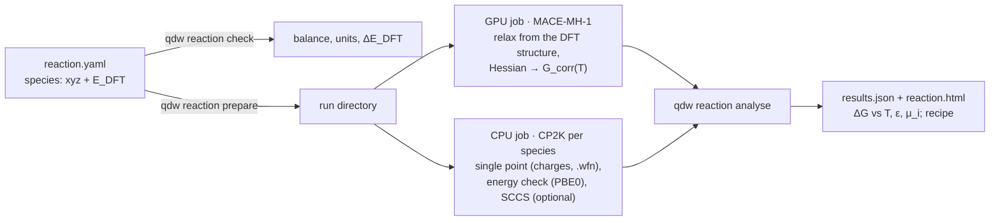
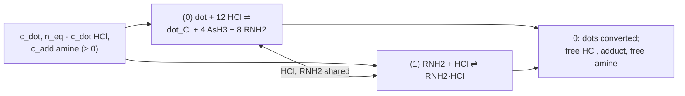

# Reaction free energies (`qdw reaction`)

On demand, outside the library batch: a balanced reaction whose species come with DFT-relaxed
structures and DFT energies. qd-workflows adds the thermal corrections (MACE-MH-1 Hessians), the
solvation free energies (CP2K single points, post-processed), and evaluates the reaction free
energy against temperature, dielectric constant, the electronic-energy level and the chemical
potential of every species, on an interactive page.

```bash
qdw reaction check   reaction.yaml
qdw reaction prepare reaction.yaml --cluster nhr --out runs/x --test-queue
(cd runs/x && bash submit.sh)
qdw reaction analyse runs/x          # results/: results.json, summary.json, plots, reaction.html
```



Examples: `examples/reaction_InAs_HCl/` (InAs dot + 12 HCl), `examples/reaction_InAs_adduct/`
(the CH$_3$NH$_2$·HCl adduct as the HCl source) and `examples/reaction_InAs_toluene/` (HCl
treatment in toluene, oleylamine added or not: the recipe mode).

## Input

```yaml
name: InAs285_HCl
energy_method: HLE17                 # what the given energies are
equation: "origin + 12 HCl -> QD_Cl + 4 AsH3 + 8 CH3NH2"
energy_unit: hartree                 # hartree | eV, required
T: [250, 800, 10]                    # K: start, stop, step (298.15 is always added)
per: HCl                             # also per HCl (a species, or a number)
conditions: {eps: 2.38, electrostatics: cosmo, cavity: beta0}
scan: {species: HCl, log10_c: [-8, 1]}
ligand: CH3NH2                       # ΔG_lig slider per released ligand
species:
  origin: {xyz: origin_285.xyz, energy: xyz, charge: 0, mult: 1, c: 1.0e-6}
  AsH3:   {xyz: AsH3.xyz, energy: xyz, c: 1.0e-6, p_bar: 1.0e-4, phase: gas}
  CH3NH2: {xyz: CH3NH2.xyz, energy: xyz, phase: solvent, c_liquid: 3.04}
  # energy: a number, or xyz (the "E = ..." of the comment line)
  # phase: solute (c, M) | gas (p_bar) | solvent (c_liquid, M); optional symmetry_number, charges, label
settings:
  sp_functional: HLE17               # GAPW single point at the given geometry (charges, .wfn)
  energy_check_functional: PBE0      # isolated PBE0 (ADMM2) single points: an energy set
  sccs: false                        # SCCS runs (an optional check)
```

`qdw reaction check` verifies element and charge balance, suggests the coefficients when the
equation is not balanced, and prints $\Delta E_\mathrm{DFT}$.

Optional blocks for the recipe mode: `equilibria` (side equilibria solved together with the
reaction) and `recipe` (what is put in the flask); see [Recipe mode](#recipe-mode).

## Model

For every species $i$, with $\nu_i < 0$ for reactants:

$$
\mu_i = E_i + G^\mathrm{corr}_i(T) + \Delta G_{\mathrm{solv},i}(\varepsilon) + k_BT\ln a_i
$$

$$
\Delta G_r = \sum_i \nu_i\,\mu_i + \nu_L\,\Delta G_\mathrm{lig}
= \Delta G_r^\circ + k_BT\ln Q, \qquad Q = \prod_i a_i^{\nu_i}
$$

### Electronic energy

One of several sets, chosen on the page; each set is internally consistent, and a set appears
only when every species has it:

| Set | Meaning |
|---|---|
| given (e.g. HLE17) | the user's energies at the user's geometries |
| PBE0@given geometries | isolated PBE0 (ADMM2) single points at the given geometries |
| MACE-MH1 | MACE-MH-1 at its own minima |
| PBE0@MACE-MH1 geometries | PBE0 single points at the MACE minima |
| PBE0-D3(BJ)@… | the same with Grimme's D3(BJ) dispersion |

### Thermal correction

MACE-MH-1 relaxes each species from the given structure (heavy-atom RMSD reported, flagged above
0.1 Å), the Hessian is taken at the MACE minimum, and

$$
G^\mathrm{corr}(T) = \mathrm{ZPE} + \left[U_\mathrm{vib}(T) - \mathrm{ZPE}\right] + H_\mathrm{trans} + H_\mathrm{rot}
- T\left(S_\mathrm{trans} + S_\mathrm{rot} + S_\mathrm{vib} + S_\mathrm{el}\right)
$$

as an ideal gas at 1 M with a rigid rotor and quasi-RRHO vibrational entropy
([Thermochemistry](theory/thermochemistry.md)); $S_\mathrm{el} = k_B\ln(2S+1)$. It agrees to 1 µeV with
Orchestr.AI `qd.references.ideal_gas_g`.

### Activities

| Phase | $a_i$ | Solvation term |
|---|---|---|
| dissolved (`solute`) | $c_i / 1\,\mathrm{M}$ | yes |
| pure or diluted liquid (`solvent`) | $c_\mathrm{liquid} / 1\,\mathrm{M}$ (neat oleylamine: 3.04 M) | yes |
| gas in equilibrium with its headspace (`gas`) | $p_i / (c^\circ R T)$ | none |

### Ligand term

$\Delta G_\mathrm{lig}$ is the free energy per released ligand that a small surrogate leaves out
(chain packing in the shell, conformational entropy of oleylamine against CH$_3$NH$_2$); calibrate
it on a measured bound/free ratio.

### Solvation

$$
\Delta G_\mathrm{solv}(\varepsilon) = \left(1 - \frac{1}{\varepsilon}\right) E_\infty + (\alpha + \gamma)(\varepsilon)\,S
$$

COSMO on the DFT potential at the density isosurface plus the β = 0 cavity/dispersion term
([Solvation](theory/solvation.md)). Alternatives on the page: CP2K SCCS interpolated in
$1 - 1/\varepsilon$ (molecules), or Generalized Born on RESP charges.

## Recipe mode

For a treatment where the knobs are what is put in the flask: dots at $c_\mathrm{dot}$, a reagent
in equivalents per dot $n_\mathrm{eq}$, an additive at $c_\mathrm{add}$ (zero allowed). The reaction
and its side equilibria are solved together. Example: InAs dots washed and redispersed in toluene,
treated with HCl, oleylamine added or not; free amine binds HCl, and every etched dot releases
8 amines.



```yaml
equilibria:
  - "CH3NH2 + HCl -> CH3NH2_HCl"
recipe:
  dot: origin
  c_dot: 1.0e-5          # M
  reagent: HCl
  equivalents: 100       # per dot
  additive: CH3NH2
  c_additive: 0.0        # M; 0 = none added
```

Mass balance with the extents $\xi_0$ (reaction) and $\xi_1$ (binding):

$$
\begin{aligned}
c_\mathrm{dot} &= c^0_\mathrm{dot} - \xi_0, & c_{\mathrm{dot\_Cl}} &= \xi_0,\\
c_\mathrm{HCl} &= n_\mathrm{eq}c^0_\mathrm{dot} - 12\,\xi_0 - \xi_1, & c_\mathrm{adduct} &= \xi_1,\\
c_{\mathrm{RNH_2}} &= c_\mathrm{add} + 8\,\xi_0 - \xi_1, & c_{\mathrm{AsH_3}} &= 4\,\xi_0\ \ \text{(closed vial)}
\end{aligned}
$$

(a species set to `gas` stays at its partial pressure instead: an open flask). Both reactions at
equilibrium:

$$
\frac{\Delta G_r^\circ}{k_BT} + \sum_i \nu_{ri}\ln a_i = 0 \qquad (r = 0, 1)
$$

The total free energy is convex in the extents, so each residual rises with its own extent: the
main extent by bisection, and for each trial the binding extent in closed form,

$$
y = K_1(a - y)(b - y) \;\Rightarrow\; y = \frac{2K_1ab}{K_1(a+b) + 1 + \sqrt{K_1^2(a-b)^2 + 2K_1(a+b) + 1}}
$$

($a$, $b$: HCl and amine left after the reaction). Output: the fraction of dots converted
$\theta = \xi_0/c^0_\mathrm{dot}$ and the free HCl, adduct and free amine. A slider corrects
$\Delta G^\circ$ of the side equilibrium (ion pairing beyond the H-bonded complex computed).
All 12 HCl per dot react in one step, so $\theta$ is the fraction of fully converted dots.

## The page

`results/reaction.html` (Plotly), with selectors for the energy set, electrostatics model,
cavity model and energy unit (eV, kcal/mol, kJ/mol), a dielectric-constant slider, per-species
phase and amount, the ligand slider, and:

- $\Delta G_r(T)$ and $\Delta G_r^\circ(T)$, in solution and in the gas phase;
- the decomposition at one temperature (ΔE, ZPE, thermal, −TΔS by kind, solvation by kind,
  ligand, $k_BT\ln Q$);
- a map over $T$ and the chemical potential of any species, with the $\Delta G_r = 0$ line;
- $\Delta G_r$ against $\varepsilon$ for each solvation model;
- the equilibrium conversion against $T$;
- the recipe panel (dots converted against equivalents, a map over equivalents × additive,
  the speciation, conversion against $T$).

Dots are labelled by their stoichiometry, $[\mathrm{MA}]_x(\mathrm{MX}_k)_y(L)_z$
(e.g. $[\mathrm{InAs}]_{35}(\mathrm{InCl_3})_{17}(\mathrm{CH_3NH_2})_{21}$).

## CP2K runs per species

| Run | Settings | Gives |
|---|---|---|
| `charges` | the given functional (e.g. HLE17), GAPW, MULTIPOLE, OT, `MAX_SCF 200` | .wfn, CP2K energy at the given geometry |
| `energy_<f>` | isolated PBE0 (ADMM2, truncated or full Coulomb) | the PBE0 energy set |
| `sccs_vac`, `sccs_e<ε>` (optional) | GPW, periodic Poisson solver, ε ladder 2 → 4 → 10 → 80 | SCCS electrostatics |

The ESP cubes (a restart of `charges` with the potential and density cubes, one SCF cycle), the
PBE0@MACE and the D3 runs of the InAs example were run with separate scripts from the helpers
`esp_from_single_point` and `with_d3` in `reaction/cp2k.py`.

SCCS in CP2K 2026.2 works only with GPW, the periodic Poisson solver and one OpenMP thread per
rank, restarted along the ε ladder; for the InAs dots it converged at ε = 2 only.

## On NHR

- Jobs are charged to `bep00157` (profile `account:`).
- `--test-queue`: 1 h pieces that resubmit themselves; CP2K stops cleanly 150 s before the limit
  (EXIT file) and the next piece continues from the .wfn; the last piece submits the analysis.
- CP2K pure MPI (192 × 1 per node): with OpenMP threads every rank ended up on one core. Small
  molecules with exact exchange: 2 ranks (8–24 ranks were 10–30× slower per SCF step).
- The analysis needs scikit-image (marching cubes) and scipy.
