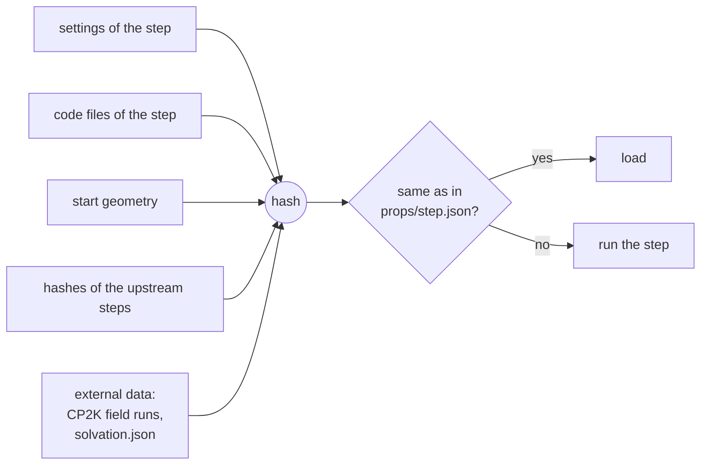

# Reproducibility and caching

## Pinned packages

`components.yaml` names the repository, branch and commit of every package a result is made with
(Orchestr.AI, QDEX, QD_builder, QDSpaceWebApp). A batch is reproduced by checking out those
commits and the same cluster profile.

## Step cache

Every Orchestr.AI step writes `props/<step>.json` with a hash of everything it read:

- A change of model, settings or code reruns the step and everything downstream of it.
- New DFT results (field runs, `solvation.json`) enter the field and solvation steps' keys, so
  they invalidate exactly those steps.
- The CPU stage runs with `upstream: cached`: it reads the GPU steps from the cache and fails
  instead of recomputing them.
- Desorption relaxations and Raman modes are checkpointed within a step.

## Resuming jobs

- **CP2K chain**: every step is skipped when its output is there; a geo_opt stopped by the time
  limit continues from the last frame. Resubmit `chain.sh`.
- **Short queues** (`qdw props prepare --pieces`): each piece queues its successor first, stops a
  minute before its limit, and the successor continues from the cache; the last piece cancels the
  spare successor.
- **`qdw reaction --test-queue`**: 1 h pieces; CP2K stops cleanly 150 s before the limit (EXIT
  file) and the next piece restarts from the `.wfn`; the last piece submits the analysis.
