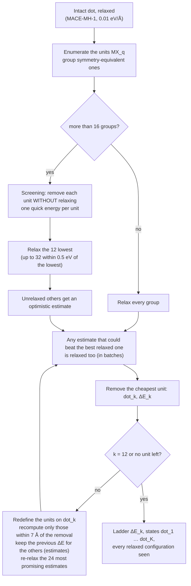

# Desorption ladder (Z-type ligands)

This page explains, step by step, how the pipeline estimates how strongly the Z-type ligands are
bound to a dot and how many of them leave at a given temperature and ligand concentration. It is
written for chemists: the computational choices are explained in words, and every approximation is
listed with its expected effect at the end.

## 1. The chemical question

The dots of the library are charge-balanced binary nanocrystals capped by **Z-type ligands**: neutral
metal-halide units $\mathrm{MX}_q$ (CdCl$_2$, ZnCl$_2$, PbCl$_2$, InCl$_3$…) that sit on the surface
through the metal (a Lewis acid) bound to surface anions, and through their halides bound to surface
metals. In solution such units can leave the surface as molecular complexes, as in ligand stripping
by amines or phosphines. Which ones leave, and how many, controls the surface stoichiometry, the
under-coordinated sites (traps) and the stability of the dot.

The pipeline answers three questions for every dot:

1. **How much does it cost to remove the first, second, third… unit?** This is the desorption
   ladder $\Delta E_k$, $\Delta G_k$.
2. **Which surface sites leave first?** The units removed along the ladder, and the cost of removing
   each symmetry-distinct unit of the intact dot (site map).
3. **How many units are missing at equilibrium** at a temperature $T$ and a concentration of free
   $\mathrm{MX}_q$? This is the mean number of removed units, $\langle k\rangle(T, \mu)$.

## 2. The reaction and its energy

With the notation of [Thermochemistry](thermochemistry.md#notation-what-ma-and-mx_q-are), a dot is
$[\mathrm{MA}]_n(\mathrm{MX}_q)_m$. Removing $k$ units, one after the other, gives a ladder of dots

$$
\mathrm{dot}_0 \xrightarrow{-\mathrm{MX}_q} \mathrm{dot}_1 \xrightarrow{-\mathrm{MX}_q} \mathrm{dot}_2 \;\cdots\;
\qquad \mathrm{dot}_k = [\mathrm{MA}]_n(\mathrm{MX}_q)_{m-k}
$$

and every step is the reaction $\mathrm{dot}_{k-1} \to \mathrm{dot}_k + \mathrm{MX}_q$, the unit leaving as
a free molecule (linear CdCl$_2$, trigonal InCl$_3$…). Its energy, with every species at its own
relaxed geometry, is

$$
\Delta E_k = E(\mathrm{dot}_k) + E(\mathrm{MX}_q) - E(\mathrm{dot}_{k-1})
$$

- $\Delta E_k > 0$: removing the unit costs energy, which is the usual case. Typical values from the
  validation runs are about 1.4 eV per InCl$_3$ on InP In$_{119}$P$_{80}$Cl$_{117}$, 1.6 eV on InAs
  In$_{844}$As$_{715}$Cl$_{387}$ and 2.5 eV per PbCl$_2$ on PbS Pb$_{236}$S$_{201}$Cl$_{70}$.
- $\Delta E_k < 0$: the unit is not bound in that structure, and the dot is more stable without it.
  This happens for some builder structures. The builder packs the ligand shell to maximum coverage,
  which need not be the most stable arrangement; ZnSe Zn$_{301}$Se$_{224}$Cl$_{154}$, for example,
  loses its first three ZnCl$_2$ downhill. These values are kept as computed.
- The **cumulative** energy $\sum_{j\le k}\Delta E_j$ is the cost of stripping $k$ units.

Energies $E$ are those of the machine-learned potential MACE-MH-1 (head `omat_pbe`), trained on
PBE-level DFT data. It is fast enough to relax thousands of candidate structures.

### From energy to free energy

A free molecule has translational and rotational entropy that it did not have on the surface, so
desorption becomes more favourable with temperature. In vacuum (gas phase, 1 M standard state):

$$
\Delta G_k^{\mathrm{gas}}(T) = E(\mathrm{dot}_k) - E(\mathrm{dot}_{k-1}) + \Delta F_{\mathrm{vib},k}(T) + G^\circ_{\mathrm{MX}_q}(T)
$$

where $G^\circ_{\mathrm{MX}_q}(T)$ is the full free energy of the free molecule (its energy, vibrations,
rotation and translation; see [Thermochemistry](thermochemistry.md)), and $\Delta F_{\mathrm{vib},k}$ is
the change in the vibrational free energy of the dot. In solution every species also gets its
solvation free energy (dielectric continuum, [Solvation](solvation.md)), and the free unit enters
with its chemical potential at concentration $c$:

$$
\Delta G_k(T, \varepsilon, c) = G^{\mathrm{sol}}_{k} - G^{\mathrm{sol}}_{k-1} + \mu_{\mathrm{MX}_q}, \qquad
\mu_{\mathrm{MX}_q} = G^{\circ,\mathrm{sol}}_{\mathrm{MX}_q} + k_BT \ln\frac{c}{c^\circ}
$$

A step is favourable when $\Delta G_k < 0$. A lower concentration of free $\mathrm{MX}_q$ (dilution,
or a scavenger that binds it) lowers $\mu$ and drives more units off.

## 3. What is a "unit"?

Before a unit can be removed it has to be defined on the actual surface. From the bonds of the
relaxed dot (structure step: opposite-charge pairs closer than a tolerance times the bulk bond):

1. Every surface **metal M that carries ligands X** can leave as $\mathrm{MX}_q$.
2. **If it carries at least $q$ ligands,** the unit is M with $q$ of its own X: a *molecular* unit. A
   metal with more than $q$ ligands gives one unit per choice of $q$ of them. For example, an In
   bound to four Cl gives four possible InCl$_3$ units.
3. **If it carries fewer than $q$,** it is completed with the closest other X in space (a
   *non-molecular* unit, flagged in the output). Equally close choices are all kept.
4. **Symmetry-equivalent units are grouped:** removing any of them gives the same product up to a
   rotation of the dot, so one calculation serves the whole group.
5. **The units are redefined after every removal**, on the relaxed (and possibly reconstructed)
   surface. A removal can change which X a neighbouring metal holds.

Large dots have many units: InAs In$_{844}$As$_{715}$Cl$_{387}$ has 557 candidate InCl$_3$ units and
no rotational symmetry. Most of the computational effort described below goes into not relaxing all
of them at every step.

## 4. How the ladder is found, step by step

Finding the lowest-energy order of removal exactly would mean trying every sequence. That is
impossible beyond a few steps: 557 choices for the first unit, about as many for the second, and so
on. The pipeline uses a **greedy** search instead: at every step it removes the unit that is
cheapest at that moment, and it keeps one path.

In words:

1. **Start** from the relaxed intact dot.
2. **Enumerate** the units (section 3) and group the symmetry-equivalent ones.
3. **Screen** (when a step has more than 16 distinct candidates). Every unit is removed and the
   energy of what is left is computed *without* relaxing it. This takes one quick evaluation per
   unit, roughly a minute for the 557 units of the InAs dot. The unrelaxed energies rank the
   candidates roughly.
4. **Relax** the most promising candidates: the 12 lowest by unrelaxed energy, plus others within
   0.5 eV of the lowest, at most 32 in total. Relaxing means letting all atoms of the stripped dot
   move to the nearest energy minimum, so the surface can heal around the vacancy. Each candidate
   starts from a slightly displaced geometry (0.02 Å random displacement, reproducible) so it does
   not stay on a flat shoulder of the energy surface. Many candidates are relaxed together on the
   GPU.
5. **Safety net.** A candidate that was not relaxed gets an *optimistic* estimate: its unrelaxed
   energy minus a large relaxation energy, namely the 90th percentile of those seen for the relaxed
   candidates. Any candidate whose estimate is lower than the best relaxed one is relaxed before a
   choice is made. So a unit can be missed only if it gains much more on relaxing than nearly all
   the others.
6. **Remove** the cheapest relaxed unit. This gives $\mathrm{dot}_k$ and $\Delta E_k$.
7. **Update locally.** A removal mostly perturbs its neighbourhood. On the new dot the units are
   redefined; those within 7 Å of the removed metal are recomputed (steps 3–5). The others keep
   their previous $\Delta E$ as an estimate, and the 24 most promising estimates (those within
   0.3 eV of the best) are re-relaxed, because a removal can make a distant unit cheaper too.
8. **Repeat** until 12 units have been removed or none is left.

Every candidate relaxation, chosen or not, is kept: they are the "configurations evaluated" used for
$\langle k\rangle$ below, and snapshots along them feed the ML training set
([GPU stage](../pipeline/gpu-stage.md#wigner-and-md)).

### How good is the greedy ladder?

| Test (12 removals unless noted) | Result |
|---|---|
| Cd$_{68}$Se$_{55}$Cl$_{26}$, greedy vs a broader beam search (two paths kept at every step, every unit polished) | identical for the first 4 removals; afterwards ~0.1 eV per unit higher |
| Pb$_{236}$S$_{201}$Cl$_{70}$, quick vs fully converged greedy | the same ladder |
| In$_{119}$P$_{80}$Cl$_{117}$, with vs without screening and the refresh cap | identical: the same 12 units, cumulative $\Delta E$ 17.190 eV in both |
| Pb$_{236}$S$_{201}$Cl$_{70}$, with vs without screening and the refresh cap | within 0.019 eV at every step. Its PbCl$_2$ units are nearly degenerate (≈2.52 eV each), so equivalent units can be taken in a different order. |

The ladder is meant as a **qualitative to semi-quantitative** description: the order of magnitude
of the binding of each successive unit, which sites leave first, and how the cost changes as the
shell thins. It is not a proof that no other path is lower.

## 5. Thermal corrections along the ladder

- **Vibrations of the dot.** A Hessian (matrix of second derivatives of the energy) gives the
  vibrational free energy $F_\mathrm{vib}$. It is computed for the intact dot and, for dots of up to
  300 atoms, for the **last** state of the ladder only. The states in between are interpolated
  linearly in $k$:

  $$
  F_{\mathrm{vib},k}(T) = F_{\mathrm{vib},0}(T) + \frac{k}{K}\left[F_{\mathrm{vib},K}(T) - F_{\mathrm{vib},0}(T)\right]
  $$

  Above 300 atoms the change of the dot's vibrations along the ladder is not included
  ($\Delta F_{\mathrm{vib},k} = 0$). The free molecule's vibrations always are.
- **The free molecule** $\mathrm{MX}_q$ has its own relaxed geometry and Hessian, and the ideal-gas
  translation and rotation at the 1 M standard state ([Thermochemistry](thermochemistry.md)). Its
  entropy, of the order of a few tenths of an eV in $T\Delta S$ at room temperature, is the main
  reason desorption becomes easier on heating.
- **Solvation** (CPU stage) is computed by DFT for the intact dot and for the last state, and
  interpolated linearly in $k$ in between ([Solvation](solvation.md)).

## 6. How many units are missing at equilibrium: ⟨k⟩

The search evaluates many relaxed configurations: all candidates at all steps, not only the chosen
path. Each is a dot with $k_j$ units removed, an energy, and a symmetry number $\sigma_j$ (how many
equivalent copies it has). At temperature $T$ and ligand chemical potential $\mu$, each gets a
Boltzmann weight, and the average number of removed units is

$$
\langle k\rangle(T, \mu_{\mathrm{MX}_q}) = \frac{\sum_j k_j\, e^{-\mathcal G_j / k_BT}}{\sum_j e^{-\mathcal G_j / k_BT}}, \qquad
\mathcal G_j = G^{\mathrm{sol}}_{k_j} + \Delta E_j + k_BT\ln\frac{\sigma_j}{\sigma_{k_j}} + k_j\,\mu_{\mathrm{MX}_q}
$$

($\Delta E_j$: the configuration's energy relative to the ladder state with the same $k$). Reading it:
at low $T$ or high ligand concentration $\langle k\rangle \approx 0$ (full shell). As $\mu$ drops or $T$
rises, $\langle k\rangle$ climbs in steps that follow the ladder. Because only configurations near the
path are known, $\langle k\rangle$ is reliable for the first part of the shell (up to the 12 removals
computed) and is a lower bound beyond it.

## 7. Approximations and their effects

| Approximation | Why | Expected effect |
|---|---|---|
| MACE-MH-1 energies instead of DFT | thousands of relaxations per dot | PBE-like energies. The difference from DFT for these ligands has not been measured yet; DFT single points on ladder states can check it. |
| Greedy path (one path, cheapest unit first) | exhaustive search is impossible | may miss sequences where a costly first removal enables cheaper later ones; ~0.1 eV per unit on Cd$_{68}$ after 4 removals |
| At most 12 removals | bounded cost | describes the first part of the shell only (e.g. ~10 % of the InCl$_3$ shell of In$_{844}$As$_{715}$Cl$_{387}$) |
| Candidates relaxed to 0.05 eV/Å (not 0.01) | fewer optimiser steps per candidate | small; quick and fully converged greedy ladders agree on Pb$_{236}$S$_{201}$Cl$_{70}$ |
| Local updates (7 Å) and the refresh of 24 estimates | a removal mainly affects its neighbourhood | a distant unit made much cheaper by a removal can be missed |
| Screening by unrelaxed energy, with optimistic estimates | 557 candidates at the first step of a 1,946-atom dot | missed only if a unit relaxes far more than nearly all others; no change on InP, ≤ 0.02 eV on PbS |
| The unit leaves as a free, uncoordinated molecule in a dielectric continuum | standard reference state | ignores specific binding of solvent or amine to the free $\mathrm{MX}_q$ (e.g. $\mathrm{MX}_q\mathrm{L}_2$ complexes), which would make desorption easier. Such adducts are treated explicitly in [qdw reaction](../reactions.md). |
| Harmonic vibrations, Hessian of the last state only, none above 300 atoms | cost of Hessians of large dots | small for $\Delta G$ per step compared with the molecule's translational and rotational entropy |
| Solvation linear in $k$ between the intact and fully stripped dot | DFT solvation of every state is expensive | small at the low dielectric constants of the usual solvents |
| Size limit (`detach_max_atoms`, 600 by default; being extended to 2,000) | cost of the search for large dots | larger dots get no ladder (but all their other properties) |

## 8. Outputs

| File | Content |
|---|---|
| `props/detachment.json` | the ladder (per step: $\Delta E_k$, $\Delta G_k(T)$, the unit removed, whether it is molecular, its metal's coordination), the site map of the intact dot, every evaluated configuration, $\langle k\rangle(T,\mu)$, and the search statistics (relaxations, screening, time) |
| `props/detach_<k>.xyz` | the ladder states $\mathrm{dot}_k$ |
| `props/ensemble/detach_relax.extxyz`, `detach_md.extxyz`, `detach_rattle.extxyz` | training frames from the search and from the ladder states ([GPU stage](../pipeline/gpu-stage.md#wigner-and-md)) |

The solution-phase ladder, $\langle k\rangle$ in solution and the plots are in the report
([CPU stage](../pipeline/cpu-stage.md)).
