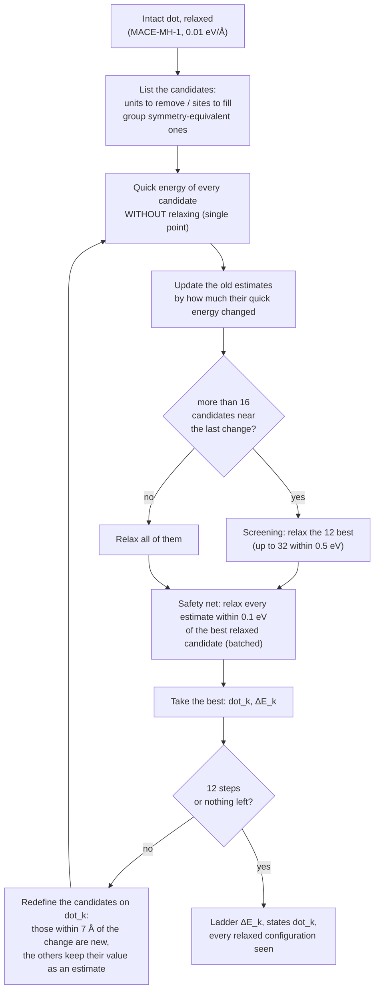

# Desorption and adsorption ladder (Z-type ligands)

This page explains, step by step, how the pipeline estimates how strongly the Z-type ligands are
bound to a dot, how many leave or join at a given temperature and ligand concentration, and why. It
is written for chemists: the computational choices are explained in words, and every approximation
is listed with its expected effect at the end.

## 1. The chemical question

The dots of the library are charge-balanced binary nanocrystals capped by **Z-type ligands**: neutral
metal-halide units $\mathrm{MX}_q$ (CdCl$_2$, ZnCl$_2$, PbCl$_2$, InCl$_3$…) that sit on the surface
through the metal (a Lewis acid) bound to surface anions, and through their halides bound to surface
metals. In solution such units can leave the surface as molecular complexes, as in ligand stripping
by amines or phosphines, or join it from an excess of $\mathrm{MX}_q$ in the synthesis. The builder
covers the surface at intermediate-to-high coverage, set by the surface energies, so a dot can
usually both lose and gain units.

The pipeline answers four questions for every dot:

1. **How much does it cost to remove the first, second, third… unit?** The desorption ladder
   $\Delta E_k$, $\Delta G_k$, $k = 1, 2, \dots$
2. **How much is gained by adding one, two, three… more?** The adsorption ladder, written with
   negative $k$.
3. **Which surface sites leave or are filled first?** The units removed or added along the ladders,
   and the cost of removing each symmetry-distinct unit of the intact dot (site map).
4. **How many units are missing or added at equilibrium** at a temperature $T$ and a free-ligand
   chemical potential $\mu$? The mean $\langle k\rangle(T, \mu)$, including the configurational entropy
   of the ligand shell.

## 2. The reactions and their energies

With the notation of [Thermochemistry](thermochemistry.md#notation-what-ma-and-mx_q-are), a dot is
$[\mathrm{MA}]_n(\mathrm{MX}_q)_m$. Removing units one after the other, or adding them, gives a ladder
of dots in both directions:

$$
\cdots\; \mathrm{dot}_{-2} \xleftarrow{+\mathrm{MX}_q} \mathrm{dot}_{-1} \xleftarrow{+\mathrm{MX}_q} \mathrm{dot}_0
\xrightarrow{-\mathrm{MX}_q} \mathrm{dot}_1 \xrightarrow{-\mathrm{MX}_q} \mathrm{dot}_2 \;\cdots
\qquad \mathrm{dot}_k = [\mathrm{MA}]_n(\mathrm{MX}_q)_{m-k}
$$

The leaving or arriving unit is a free molecule (linear CdCl$_2$, trigonal InCl$_3$…). With every
species at its own relaxed geometry:

$$
\Delta E_k = E(\mathrm{dot}_k) + E(\mathrm{MX}_q) - E(\mathrm{dot}_{k-1}) \quad (k > 0), \qquad
\Delta E^{\mathrm{add}}_j = E(\mathrm{dot}_{-j}) - E(\mathrm{dot}_{-(j-1)}) - E(\mathrm{MX}_q)
$$

- $\Delta E_k > 0$: removing the unit costs energy, the usual case. Typical values: about 1.4 eV
  per InCl$_3$ on InP In$_{119}$P$_{80}$Cl$_{117}$, 1.6 eV on InAs In$_{844}$As$_{715}$Cl$_{387}$,
  2.5 eV per PbCl$_2$ on PbS Pb$_{236}$S$_{201}$Cl$_{70}$, 1.0–2.0 eV per CdCl$_2$ on Cd$_{68}$Se$_{55}$Cl$_{26}$.
- $\Delta E_k < 0$: the unit is not bound in that structure, and the dot is more stable without it.
  ZnSe Zn$_{301}$Se$_{224}$Cl$_{154}$ loses its first three ZnCl$_2$ downhill. The builder's coverage is
  not necessarily the most stable one; these values are kept as computed.
- $\Delta E^{\mathrm{add}}_j < 0$: the extra unit binds. Cd$_{68}$ binds 12 more CdCl$_2$ by 0.3–1.4 eV
  each (in vacuum).
- Some dots have **no adsorption site**. InP In$_{119}$P$_{80}$Cl$_{117}$ has all its P fully
  coordinated (In-terminated surface covered with Cl), so its ladder only goes down.

Energies $E$ are those of the machine-learned potential MACE-MH-1 (head `omat_pbe`), trained on
PBE-level DFT data. It is fast enough to relax thousands of candidate structures.

### From energy to free energy

A free molecule has translational and rotational entropy that it does not have on the surface, so
desorption becomes more favourable with temperature. In vacuum (gas phase, 1 M standard state):

$$
\Delta G_k^{\mathrm{gas}}(T) = E(\mathrm{dot}_k) - E(\mathrm{dot}_{k-1}) + \Delta F_{\mathrm{vib},k}(T) + G^\circ_{\mathrm{MX}_q}(T)
$$

(with $-G^\circ_{\mathrm{MX}_q}$ for an addition). $G^\circ_{\mathrm{MX}_q}(T)$ is the full free energy of
the free molecule (energy, vibrations, rotation and translation; see
[Thermochemistry](thermochemistry.md)), and $\Delta F_{\mathrm{vib},k}$ is the change in the
vibrational free energy of the dot (section 5). In solution every species also gets its solvation
free energy ([Solvation](solvation.md)), and the free unit enters with its chemical potential:

$$
\Delta G_k(T, \varepsilon, c) = G^{\mathrm{sol}}_{k} - G^{\mathrm{sol}}_{k-1} + \mu_{\mathrm{MX}_q}, \qquad
\mu_{\mathrm{MX}_q} = G^{\circ,\mathrm{sol}}_{\mathrm{MX}_q} + k_BT \ln\frac{c^{\mathrm{free}}}{c^\circ}
$$

A removal is favourable when $\Delta G_k < 0$. A lower concentration of **free** $\mathrm{MX}_q$
(dilution, or something that binds it, such as an amine) lowers $\mu$ and drives units off; an
excess raises $\mu$ and drives units on. Section 7 explains how $\mu$ is set in practice.

## 3. Units to remove, sites to fill

**Removal: what is a unit?** From the bonds of the relaxed dot (opposite-charge pairs closer than a
tolerance times the bulk bond):

1. Every surface **metal M that carries ligands X** can leave as $\mathrm{MX}_q$.
2. **If it carries at least $q$ ligands,** the unit is M with $q$ of its own X (a *molecular* unit); a
   metal with more than $q$ ligands gives one unit per choice (an In with four Cl gives four InCl$_3$).
3. **If it carries fewer than $q$,** it is completed with the closest other X in space (a
   *non-molecular* unit, flagged).
4. **Symmetry-equivalent units are grouped:** one calculation serves the whole group.
5. **The units are redefined after every removal** on the relaxed, possibly reconstructed surface.

Large dots have many units: InAs In$_{844}$As$_{715}$Cl$_{387}$ has 557 candidate InCl$_3$ units and no
rotational symmetry.

**Addition: where can a unit bind?** The same rules as the builder's Z-type post-treatment, applied
to the relaxed dot. M takes the empty cation site above an **under-coordinated surface anion**
(along one of its missing bonds, at the M–A bond length). Its $q$ ligands X take free sites around M
in the cation's bulk coordination (tetrahedral or octahedral), preferring sites that bridge to
surface metals. No new atom may be closer to an existing one than 0.8 of its bond. Neighbouring
sites compete for the same X positions, so after one addition some nearby sites disappear. That is
why the builder fits 19 more CdCl$_2$ on Cd$_{68}$ ([CdSe]$_{55}$(CdCl$_2$)$_{13}$ →
[CdSe]$_{55}$(CdCl$_2$)$_{32}$), although it has 24 free anions.

## 4. How the ladders are found, step by step

Finding the lowest-energy order exactly would mean trying every sequence: impossible beyond a few
steps (557 choices for the first unit of the InAs dot, about as many for the second…). The pipeline
uses a **greedy** search: at every step it removes (or adds) the unit that is most favourable at that
moment, and keeps one path. The same search runs downward (removals) and upward (additions), for at
most 12 steps each.

In words:

1. **Start** from the relaxed intact dot and **list the candidates** (section 3).
2. **Quick energies.** Every candidate is evaluated once *without relaxing* (one batched single
   point each). This ranks them roughly and is cheap: about a minute for the 557 units of the InAs
   dot.
3. **Update the estimates.** A candidate far from the last change keeps its value from the
   previous step as an *estimate*, corrected by how much its quick energy changed since then:

    $$
    \Delta E_k^{\mathrm{est}}(u) = \Delta E_{k-1}(u) + \big[\Delta E^{\mathrm{rigid}}_{k}(u) - \Delta E^{\mathrm{rigid}}_{k-1}(u)\big]
    $$

4. **Relax** the candidates near the last change (within 7 Å). Each one is relaxed: the atoms of the
   new dot move to the nearest energy minimum, so the surface heals around the vacancy or
   accommodates the new unit. When there are many (more than 16), only the most promising by quick
   energy are relaxed: the 12 lowest, and up to 32 within 0.5 eV of the lowest. The others get an
   *optimistic* estimate (their quick energy minus a large relaxation energy). Every candidate starts
   from a slightly displaced geometry (0.02 Å, reproducible) so it does not stay on a flat shoulder
   of the energy surface. Candidates are relaxed together on the GPU.
5. **Safety net.** Before choosing, every estimate lower than the best relaxed candidate, or within
   0.1 eV above it, is relaxed (in one batch). A near-tie is therefore always settled by real
   relaxations.
6. **Take** the best relaxed candidate: this gives $\mathrm{dot}_k$ and $\Delta E_k$.
7. **Repeat** until 12 steps, or until no candidate is left.

Every candidate relaxation, chosen or not, is kept. They are the configurations behind the site map
and part of the ML training set (snapshots along each relaxation, [GPU stage](../pipeline/gpu-stage.md#wigner-and-md)).

### How good is the greedy ladder?

| Test (12 steps) | Result |
|---|---|
| Cd$_{68}$Se$_{55}$Cl$_{26}$, greedy vs a broader search (two paths kept at every step) | identical for the first 4 removals; afterwards ~0.1 eV per unit higher |
| In$_{119}$P$_{80}$Cl$_{117}$, with vs without screening, refresh and margin | identical: the same 12 units, cumulative $\Delta E$ 17.19 eV in all variants |
| Pb$_{236}$S$_{201}$Cl$_{70}$, with vs without screening | within 0.019 eV at every step (its PbCl$_2$ units are nearly degenerate, ≈2.52 eV each) |
| Cd$_{68}$, two runs with different settings | identical first step; at the second step two units 3 meV apart, and the two branches differ by up to 0.7 eV in the middle of the ladder but end within 0.02 eV after 12 steps (17.46 vs 17.48 eV) |

The last line shows the main limitation of a single greedy path: when two units are nearly
degenerate, which one is taken can change the next steps by a few tenths of an eV. The cumulative
cost and the equilibrium populations (section 7), which do not depend on a single path, are much more
robust than any individual step. The ladder is meant as a **qualitative to semi-quantitative**
description: the order of magnitude of each step, which sites leave first, and how the cost changes
as the shell thins or fills.

## 5. Vibrations along the ladder

A Hessian (matrix of second derivatives of the energy) gives the vibrational free energy
$F_\mathrm{vib}$. It is computed for the intact dot and for the **last** state of each ladder (up to
2,000 atoms); the states in between are interpolated linearly in $k$:

$$
F_{\mathrm{vib},k}(T) = F_{\mathrm{vib},0}(T) + \frac{k}{K}\left[F_{\mathrm{vib},K}(T) - F_{\mathrm{vib},0}(T)\right]
$$

This was tested on Cd$_{68}$ against the Hessian of every one of its 12 ladder states, and against a
cheaper alternative, the block of the intact dot's Hessian that belongs to the remaining atoms:

| Method | $F_{12} - F_0$ at 300 K | Largest error at any $k$ |
|---|---|---|
| Hessian of every state (reference) | +0.902 eV | — |
| **Last state, linear in $k$ (used)** | +0.902 eV | 0.032 eV |
| Block of the intact dot's Hessian | +1.495 eV | 0.593 eV |

The block method keeps the remaining atoms as stiff as if their departed neighbours were still there,
and does not let the surface relax. Each removal raises the dot's vibrational free energy by about
+0.08 eV at 300 K (+0.29 eV at 500 K), because the dot loses the soft modes of the departed unit. That
works against desorption and is not negligible at high temperature.

## 6. Configurational entropy of the ligand shell

A dot with a given number of ligands can arrange them on its surface in many ways, almost equal in
energy. This **configurational entropy** is not in any single structure, but it matters for the
populations. It is counted on the places where a ligand X can sit:

- every surface metal misses bonds to the anion sublattice; along each missing bond, an X would sit
  at the M–X distance (exactly where the builder places it);
- positions from neighbouring metals that coincide are **one bridging site**; the others are
  **terminal** sites. Each position counts once, whichever kind it is;
- positions inside the dot are dropped; every existing X sits on one of them.

With $x$ such sites and $y$ ligands, the number of arrangements is the binomial coefficient:

$$
S_{\mathrm{conf}} = k_B \ln\binom{x}{y}, \qquad
\Delta S_{\mathrm{conf},k} = k_B\ln\binom{x_k}{y_k} - k_B\ln\binom{x_{k-1}}{y_{k-1}}
$$

Examples (intact dots): Cd$_{68}$Se$_{55}$Cl$_{26}$ has $x$ = 52 sites for $y$ = 26 Cl (every Cl on a predicted
site, half covered); Pb$_{236}$S$_{201}$Cl$_{70}$ 168 sites for 70 Cl; In$_{119}$P$_{80}$Cl$_{117}$ about 150 for 117.

$y$ changes by exactly $q$ per step. The raw site count $x$ moves by a few sites from one relaxed
state to the next (the surface reconstructs and predicted positions move across the merging
tolerance), which would make single steps noisy by 0.1–0.2 eV. $x$ is therefore taken from a
straight-line fit against $k$ on each side of the intact dot (sites lost per removal, gained per
addition), through the intact dot's exact count.

What it does: below half coverage ($y < x/2$), removing ligands **reduces** the number of
arrangements, so the configurational entropy works against desorption and in favour of adsorption.
On Cd$_{68}$ it is −0.02 to −0.12 eV per removal at 300 K, about 1 eV over 12 removals: comparable to
a whole step. It is an **ideal count** (every arrangement equally likely): an upper bound, with
$S_\mathrm{conf} = 0$ the lower bound. Both are reported.

## 7. Equilibrium populations and the chemical potential

At a temperature $T$ and a free-ligand chemical potential $\mu = G^\circ_{\mathrm{MX}_q} + \Delta\mu$, each
ladder state $k$ (removed $k > 0$, added $k < 0$) has the weight

$$
P_k \propto \exp\!\left[-\frac{G_k(T) + k\,\Delta\mu}{k_BT}\right], \qquad
G_k = E_k + F_{\mathrm{vib},k} + k\,G^\circ_{\mathrm{MX}_q} - T\,S_{\mathrm{conf},k}
$$

and $\langle k\rangle = \sum_k k\,P_k$.

**Reading $\Delta\mu$.** $\Delta\mu = k_BT\ln(c^{\mathrm{free}}/c^\circ)$ is logarithmic in the free-ligand
concentration:

| $\Delta\mu$ at 300 K | free $\mathrm{MX}_q$ |
|---|---|
| −0.1 eV | 2·10⁻² M |
| −0.3 eV | 10⁻⁵ M |
| −0.5 eV | 4·10⁻⁹ M |
| −1.0 eV | 2·10⁻¹⁷ M |

So a change of $\langle k\rangle$ over a few tenths of an eV spans many orders of magnitude in
concentration. In vacuum (no solvation, no binding partner for the free unit), Cd$_{68}$, InP, InAs and
PbS keep their shell at any realistic concentration. They lose it only below $\Delta\mu$ ≈ −1 eV (−2 eV
for PbS), i.e. if the free unit is captured. Cd$_{68}$ takes up additional CdCl$_2$ already at
$\Delta\mu$ ≈ −0.5 eV.

**Synthesis (excess $\mathrm{MX}_q$).** The excess is a reservoir that fixes $\mu$. In an amine solvent
most of it is bound (e.g. CdCl$_2$(amine)$_2$), which lowers the free concentration:
$c^{\mathrm{free}} = c^{\mathrm{tot}} / (1 + K_L c_L^2)$, with $K_L$ the binding constant and $c_L$ the amine
concentration. $\langle k\rangle$ at the synthesis temperature and this $\mu$ is the coverage the dots
leave the synthesis with (often negative $k$: extra units).

**Washed and stored dots (nothing added).** $\mu$ is then not a free variable: the free ligand
comes only from the dots themselves. It is fixed by the mass balance

$$
\langle k\rangle(T, \mu)\; c_{\mathrm{dot}} = c^{\mathrm{free}}_{\mathrm{MX}_q}(\mu)
$$

which is self-limiting: as units leave, $\mu$ rises and stops further desorption. For the first unit
this gives a simple criterion. A dot at concentration $c_\mathrm{dot}$ loses units only if

$$
\Delta G^{\mathrm{sol}}_1 - T\Delta S_{\mathrm{conf},1} \;<\; k_BT\ln\frac{c^\circ}{c_{\mathrm{dot}}}
\qquad (0.36\ \text{eV at 1 µM},\ 0.18\ \text{eV at 1 mM, 300 K})
$$

More dilute dots lose more. Residual amine, which binds the free unit, makes desorption easier.
Kinetics is not included: a washed dot may stay out of equilibrium for a long time; these numbers give
the driving force. The solution-phase model of the CPU stage solves this mass balance for mixtures of
dots and free monomers ([Reactions and equilibria](equilibria.md)). Adding the configurational
entropy and the adsorption ladder to that model is the next step.

## 8. Approximations and their effects

| Approximation | Why | Expected effect |
|---|---|---|
| MACE-MH-1 energies instead of DFT | thousands of relaxations per dot | PBE-like energies; the difference from DFT for these ligands has not been measured yet |
| Greedy path (one path, best step first) | exhaustive search is impossible | near-degenerate choices can shift later steps by a few tenths of an eV; cumulative costs are more robust |
| At most 12 removals and 12 additions | bounded cost | describes the shell near its builder coverage; ⟨k⟩ = ±12 means "at least 12" |
| Candidates relaxed to 0.05 eV/Å (not 0.01) | fewer optimiser steps | small; quick and fully converged ladders agree on Pb$_{236}$S$_{201}$Cl$_{70}$ |
| Local updates (7 Å) with quick-energy corrections of the other estimates | a change mainly affects its neighbourhood | effects carried by relaxation beyond 7 Å are not seen until relaxed (a Cd$_{68}$ unit 7.6 Å away became 0.42 eV cheaper) |
| Screening by quick energies, optimistic estimates, 0.1 eV margin | 557 candidates at the first step of a 1,946-atom dot | no change on InP, ≤ 0.02 eV on PbS |
| Free, uncoordinated $\mathrm{MX}_q$ in a dielectric continuum | standard reference state | ignores binding of solvent or amine to the free unit, which makes desorption easier; treated explicitly in [qdw reaction](../reactions.md) |
| Vibrations: harmonic, last-state Hessian, linear in $k$ | cost of Hessians of every state | within 0.03 eV of every state's Hessian on Cd$_{68}$ |
| Configurational entropy: ideal count of ligands on lattice sites, $x(k)$ from a linear fit | no extra calculation | an upper bound; the true value lies between it and zero |
| Solvation linear in $k$ between the intact and fully stripped dot | DFT solvation of every state is expensive | small at the low dielectric constants of the usual solvents |
| Size limit (`detach_max_atoms`, 600 by default; tested up to 2,000) | cost of the search for large dots | larger dots get no ladder (but all their other properties) |

## 9. Outputs

| File | Content |
|---|---|
| `props/detachment.json` | both ladders (per step: $\Delta E$, $\Delta G(T)$, $\Delta F_\mathrm{vib}$, the unit, the sites $x$ (raw and fitted), the ligands $y$, $S_\mathrm{conf}$ and its change), the site map, every evaluated configuration, $\langle k\rangle(T,\mu)$ with and without $S_\mathrm{conf}$, and the search statistics |
| `props/detach_<k>.xyz`, `props/adsorb_<j>.xyz` | the ladder states: $k$ units removed, $j$ added |
| `props/ensemble/detach_relax.extxyz`, `detach_md.extxyz`, `detach_rattle.extxyz` | training frames from the search and from the ladder states, both directions ([GPU stage](../pipeline/gpu-stage.md#wigner-and-md)) |

The solution-phase ladder and the plots are in the report ([CPU stage](../pipeline/cpu-stage.md)).
