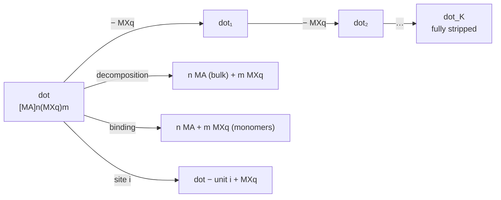

# Reactions and equilibria

A dot is a charge-balanced binary $[\mathrm{MA}]_n(\mathrm{MX}_q)_m$: $n$ MA units (the core) and $m$ Z-type ligand units $\mathrm{MX}_q$. Energies $E$ are MACE-MH-1 energies at MACE-MH-1 minima; $k_BT$ at 298.15 K is 25.69 meV.

The reactions the pipeline evaluates for every dot, and the equilibria they define. The dashboards evaluate them live for any $T$, $\varepsilon$ and concentration.

## Reactions of the dot

Every reaction below is evaluated in vacuum (GPU stage, with $G^\circ$) and in solution (report and dashboards, with $G^\mathrm{sol}$ and $\mu$).

### Decomposition

(stability against growth of the bulk; per MA unit):

$$
\Delta G_{\mathrm{dec}}(T) = \frac{G^{\mathrm{sol}}_{\mathrm{dot}} - n\,G^{\mathrm{bulk}}_{\mathrm{MA}} - m\,\mu_{\mathrm{MX}_q}}{n}
$$

### Binding

(cohesion against the monomers; per unit) and the dissolution temperature:

$$
\Delta G_{\mathrm{bind}}(T) = \frac{G^{\mathrm{sol}}_{\mathrm{dot}} - n\,\mu_{\mathrm{MA}} - m\,\mu_{\mathrm{MX}_q}}{n + m}, \qquad
\Delta G_{\mathrm{bind}}(T_{\mathrm{diss}}) = 0
$$

### Desorption ladder

$\mathrm{dot}_{k-1} \to \mathrm{dot}_k + \mathrm{MX}_q$, for dots up to 600 atoms. Removing a unit $u$
from the relaxed structure $R_k$ costs

$$
\Delta E_k(u) = E[\mathrm{relax}(R_{k} - u)] + E(\mathrm{MX}_q) - E(R_k)
$$

The default search moves symmetry-equivalent units together (`detach_search: symmetric`); the
alternative keeps the 2 best structures per level (beam search). Every candidate is a real MACE
relaxation, and the units are redefined on the relaxed surface after each removal. Along the best
path, in vacuum and in solution:

$$
\Delta G_k^{\mathrm{gas}}(T) = E_k - E_{k-1} + \Delta F_{\mathrm{vib},k}(T) + G^\circ_{\mathrm{MX}_q}(T)
$$

$$
\Delta G_k(T, \varepsilon, c) = G^{\mathrm{sol}}_{k} - G^{\mathrm{sol}}_{k-1} + \mu_{\mathrm{MX}_q}
$$

### Mean number of removed units

at a ligand chemical potential: Boltzmann average over every relaxed
configuration $j$ the search evaluated ($k_j$ units removed, energy offset $\Delta E_j$ from the
ladder state, symmetry number $\sigma_j$):

$$
\langle k\rangle(T, \mu_{\mathrm{MX}_q}) = \frac{\sum_j k_j\, e^{-\mathcal G_j / k_BT}}{\sum_j e^{-\mathcal G_j / k_BT}}, \qquad
\mathcal G_j = G^{\mathrm{sol}}_{k_j} + \Delta E_j + k_BT\ln\frac{\sigma_j}{\sigma_{k_j}} + k_j\,\mu_{\mathrm{MX}_q}
$$

### Site-resolved binding

(one value per symmetry-distinct surface unit $u_i$), with the thermal part of
the first ladder step:

$$
\Delta G_{\mathrm{site},i} = G^{\mathrm{sol}}(\mathrm{dot} - u_i) - G^{\mathrm{sol}}(\mathrm{dot}) + \mu_{\mathrm{MX}_q}, \qquad
G(\mathrm{dot} - u_i) \simeq G(\mathrm{dot} - u_1) + E(\mathrm{dot} - u_i) - E(\mathrm{dot} - u_1)
$$

## Coupled equilibria in solution

For a population of species $i$ (every $\mathrm{dot}_k$ of every dot family, $n_i$ MA and $m_i$
$\mathrm{MX}_q$ units each) in equilibrium with the free monomers:

$$
c_i = \exp\!\left(-\frac{\Delta G^\circ_i}{k_BT}\right) c_{\mathrm{MA}}^{\,n_i}\, c_{\mathrm{MX}}^{\,m_i}, \qquad
\Delta G^\circ_i = G^{\mathrm{sol}}_i - n_i\, G^{\mathrm{sol}}_{\mathrm{MA}} - m_i\, G^{\mathrm{sol}}_{\mathrm{MX}}
$$

with the mass balances for the totals $C_{\mathrm{MA}}$, $C_{\mathrm{MX}}$ put in:

$$
C_{\mathrm{MA}} = c_{\mathrm{MA}} + \sum_i n_i\, c_i, \qquad
C_{\mathrm{MX}} = c_{\mathrm{MX}} + \sum_i m_i\, c_i
$$

solved for $(\ln c_{\mathrm{MA}}, \ln c_{\mathrm{MX}})$ by nested bisection (both residuals are increasing
log-sum-exps). Optionally MA precipitates as bulk above its solubility:

$$
c_{\mathrm{MA}} \le c_{\mathrm{sat}} = \exp\!\left(-\frac{G^{\mathrm{sol}}_{\mathrm{MA}} - G^{\mathrm{bulk}}_{\mathrm{MA}}}{k_BT}\right), \qquad
\text{supersaturation} = c_{\mathrm{MA}} / c_{\mathrm{sat}}
$$

Outputs: the fraction of MA in each dot family, its mean $\langle k\rangle$, the free monomer fractions.

