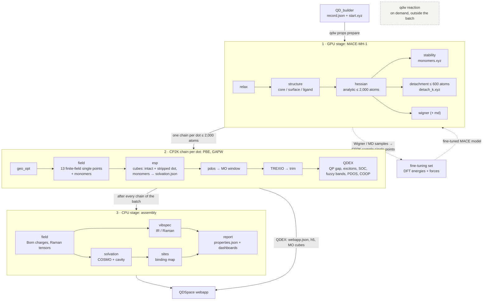

# The qd-workflows pipeline

One batch of library records goes through three Slurm stages: MACE-MH-1 on a GPU, one CP2K
chain per dot on CPU nodes, then the CPU stage that assembles the properties and the report.
Every step is cached: a job that stops continues where it stopped when resubmitted.



## What each engine provides

| Quantity | Source (dots ≤ 2,000 atoms) |
|---|---|
| Structure, frequencies, thermochemistry, desorption ladder, Wigner / MD ensembles | MACE-MH-1 |
| Electronic structure: levels, QP gap, excitons, absorption, PDOS, COOP | CP2K PBE → QDEX |
| IR / Raman intensities | DFT Born charges and Raman tensors (finite field) on the MACE modes |
| Solvation | COSMO on the DFT potential + cavity/dispersion |

xTB is not used in the batch. Orchestr.AI keeps its xTB steps (electronic levels, g-xTB IR/Raman,
GB on xTB charges) for runs without a DFT chain (`vibspec_source gxtb`, `solvation_charges xtb`).

## Size routing

| Atoms | What runs |
|---|---|
| ≤ 600 | everything, including the desorption ladder and its thermochemistry |
| ≤ 2,000 | analytic Hessian, the CP2K chain and QDEX; no desorption ladder above 600 |
| > 2,000 | MACE relaxation and structure analysis only: every step that needs the Hessian (and the report) is skipped |

## Commands

```bash
qdw props prepare <records> --cluster nhr --out jobs/batch   # GPU job; it submits the chains and the CPU job
(cd jobs/batch && sbatch job.sh)
qdw cp2k chain relaxed.xyz --project <id> --record record.json --out cp2k   # one chain by hand
qdw reaction prepare reaction.yaml --cluster nhr --out runs/x                # on demand
```

Dashed in the diagram: the fine-tuning loop. Its pieces exist (`qdw cp2k prepare --step sample`,
`qdw cp2k label`), but nothing runs it automatically yet. `qdw reaction` stands outside the batch.
